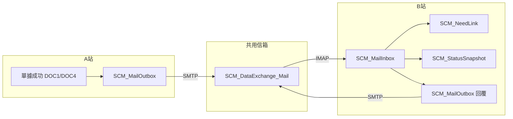

# SCM（供應鏈協同）Mail 交換：運作原理與資料表說明

> **文件性質**：說明 SoftNet MES 以「共用信箱 + 主旨路由」做跨站協同的**整體原理**，以及 `SoftNetLogDB` 內 SCM 相關表的**欄位意義**與在流程中的**運用方式**。  
> **對應規格**：`prd_供應鏈協同（mail_交換）.md`  
> **對應建表**：`sql_供應鏈協同（mail_交換）_建表.sql`  
> **主要程式**：`SoftNetWebII/Services/ScmMailBridgeService.cs`（背景輪巡由 `RUNTimeServer` 呼叫）

---

## 1. 為什麼要用 SCM Mail 模式

在多方 MES 各在內網、**無固定對外 IP** 的情境下，難以長期維護站對站 API。SCM 模組改採**同一個資料交換用信箱**（`FunConfig.SCM_DataExchange_Mail`），以電子郵件做 **Store-and-Forward（先落地、再轉送）**：

- 寄出方先把訊息寫入 **`SCM_MailOutbox`**，再由背景程式用 SMTP 寄到共用信箱。
- 收信方用 IMAP 取信，符合路由與規格的訊息寫入 **`SCM_MailInbox`**，再依 `MessageType` 更新 **`SCM_NeedLink`** / **`SCM_StatusSnapshot`** 等。

如此不需對方固定 IP，只要雙方都能收發同一信箱即可交換。

---

## 2. 整體運用原理（端到端）

### 2.1 身分與路由

- 每一套 MES 有 **`FunConfig.ServerId`**（規格上對應 `nchar(2)` 與他表一致）。
- 郵件**主旨**帶有固定格式，供程式解析 `FromServerId`、`ToServerId`、`MessageType`、`MessageId` 等（前綴預設 `[SoftNetSCM]`，可改 `SCM_MailSubjectPrefix`）。
- **非本機 `ToServerId`**：程式**不讀入業務**、**不寫 `SCM_MailInbox`**，直接略過該封（與規格書現行版一致）。
- **非 SCM 主旨前綴**：略過 SCM 處理；並以 **`SCM_MailPollState.LastImapUniqueId`** 記錄已掃過的 IMAP UID，避免同一封非 SCM 信在 `NotSeen` 搜尋下每輪重複進入處理迴圈（不必強制改使用者郵件已讀狀態）。

### 2.2 背景輪巡（`RunCycle`）

由 `RUNTimeServer` 依 `SCM_WorkingDoWhileTime`（分鐘）觸發一次，順序大致為：

1. **`SendPendingMessages`**  
   從 `SCM_MailOutbox` 取出待寄／可重試列，寄到 `SCM_DataExchange_Mail`，成功則標為已寄出；失敗則累計重試、排 `NextRetryTime`，超過 `SCM_MaxRetryCount` 則停止重試（狀態改為取消類，見下表說明）。
2. **`FetchInboxMessages`**  
   IMAP 連線、搜尋未讀（並可搭配 `SCM_MailInbox` 的 `MAX(ReceiveTime)` 做 **DeliveredAfter** 增量，減少重掃）。  
   僅處理：主旨前綴正確、且 `ToServerId` 等於本機之郵件；解析後插入 **`SCM_MailInbox`**；成功納入處理者並將該封標為已讀（避免重複入 Inbox）。
3. **`ProcessInboxMessages`**  
   讀取 `ParseStatus=0` 且 `ProcessStatus=0` 的 Inbox 列，依 **`MessageType`** 呼叫對應邏輯（例如 `NeedCreated` 寫入 `SCM_NeedLink`；`PromiseDate`／`ProdStatus`／`Exception` 寫入 `SCM_StatusSnapshot`；部分類型會再排入 Outbox 回覆）。

### 2.3 與單據／夥伴主檔的銜接（觸發 `CreateNeed`）

-  **`DOC1`（採購）** 或 **`DOC4`（委外）** 建單成功，且 **`MFData.SCM_ServerId`** 有值時，由 `RUNTimeServer` 呼叫 **`EnqueueCreateNeed`**。
- 產生符合 PRD 的 **JSON Body**（含 `needMapping.needIdA`、`simulationIdA`、`docNumberNO` 等）與標準**主旨**，寫入 **`SCM_MailOutbox`**，再由上述輪巡寄出。

### 2.4 冪等與去重

- **技術冪等鍵**：`MessageId`（Outbox 有 `UX_SCM_MailOutbox_MessageId`；Inbox 處理時會比對是否已有同 `MessageId` 且已處理完成，標為重複）。
- **`EnqueueCreateNeed` 業務去重**：以 Outbox 內是否已有相同條件之 `CreateNeed`（來源、目的、單據、Need／Simulation）避免重複建列。

### 2.5 訊息類型（`MessageType`）與資料表關係（摘要）

| 類型 | 方向概念 | 主要落地／後續 |
|------|-----------|----------------|
| `CreateNeed` | A→B | Outbox 寄出；B 端處理後可能回 `PromiseDate` 等 |
| `PromiseDate` / `ProdStatus` / `Exception` | B→A 或雙向 | 寫入 **`SCM_StatusSnapshot`**（快照追加） |
| `NeedCreated` | B→A | 寫入／更新 **`SCM_NeedLink`** |
| `OKNeed` / `NGNeed` / `CancelNeed` / `AskStatus` 等 | 依流程 | 現行程式可能再排 Outbox 或擴充 Handler |

完整枚舉與流程細節仍以 `prd_供應鏈協同（mail_交換）.md` 為準。

---

## 3. 輔助表：`SCM_MailPollState`（建表腳本內）

| 欄位 | 型別 | 用意 |
|------|------|------|
| `ServerId` | `nchar(2)` | 本機站點（與 `ServerId` 前 2 字一致），主鍵。 |
| `LastImapUniqueId` | `bigint` | 本機已掃過的**最大 IMAP UID**；下一輪只處理 UID 更大之候選，使「已略過的非 SCM 信」不再重複進入處理迴圈。 |
| `UpdatedTime` | `datetime` | 游標最後更新時間。 |

---

## 4. `SCM_MailOutbox`（寄件佇列）

### 4.1 表的角色

**待寄、重試、已寄出、作廢** 的 SCM 訊息都先存在此表。背景寄件**只讀此表**，不直接對業務表寫入後再寄信。

### 4.2 各欄位說明

| 欄位 | 型別 | 用意與運用原理 |
|------|------|----------------|
| `Id` | `bigint` identity | 聚簇主鍵；寄件程式更新狀態時以 `Id` 定位，效能佳。 |
| `MessageId` | `nvarchar(50)`，**唯一** | **冪等鍵**；與郵件內 JSON 的 `messageId`、主旨 `Msg:` 一致，便於跨站對帳。寄件前產生後整段流程沿用同一值。 |
| `FromServerId` | `nchar(2)` | 發送端站點編號；與主旨 `From:` 一致。 |
| `ToServerId` | `nchar(2)` | 接收端站點編號；與主旨 `To:` 一致。 |
| `MessageType` | `nvarchar(20)` | 訊息類型（如 `CreateNeed`、`NeedCreated`）；與主旨 `Type:`、Body 內 `messageType` 一致。 |
| `Subject` | `nvarchar(500)` | **完整郵件主旨**（含前綴與路由欄位）；收件端先依此解析，再決定是否讀 Body。 |
| `BodyJson` | `nvarchar(max)` | **郵件內文**（JSON 字串）；業務欄位如 `docType`、`docNumberNO`、`needMapping`、`payload` 等皆在此。 |
| `Status` | `char(1)` | **寄送狀態**（與 PRD 對齊之建議語意）：`0` 待寄／排程重試、`1` 已寄出、`2` 失敗（可與重試條件並用；目前寄件查詢條件含 `0` 與 `2`，實際寫入 `2` 與否依程式版次）、`3` 取消／停止重試。現行程式在 SMTP 失敗時會將 `RetryCount` 遞增並排 `NextRetryTime`，未達上限前維持可再寄狀態；超過 `SCM_MaxRetryCount` 後改為 `3` 停止重寄。 |
| `RetryCount` | `int` | 已嘗試寄送次數（含失敗後重試）。 |
| `NextRetryTime` | `datetime` null | 下次允許重試的時間；與 `SCM_WorkingDoWhileTime` 搭配，避免失敗時瘋狂重試。 |
| `CreatedTime` | `datetime` | 列建立時間（進佇列時間）。 |
| `SentTime` | `datetime` null | SMTP 成功寄出後寫入，供稽核與 SLA 統計。 |
| `ErrorMessage` | `nvarchar(1000)` null | 最後一次失敗的錯誤摘要，供除錯。 |

### 4.3 索引與查詢習慣

- `UX_SCM_MailOutbox_MessageId`：避免重複插入同一訊息。
- `IX_SCM_MailOutbox_Status_NextRetryTime`：加速「挑待寄與到期重試」。

---

## 5. `SCM_MailInbox`（收件暫存）

### 5.1 表的角色

從 IMAP 取下、且**通過本機路由與基本檢核**的郵件，落地於此表，再由 **`ProcessInboxMessages`** 做業務處理。  
（**非本機 To**、**非 SCM 主旨** 之郵件不寫入此表。）

### 5.2 各欄位說明

| 欄位 | 型別 | 用意與運用原理 |
|------|------|----------------|
| `Id` | `bigint` identity | 聚簇主鍵；處理進度更新時使用。 |
| `MessageId` | `nvarchar(50)` | 與 Outbox／主旨／JSON 一致；**冪等**比對時用來判斷是否曾成功處理。 |
| `FromServerId` | `nchar(2)` | 來源站點（主旨 `From:`）。 |
| `ToServerId` | `nchar(2)` | 目標站點（主旨 `To:`）；落地列僅會是本機。 |
| `MessageType` | `nvarchar(20)` | 訊息類型（主旨 `Type:`）。 |
| `Subject` | `nvarchar(500)` | 原始主旨全文，供稽核與除錯。 |
| `BodyJson` | `nvarchar(max)` | 原始／正規化後 JSON；處理器以 `JObject.Parse` 讀取。 |
| `ReceiveTime` | `datetime` | **郵件日期**（實作取 `message.Date` 之本地時間，無則用當下時間）；亦用於 **`MAX(ReceiveTime)`** 做 IMAP **DeliveredAfter** 增量起點。 |
| `ParseStatus` | `char(1)` | **解析狀態**：`0` 主旨與 JSON 欄位檢查通過；`1` 主旨無法解析；`2` JSON 缺欄或無法解析。`3`（NotTarget）在欄位定義上可保留，**現行流程不寫入**（非本機直接略過不入表）。 |
| `ProcessStatus` | `char(1)` | **業務處理狀態**：`0` 待處理；`1` 已完成；`2` 處理失敗；`3` 重複訊息（同 `MessageId` 已成功處理過）。 |
| `ErrorMessage` | `nvarchar(1000)` null | 解析或處理失敗時的錯誤說明。 |

### 5.3 索引與查詢習慣

- `IX_SCM_MailInbox_MessageId`：冪等與重複檢查。
- `IX_SCM_MailInbox_ToServerId_ReceiveTime`：依本機與時間掃描、報表。

---

## 6. `SCM_NeedLink`（A/B Need 關聯主檔）

### 6.1 表的角色

保存 **需求端（A）** 與 **供應端（B）** 的 `NeedId`／`SimulationId` 對應與來源單據，是供應鏈追溯的**主關聯表**。  
典型寫入時機：收到 **`NeedCreated`** 且 JSON 內 `needMapping` 齊備時 upsert。

### 6.2 各欄位說明

| 欄位 | 型別 | 用意與運用原理 |
|------|------|----------------|
| `LinkId` | `nchar(12)`，PK | 關聯鍵；實作由 `needIdA` 與 `needIdB` 各取前 6 字元組成固定長度鍵（與 `SCM_StatusSnapshot.LinkId` 對應）。若未來改為 GUID 或序號，需一併調整快照與程式。 |
| `FromServerId` | `nchar(2)` | 下單／需求端（A）站點。 |
| `ToServerId` | `nchar(2)` | 接單／供應端（B）站點。 |
| `NeedId_A` | `nchar(12)` | A 端需求編號。 |
| `SimulationId_A` | `nchar(12)` null | A 端模擬／子排程編號；可空。 |
| `NeedId_B` | `nchar(12)` | B 端需求編號；`NeedCreated` 時由對方帶回。 |
| `DocType` | `nchar(4)` | 來源單據大類（如 `DOC1`、`DOC4`）。 |
| `DocNumberNO` | `nvarchar(20)` | 來源單據號碼，便於從單據反查關聯。 |
| `LinkStatus` | `char(1)` | **關聯生命週期**：`0` 待關聯／進行中、`1` 已關聯（B 端 Need 已確認）、`2` 結案、`3` 拒絕（依 PRD 定義；實際轉折可由後續訊息驅動）。 |
| `CreatedTime` | `datetime` | 建立時間。 |
| `UpdatedTime` | `datetime` | 最後更新時間（upsert 時刷新）。 |

### 6.3 索引

- `NeedId_A` + `SimulationId_A`、`NeedId_B`：查單筆需求或反查夥伴 Need。

---

## 7. `SCM_StatusSnapshot`（進度／交期／異常快照）

### 7.1 表的角色

保存對方回覆的 **承諾交期、排程狀態、報工摘要、異常代碼** 等，採 **追加（append-only）** 多筆快照，便於歷史曲線與稽核，**不覆蓋**舊資料。  
典型寫入：`PromiseDate`、`ProdStatus`、`Exception` 等訊息處理時插入一列。

### 7.2 各欄位說明

| 欄位 | 型別 | 用意與運用原理 |
|------|------|----------------|
| `SnapshotId` | `bigint` identity，PK | 快照序號。 |
| `LinkId` | `nchar(12)`，**FK → `SCM_NeedLink.LinkId`** | 綁定關聯主檔；查詢「同一供需關係的歷程」時用。實作上由 `needMapping.needIdA` + `needIdB` 推導與 NeedLink 相同規則之鍵。 |
| `NeedId_B` | `nchar(12)` | B 端需求編號，冗餘儲存便於單條件查詢與報表。 |
| `PromiseDate` | `datetime` null | 承諾交期；自 JSON `payload.promiseDate` 解析。 |
| `PlanState` | `nvarchar(50)` | 排程／狀態摘要（如 `payload.state` 或 `planState`）。 |
| `ReportProgress` | `nvarchar(200)` | 報工／進度文字摘要。 |
| `ExceptionCode` | `nvarchar(30)` null | 異常代碼（如 PRD 建議之 `NeedDelayed` 等）。 |
| `ExceptionRemark` | `nvarchar(500)` null | 異常說明。 |
| `SnapshotTime` | `datetime` | 本筆快照寫入時間。 |

### 7.3 索引

- `LinkId` + `SnapshotTime DESC`：取「同一關聯最新狀態」或繪製時間序列。

---

## 8. 資料流簡圖（概念）

---

## 9. 維運與除錯建議

1. **先確認建表**：`SCM_MailOutbox`、`SCM_MailInbox`、`SCM_NeedLink`、`SCM_StatusSnapshot`、`SCM_MailPollState` 皆已在 `SoftNetLogDB` 建立。  
2. **設定**：`SCM_IsEnabled`、`SCM_DataExchange_Mail`、`MailCredentialsAccount`／密碼、`SCM_ImapServer`／`Port`、`ServerId`。  
3. **查問題順序**：Outbox 是否入列 → 是否寄出（`Status`／`ErrorMessage`）→ Inbox 是否有列（`ParseStatus`／`ProcessStatus`）→ NeedLink／Snapshot 是否更新。  
4. **驗證 SQL**：可搭配 `sql_供應鏈協同（mail_交換）_最小驗證.sql` 做快速巡檢。

---

## 10. 文件版本

| 項目 | 內容 |
|------|------|
| 版本 | 1.0（運作原理與欄位說明彙整） |
| 建議 | 若程式狀態碼與 PRD 用語有細部差異，以程式註解與實際 DB 資料為準，並回寫 PRD 狀態碼表 |

---

**相關文件**：`prd_供應鏈協同（mail_交換）.md`、`prd_供應鏈協同（mail_交換）_實作清單.md`、`資料庫欄位說明書.md`（SoftNetLogDB SCM 章節）
