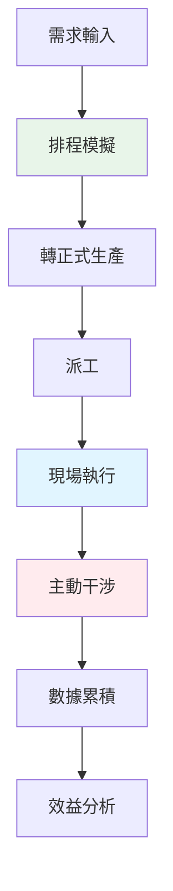

# SoftNet MES 智慧製造執行系統 - 產品需求文件（PRD）

> **文件版本**: 整合版 v1.0  
> **適用對象**: 產品規劃、工程開發、AI 輔助開發、客戶導入  
> **最後更新**: 2026-01-12

---

## 📋 目錄

1. [產品定位與核心價值](#1-產品定位與核心價值)
2. [系統總體架構](#2-系統總體架構)
3. [核心設計理念](#3-核心設計理念)
4. [功能模組說明](#4-功能模組說明)
5. [主動干涉引擎](#5-主動干涉引擎)
6. [使用角色與權限](#6-使用角色與權限)
7. [核心流程](#7-核心流程)
8. [系統部署與配置](#8-系統部署與配置)
9. [非功能需求](#9-非功能需求)
10. [開發規範](#10-開發規範)
11. [系統目標與預期效果](#11-系統目標與預期效果)

---

## 1. 產品定位與核心價值

### 1.1 產品一句話定位

**SoftNet MES 是一套「會主動介入生產現場的智慧製造系統」，
不是只顯示問題，而是能即時修正排程、製造與庫存異常。**

### 1.2 核心價值

- ✅ **主動介入修正**：系統不是只顯示問題，而是主動介入修正
- ✅ **即時反應**：即時修正排程、製造、單據與倉儲過程中「已發生但尚未被人處理的異常狀態」
- ✅ **預測性處理**：處理「未發生但可能會延滯的資料的未來即將發生異常狀態」
- ✅ **行為導向**：MES 是「會行動的系統」，不是報表工具

### 1.3 系統差異化特點

> **註**: 以下內容主要用於產品說明，開發時請參考技術架構與功能模組說明。

| 特點 | 說明 |
|------|------|
| **主動介入** | 系統主動介入，動態修正排程與異常 |
| **即時處理** | 行為導向，即時處理異常狀態 |
| **自動校正** | 主動校正資料，確保與實況一致 |

---

## 2. 系統總體架構

### 2.1 系統簡介

- **系統名稱**: SoftNet 智慧工廠管理系統
- **系統類型**: MES (Manufacturing Execution System)
- **主要用途**: 製造執行管理、生產監控、單據自動生成、倉儲管理、資料分析
- **產品定位**: 中小型工廠
- **系統角色**: 管理工廠生產所有事宜

### 2.2 技術架構

| 層級 | 技術 | 說明 |
|------|------|------|
| **前端** | ASP.NET Core MVC + Razor Views | Web 介面（PC/平板/手機，觸控友善） |
| **前端套件** | JavaScript (Bootstrap, jQuery, DataTable, Chart) | UI 元件與圖表 |
| **後端** | ASP.NET Core Web API | RESTful API |
| **即時通訊** | WebSocket (自訂協定) / SignalR | 狀態同步、看板更新 |
| **背景服務** | BackgroundService (RUNTimeServer) | 生產監控、主動干涉引擎 |
| **資料庫** | SQL Server | 三資料庫架構 |

### 2.3 資料庫架構

| 資料庫名稱 | 用途說明 |
|----------|---------|
| `SoftNetMainDB` | 主要業務資料庫（工單、庫存、單據等） |
| `SoftNetSYSDB` | 系統設定資料庫（排程、製程、工站設定等） |
| `SoftNetLogDB` | 日誌記錄資料庫（報工記錄、操作日誌等） |

> 📖 詳細資料庫結構請參考：[資料庫欄位說明書.md](./資料庫欄位說明書.md)

### 2.4 系統模組架構

```
SoftNet MES
 ├─ 排程管理（APS）
 │   ├─ 排程模擬
 │   ├─ 工單排序
 │   └─ 機台負載計算
 ├─ 製造管理
 │   ├─ 派工（Dispatch）
 │   ├─ 開工/報工回報
 │   └─ 工站即時狀態
 ├─ 倉儲管理
 │   ├─ 收料/入庫
 │   ├─ 領料/退料
 │   └─ 批號追蹤
 ├─ 主動干涉引擎 ⭐（系統核心）
 │   ├─ Rule 引擎
 │   ├─ 異常偵測
 │   └─ 自動修正
 ├─ 單據管理
 │   ├─ 自動產生單據
 │   └─ 單據確認流程
 └─ 報表與效益分析
     ├─ 即時看板
     ├─ 歷史報表
     └─ OEE/瓶頸分析
```

---

## 3. 核心設計理念

### 3.1 主動干涉（Active Intervention）

**定義**: 當生產行為偏離計畫或 該執行卻未人為操作網頁 時，系統自動修正或警示。

**干涉內容**:
1. 計畫久未執行直接列暫停,並釋放生產能量 (33)
2. 主動將工單推至未開站的工站
3. 主動將排程採購 與 排程委外加工 與 安全存量 自動開立單據
4. 工站生產用領料單若未開立,將主動開立
5. 出貨需求若未開立且有存貨,將主動開立領出單
6. 排程結束後,干涉修正數量 (捕或增或減委外加工單量.捕或增或減人工報工量)
7. 工單應關未關,將主動關閉
8. 工站應停止未停止,將主動停止
9. 將可入帳的生產用領料/入庫/退料的單據主動確認,並異動存貨帳的數量
10.單據若可入帳,將主動入帳

**觸發時機**:
- 已發生但尚未被人處理的異常狀態
- 未發生但可能會延滯的未來異常狀態

**處理方式**:
- **Warning（警示）**: Mail通知相關人員
- **AutoFix（自動修正）**: 系統自動執行修正動作
  - **物料相關**：
    - 自動開立進貨單
    - 自動調撥其他可用量
    - 自動採用替代料
  - **排程相關**：
    - 自動延後產出時間
    - 自動改委外生產
  - **工站相關**：
    - 自動派工
    - 自動異動狀態為開站
    - 自動調撥其他可用工站
  - **單據相關**：
    - 自動完成單據作業
  - **警示通知**：
    - 警示進貨管理者追蹤
    - 警示銷貨管理者追蹤
    - 警示倉儲管理者追蹤
    - 警示生產管理者追蹤

### 3.2 主動監看

**定義**: 定時間看資料資料內容。

**監看內容**:
1. 監看工站CT 是否遠離偏離目標CT值 (14)
2. 推演完成日與計畫完成日相差逾7天以上 (19)
3. 監看是否有計畫久未執行 (33)
4. 監看工站生產備料,無單據發起 (05)
5. 監看工作站生產物料應領用,而未領用 (04)
5. 監看生產排程計畫Keep(保留)量是否足夠庫存量
6. 監看工站每日執行工單的開工狀態 (03)
7. 監看工站人工報工是否延遲,影響有效值 (15)
8. 監看料件安全量,在制量,再途量,工站移轉量所有數據是否正常與合理 (17 26 27 28 29 30 31)

### 3.3 有效值（Effective Value）

**定義**: 以歷史行為時間為基礎，透過統計方法計算出可用的標準時間值。

**計算方法**:
1. **四分位法**: 排除離群值（異常極值）
2. **標準差演算法**: 計算平均值與標準差
3. **結果值**:
   - **有效值**: 平均值（用於排程與判斷）
   - **最佳值**: 平均值 + 標準差（理想情況）
   - **最低值**: 平均值 - 標準差（最差情況）

**用途**:
- 作為排程依據（使用有效值）
- 作為干涉判斷基準（比較實際值與有效值）
- 作為效率分析基礎（計算效率指標）

---

## 4. 功能模組說明

### 4.1 排程管理模組（APS）

**核心原則**:
- 排程模擬（Simulation）與正式生產資料需嚴格分離，避免資料混淆及影響實際運作。
- 排程產生的結果應能依據系統內規則（Rule）自動調整與最佳化，以因應各種例外與需求變動。

**主要功能**:
- 多工單排程
- 工單排序
- 機台負載計算
- 排程模擬與確認
- 排程狀態校正

**相關干涉 Rule**:
- R-03: 排程狀態修正
- R-12: 應開未開工單處理

### 4.2 製造管理模組

**主要功能**:
- 派工（Dispatch）
- 開工/報工回報
- 工站即時狀態
- 多工單工站管理（ManufactureII）

**相關干涉 Rule**:
- R-07: 派工未領料處理
- R-09: 自動結案
- R-10: 效率警示
- R-11: 報工延遲處理

### 4.3 倉儲管理模組

**核心概念**:
- 庫存為動態狀態
- 批號（BarCode + ArrivalDate）為決策依據

**主要功能**:
- 收料/入庫
- 領料/退料
- 批號追蹤
- 儲位管理

**相關干涉 Rule**:
- R-04: 缺料補齊
- R-05: 自動領料
- R-07: 派工未領料
- R-13: 移轉合理性檢查

### 4.4 單據管理模組

**主要功能**:
- 自動產生單據（進貨單、領料單、委外加工單等）
- 單據確認流程
- 單據狀態追蹤

> 📖 詳細單據自動產生邏輯請參考：[prd_單據管理（自動產生／確認／簽核）.md](./prd_單據管理（自動產生／確認／簽核）.md)

### 4.5 報表與效益分析模組

**主要功能**:
- 即時看板
- 歷史報表
- OEE（整體設備效率）分析
- 瓶頸分析
- 效率統計

---

## 5. 主動干涉引擎

### 5.1 引擎定義

主動干涉引擎是一個 **Rule-based Background Engine**，
定期掃描系統狀態，並依規則主動修正。

### 5.2 Rule 標準結構

| 項目 | 說明 |
|------|------|
| **RuleCode** | R-03, R-04, R-05, R-07, R-09, R-10, R-11, R-12, R-13（規則編號） |
| **RiskLevel** | Low / Medium / High（風險等級） |
| **Trigger Condition** | 觸發條件 |
| **Action** | Warning（僅警示）或 AutoFix（自動修正） |

### 5.3 Rule × Domain 對照表

| Rule | Domain | 說明 | Action |
|------|--------|------|--------|
| R-03 | 排程 | 狀態修正 | AutoFix |
| R-04 | 倉儲 | 缺料補單 | AutoFix |
| R-05 | 倉儲/製造 | 自動領料 | AutoFix |
| R-07 | 製造/倉儲 | 派工未領料 | Warning/AutoFix |
| R-09 | 製造 | 自動結案 | AutoFix |
| R-10 | 製造 | 效率警示 | Warning |
| R-11 | 製造 | 報工延遲 | Warning |
| R-12 | 排程 | 應開未開 | Warning/AutoFix |
| R-13 | 倉儲 | 移轉合理性 | Warning |

### 5.4 實際例子與觸發條件

| 情境 | 觸發條件 | 系統反應 | 對應 Rule |
|------|---------|---------|----------|
| 派工了但沒領料 | 工單已派工但 DOC3stockII 未建立或 IsOK=0 | 系統提醒或自動補齊領料單 | R-07 |
| 排程狀態錯亂 | APS_Simulation 狀態與實際工單狀態不一致 | 系統自動校正狀態 | R-03 |
| 工單長時間未回報 | 工單應開工但未開工，超過設定時間 | 系統主動警示或自動開工 | R-12 |
| 缺料導致無法生產 | 排程時庫存不足，無法滿足需求 | 系統自動補單或調撥其他可用量 | R-04 |
| 報工延遲 | 工站報工時間超過有效值範圍 | 系統警示生產管理者 | R-11 |
| 效率異常 | 工站效率低於標準值 | 系統警示效率問題 | R-10 |
| 自動結案 | 工單所有站別完成，但未關工單 | 系統自動結案工單 | R-09 |

### 5.5 現行程式邏輯對照（依程式碼）

本節以現行程式為準，補足觸發來源、處置動作與資料落地，讓 PRD 與系統一致。

#### 5.5.1 執行載體與排程節點

- **BackgroundService**：`SoftNetWebII/Services/RUNTimeServer.cs` 持續執行規則掃描與自動處置。
- **每日/定時檢查**：
  - 工站 CT 偏離目標（連續 3 筆）→ 寫入 `APS_Simulation_ErrorData`（ErrorType=14）並寄送警示信。
  - 需求已結案且 `DOC3stockII.IsOK=0` 超過設定天數 → 自動入/出庫並完成單據（設定 `APS_Simulation_ErrorData_Clear_Day`）。
  - `APS_WarningData` 到期（`WarningDate <= now`）→ 進行干涉處理並標記完成。

#### 5.5.2 主要資料表與狀態欄位

- **`APS_Simulation_ErrorData`**：異常主檔（干涉候選）
  - `ErrorType`：異常類型代碼（見 5.5.3）
  - `ActionType`：`''`=待處理、`0`=已處理、`1`=逾時不處理、`2`=NeedId 結案強制清除
  - `ActionRemark` / `ActionLogDate`：實際干涉行為與時間
- **`APS_WarningData`**：延遲/到期後執行的警示與干涉
  - `IsDEL`：`0`=待處理、`1`=已處理
- **`OperateLog`**：記錄干涉操作（例如「干涉開工」「智慧關站 系統主動干涉」）
- **`APS_EventLog`**：系統事件日誌（通知與批量處理記錄）

#### 5.5.3 ErrorType 對照與可用干涉動作（UI 對應）

以下為 `APSViewController` 介面上可選動作（用於人工/半自動干涉）：

| ErrorType | 異常意義 | 可選干涉動作（UI） |
|---|---|---|
| 01 | 排程保留量不足（非開工單） | 自動開立進貨單 / 自動調撥可用量 / 自動延後產出 / 自動採用替代料 |
| 02 | 排程保留量不足（開工單） | 自動調撥可用量 / 自動延後產出 / 自動追加生產 / 自動採用替代料 / 自動改委外生產 |
| 03 | 該開站未開（初次） | 自動異動狀態為開站 / 自動延後產出 / 自動調撥其他可用工站 |
| 04 | 料應領未領 | 自動完成單據作業 / 自動延後產出 / 自動採用替代料 / 自動調撥可用量 |
| 05 | 生產料件無單據發起 | 自動開立進貨單 / 自動延後產出 |
| 06 | 進貨單據未如預期完成 | 警示進貨管理者追蹤 / 自動完成單據 / 自動延後產出 |
| 07 | 銷貨單據未如預期完成 | 警示銷貨管理者追蹤 / 自動完成單據 / 自動延後產出 |
| 08 | 存貨單據未如預期完成 | 警示倉儲管理者追蹤 / 自動延後產出 |
| 09 | 生產單據未如預期完成 | 警示生產管理者追蹤 / 自動完成單據 / 自動延後產出 |
| 10 | 委外單據未如預期完成 | 警示進貨管理者追蹤 / 自動完成單據 / 自動延後產出 |
| 11 | 工單應開未開 | 自動異動狀態為開站 / 自動延後產出 / 自動調撥其他可用工站 |
| 12 | 工單應關未關 | 自動完成單據作業 |
| 13 | CT/WT/UPH 未達有效值 | 警示生產管理者追蹤 / 自動延後產出 |
| 14 | CT/WT/UPH 遠離目標值 | 警示生產管理者追蹤 |
| 16 | 工站工單未如計畫 | 警示生產管理者追蹤 |
| 17 | 工站料件異常 | 自動調撥其他可用量 / 自動延後產出 |
| 19 | 計畫完成日未達 | 自動延後產出 |
| 21 | 工單關閉,強制檢查各站報工的合理性 | 自動完成單據 / 修正報工數量 |
| 22 | 疑似重複報工 | 修正報工數量 |
| 23 | 疑似委外加工數量多出 | 修正單據數量 |
| 24 | 工單關閉後才補開委外加工單 | 自動完成單據 |
| 25 | 系統干涉補報工量 | 修正報工數量 |

#### 5.5.4 系統自動處置（非 UI）

- **CT 偏離偵測（ErrorType=14）**：連續 3 筆偏離即寫入 `APS_Simulation_ErrorData`，並寄送 `SendMonitorMail14`。
- **工單已關閉後報工合理性檢查（ErrorType=00）**：
  - 補開委外加工單（`Create_DOC4stock`）並同步 `APS_PartNOTimeNote`、寫入 `APS_WorkingPaper`。
  - 自動補報工（`Reporting_LabelWork` / `Reporting_STView2Work`），並寫入 `APS_Simulation_ErrorData`（ErrorType=25）。
  - 對疑似重複報工或委外多下量，新增 `APS_WarningData`（ErrorType=22/23）。
- **已結案需求清理**：`NeedId` 已結案時，將未處理異常標記為 `ActionType=2`，並清除過期工作底稿。
- **單據自動完成**：`APS_Simulation_ErrorData_Clear_Day` 到期後，對 `DOC3stockII.IsOK=0` 進行自動入/出庫與完成入帳。

#### 5.5.5 通知設定（與程式一致）

`appsettings.json` 內以 `SendMonitorMail00`～`SendMonitorMail23` 進行通知收件設定；其中：
- `SendMonitorMail14`：CT/UPH 偏離通知
- `SendMonitorMail19`：工作底稿欄位不足通知
- `APS_Simulation_ErrorData_Clear_Day`：結案後自動完成單據天數

---

## 6. 使用角色與權限

| 角色 | 主要職責 | 權限範圍 |
|------|---------|---------|
| **操作員（Operator）** | 開工/停工/報工、領/入/退料 | 工站操作、單據確認 |
| **班長/線長（Leader）** | 異常處理、即時狀態掌握 | 工站管理、異常處理 |
| **生管/工程（Planner/Engineer）** | 排程、干涉、製程設定 | 排程管理、Rule 設定 |
| **系統管理員（Admin）** | 系統設定、權限、報表 | 全系統管理 |

---

## 7. 核心流程

### 7.1 完整生產流程



### 7.2 流程說明

1. **需求輸入**: 人為輸入或系統自動產生（ERP 匯入）
2. **排程模擬**: 基於 BOM/產能/有效值進行排程模擬
3. **轉正式生產**: 確認排程後轉為正式工單
4. **派工**: 將工單派發至工站
5. **現場執行**: 透過報工/物料操作執行生產
6. **主動干涉**: 系統監控並自動修正異常
7. **數據累積**: 記錄所有生產數據
8. **效益分析**: 產生報表與分析

---

## 8. 系統部署與配置

### 8.1 部署原則

- ✅ 不影響現場生產
- ✅ 可分階段上線
- ✅ 漸進式部署

### 8.2 最小可行產品（MVP）功能範圍

**核心功能**:
- ✅ 排程管理（APS）
- ✅ 製造管理（派工/報工）
- ✅ 倉儲管理（庫存/領退料）
- ✅ 單據管理（自動產生/確認）
- ✅ 主動干涉（基礎 Rule：R-03, R-04, R-05, R-07, R-09, R-10, R-11, R-12, R-13）

---

## 9. 非功能需求

### 9.1 效能需求

| 項目 | 需求 |
|------|------|
| **即時性** | 關鍵狀態 < 5 秒同步 |
| **報工速度** | 3 秒內完成一次報工 |
| **查詢效能** | 主要查詢 < 1 秒 |

### 9.2 穩定性需求

- ✅ 斷線可回復
- ✅ 不影響生產
- ✅ 資料不遺失

### 9.3 安全性需求

- ✅ 禁止負庫存
- ✅ 所有 Rule 可獨立啟停
- ✅ Rule 執行可追蹤
- ✅ 權限控制

### 9.4 可配置性需求

- ✅ 單據流程可調
- ✅ 命名規則可調
- ✅ 參數可配置
- ✅ 多工廠支援

---

## 10. 開發規範

### 10.1 Cursor AI 使用規範

> **重要**: 本文件為 SoftNet MES 的唯一業務與系統事實來源，
> 所有程式碼、架構設計、重構與新開發，**必須完全遵循本文件**。
> 不得自行簡化、推測或改寫其中的業務邏輯。

### 10.2 禁止事項

- ❌ 不得在 Controller 寫 Rule
- ❌ 不得讓 UI 決定工單狀態
- ❌ 不得跳過主動干涉引擎
- ❌ 不得違反資料庫架構設計

### 10.3 開發原則

- ✅ Rule 必須在 BackgroundService 中執行
- ✅ 所有狀態變更必須經過主動干涉引擎
- ✅ 遵循三資料庫架構設計
- ✅ 保持 Simulation 與正式資料隔離

---

## 11. 系統目標與預期效果

### 11.1 系統設計目標

- ✅ **排程準確度**: 提升排程與實際生產的一致性
- ✅ **異常處理**: 縮短異常發現與處理的時間
- ✅ **資料準確性**: 確保系統資料與現場實況一致
- ✅ **作業效率**: 減少人工作業時間與錯誤

---

## 12. 後續文件

- 📖 [資料庫欄位說明書.md](./資料庫欄位說明書.md)（已包含業務流程圖）

---

**文件維護**: 本文件應隨系統發展持續更新，確保與實際系統一致。

**最後更新**: 2025年1月12日
