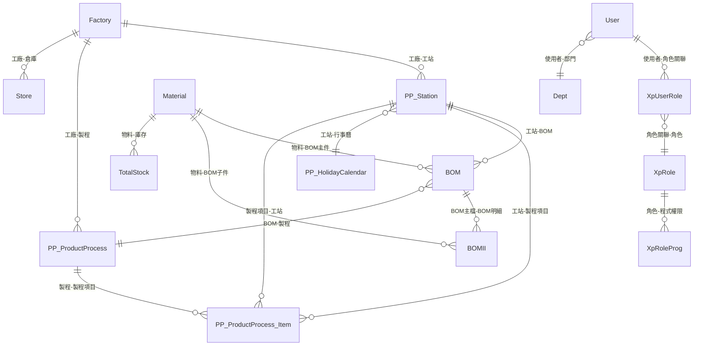

# 基礎資料管理模組 PRD

> **文件版本**: v1.0  
> **適用對象**: 產品規劃、工程開發、AI 輔助開發  
> **最後更新**: 2025-01-12

---

## 📋 目錄

1. [基礎資料管理概述](#1-基礎資料管理概述)
2. [物料主檔管理](#2-物料主檔管理)
3. [BOM 管理](#3-bom-管理)
4. [工站管理](#4-工站管理)
5. [製程管理](#5-製程管理)
6. [工廠設定](#6-工廠設定)
7. [使用者與權限管理](#7-使用者與權限管理)
8. [行事曆管理](#8-行事曆管理)
9. [廠商資料管理](#9-廠商資料管理)
10. [資料關聯性說明](#10-資料關聯性說明)

---

## 1. 基礎資料管理概述

### 1.1 核心概念

基礎資料管理模組是 SoftNet MES 系統的基礎架構，所有其他模組（排程、製造、倉儲、單據）都依賴這些基礎資料。基礎資料的正確性與完整性直接影響系統運作的準確性。

### 1.2 主要功能

- ✅ **物料主檔管理**: 管理所有料件的基本資料
- ✅ **BOM 管理**: 管理物料清單（Bill of Materials）的階層結構
- ✅ **工站管理**: 管理生產工站的設定與屬性
- ✅ **製程管理**: 管理生產製程流程與工站關聯
- ✅ **工廠設定**: 管理工廠基本資料
- ✅ **使用者與權限管理**: 管理使用者帳號、角色與權限
- ✅ **行事曆管理**: 管理工站的工作行事曆
- ✅ **廠商資料管理**: 管理委外加工廠商資料

### 1.3 資料庫架構

基礎資料主要儲存在以下資料庫：

- **SoftNetMainDB**: 物料主檔、BOM、工廠、使用者、廠商
- **SoftNetSYSDB**: 工站、製程、行事曆

---

## 2. 物料主檔管理

### 2.1 資料表結構

**主檔**: `Material` (SoftNetMainDB)

| 欄位名稱 | 資料型別 | 說明 | 必填 | 預設值 |
|---------|---------|------|------|--------|
| `ServerId` | nchar | 用戶編號（多租戶識別碼） | ✅ | - |
| `PartNO` | nvarchar | 料件編號 | ✅ | - |
| `PartName` | nvarchar | 品名 | ✅ | - |
| `Specification` | nvarchar | 規格 | ❌ | - |
| `Model` | nvarchar | 型號 | ❌ | - |
| `Class` | char | 物料類別 | ✅ | - |
| `PartType` | char | 料件類型（0=實料, 1=虛料） | ✅ | - |
| `Unit` | nvarchar | 單位（PCS, KG 等） | ✅ | - |
| `SafeQTY` | int | 安全存量 | ❌ | 0 |
| `SafeWeightQty` | float | 安全重量 | ❌ | 0 |
| `StoreSTime` | int | 倉儲標準時間(秒) | ❌ | 0 |
| `BuySTime` | int | 採購標準時間(秒) | ❌ | 0 |
| `Buy_Flag` | char | 是否自動採購標記 | ❌ | '1' |
| `OutSTime` | int | 出貨標準時間(秒) | ❌ | 0 |
| `Out_Flag` | char | 是否自動出貨標記 | ❌ | '1' |
| `APS_Default_MFNO` | nvarchar | APS預設製造廠商編號 | ❌ | - |
| `APS_Default_StoreNO` | nvarchar | APS預設物料進出倉庫編號 | ❌ | - |
| `APS_Default_StoreSpacesNO` | nvarchar | APS預設倉庫編號內的儲位編號 | ❌ | - |
| `IS_Store_Test` | bit | 是否進出倉庫檢驗 | ❌ | - |
| `IS_WorkingPaper` | bit | 是否由工作底稿進行採購或生產 | ❌ | 0 |
| `Use_ONLineTime` | int | 刀具類領出在工作站最長分鐘 | ❌ | - |
| `Use_LimitDay` | int | 刀具類使用最長天數 | ❌ | - |
| `Use_Count` | int | 刀具類使用最長次數 | ❌ | - |
| `Remark` | nvarchar | 備註 | ❌ | - |

### 2.2 物料類別（Class）

| Class 值 | 說明 | 用途 |
|---------|------|------|
| `'1'` | 原物料 | 生產用原物料 |
| `'2'` | 採購件 | 直接採購的物料 |
| `'3'` | 委外件 | 委外加工的物料 |
| `'4'` | 製造半成品 | 需要生產的半成品（可建立 BOM） |
| `'5'` | 製造成品 | 需要生產的成品（可建立 BOM） |
| `'6'` | 刀具 | 刀具類物料（有使用限制） |
| `'7'` | 工具製具 | 治具類物料 |

**重要規則**:
- 只有 `Class = '4'` 或 `Class = '5'` 的物料可以建立 BOM（`Main_Item = '1'`）
- `IS_WorkingPaper = '1'` 的物料會由工作底稿進行採購或生產
- 刀具類（`Class = '6'`）有使用時間、天數、次數的限制

### 2.3 主要功能

**對應 Controller**: `MaterialController.cs`

**主要操作**:
- `Read()` - 讀取物料列表（提供 Class、Unit、MFNO、StoreNO 選項）
- `GetPage()` - 分頁查詢物料資料
- `GetUpdJson()` - 取得要修改的物料資料
- `Create()` - 新增物料
- `Update()` - 修改物料
- `Delete()` - 刪除物料

**業務規則**:
- `PartNO` + `ServerId` 為複合主鍵，不可重複
- `PartNO`、`PartName`、`Class`、`PartType`、`Unit` 為必填欄位
- 物料類別決定該物料在系統中的行為（是否可建立 BOM、是否可排程等）

### 2.4 與其他模組的關聯

- **BOM 管理**: BOM 主件與子件都必須存在於 Material 中
- **排程管理**: 排程需求以 `PartNO` 為依據
- **倉儲管理**: 庫存以 `PartNO` 為依據
- **單據管理**: 單據明細以 `PartNO` 為依據

---

## 3. BOM 管理

### 3.1 資料表結構

#### 3.1.1 BOM 主檔

**資料表**: `BOM` (SoftNetMainDB)

| 欄位名稱 | 資料型別 | 說明 | 必填 | 備註 |
|---------|---------|------|------|------|
| `Id` | char | BOM編號 | ✅ | 主鍵 |
| `ServerId` | nchar | 用戶編號 | ✅ | - |
| `Apply_PartNO` | nvarchar | 適用料號 | ✅ | BOM 主件料號 |
| `PartNO` | nvarchar | 料件編號 | ✅ | 主件或子件料號 |
| `Main_Item` | bit | 是否主件 | ✅ | 1=主件, 0=子件 |
| `Apply_PP_Name` | nvarchar | 適用製程名稱 | ✅ | 預設值：'' |
| `Apply_StationNO` | nvarchar | 適用站別編號 | ❌ | 預設值：'' |
| `IndexSN` | int | 序號（製程順序） | ❌ | 預設值：1 |
| `EffectiveDate` | date | 生效日期 | ❌ | - |
| `ExpiryDate` | date | 失效日期 | ❌ | - |
| `Version` | nvarchar | 版本 | ❌ | - |
| `OutPackType` | bit | 是否為委外類型 | ❌ | 預設值：0 |
| `UpdateTime` | datetime | 更新時間 | ❌ | - |
| `IsEnd` | bit | 是否為最後結束站 | ❌ | 預設值：0 |
| `IsChackQTY` | bit | 確認關站前數量已足 | ❌ | 預設值：0 |
| `IsChackIsOK` | bit | 確認關站前單據已完成 | ❌ | 預設值：0 |
| `IsConfirm` | bit | 確認用戶編號是否歸屬發行 | ❌ | 預設值：0 |
| `IsShare_PP_Name` | bit | 是否為共享製程名稱 | ❌ | 預設值：0 |
| `StationNO_Merge` | nvarchar | 是否可共享指定工站編號 | ❌ | - |
| `MFNO` | nvarchar | 委外加工廠商編號 | ❌ | 預設值：'' |
| `Station_DIS_Remark` | nvarchar | 站別顯示備註 | ❌ | - |
| `Station_Custom_IndexSN` | nvarchar | 客戶制訂製程順序 | ❌ | - |
| `StationNO_Custom_DisplayName` | nvarchar | 客戶制訂製程順序名稱 | ❌ | - |
| `ESOP_Files` | nvarchar | ESOP檔案路徑 | ❌ | - |

#### 3.1.2 BOM 明細檔

**資料表**: `BOMII` (SoftNetMainDB)

| 欄位名稱 | 資料型別 | 說明 | 必填 | 備註 |
|---------|---------|------|------|------|
| `Id` | char | 唯一編號 | ✅ | 主鍵 |
| `BOMId` | char | BOM編號 | ✅ | 外鍵至 BOM.Id |
| `ServerId` | nchar | 用戶編號 | ✅ | - |
| `sn` | int | 序號 | ❌ | 預設值：1 |
| `PartNO` | nvarchar | 料件編號 | ✅ | BOM 子件料號 |
| `BOMQTY` | int | BOM用量 | ❌ | 預設值：0 |
| `Class` | char | 物料類別 | ❌ | 預設值：'1' |
| `AttritionRate` | float | 損耗率 | ❌ | 預設值：0 |

### 3.2 BOM 結構說明

#### 3.2.1 BOM 階層關係

- **主件（Main_Item = '1'）**: BOM 的主料號，必須是 `Class = '4'` 或 `Class = '5'` 的物料
- **子件（Main_Item = '0'）**: BOM 的用料明細，可以是任何 Class 的物料
- **階層關係**: 一個主件可以有多個子件（BOMII），形成多階 BOM 結構

#### 3.2.2 BOM 與製程的關聯

- `Apply_PP_Name`: BOM 適用的製程名稱
- `Apply_StationNO`: BOM 適用的主生產工站
- `IndexSN`: 製程順序（決定生產流程順序）

### 3.3 主要功能

**對應 Controllers**:
- `BOMController.cs` - BOM 基本 CRUD 操作
- `CreateBOMController.cs` - BOM 建立與階層管理

**主要操作**:

#### 3.3.1 BOM 建立（CreateBOMController.cs）

**建立母階料號（COMType = '1'）**:

**驗證規則**:
1. `Apply_PP_Name`（製程名稱）不能為空白
2. `Apply_PP_Name` + `Apply_PartNO` 不能重複
3. `Apply_StationNO`（主生產工站）不能為空白，且必須存在於 `PP_Station`
4. `PartNO`（母件料號）不能為空白，且必須存在於 `Material`
5. 母件料號必須是 `Class = '4'` 或 `Class = '5'`（生產件）
6. 若 `Apply_StationNO = OutPackStationName`（委外加工站）:
   - 必須指定 `MFNO`（委外廠商編號）
   - 不能有 `StationNO_Merge`（共用生產站）
   - `OutPackType = '1'`
7. 若 `StationNO_Merge` 不為空，必須驗證所有工站都存在

**建立邏輯**:
```csharp
// 1. 建立 BOM 主檔（Main_Item = '1'）
INSERT INTO BOM (Id, ServerId, Apply_PartNO, PartNO, Main_Item, Apply_PP_Name, Apply_StationNO, ...)

// 2. 建立 BOMII 明細（主件自己的用量）
INSERT INTO BOMII (Id, BOMId, PartNO, BOMQTY, Class, ...)

// 3. 遞迴建立子階 BOM（RecursiveBOM）
```

#### 3.3.2 BOM 修改（COMType = '2' 或 'E'）

**驗證規則**:
1. 主製程的主料號（`Main_Item = '1'` 且 `Id = MBOMId`）不能異動
2. `Apply_StationNO` 必須存在於 `PP_Station`
3. 若為生產件（`Class = '4'` 或 `'5'`），必須指定 `Apply_StationNO`
4. 若為委外加工，必須指定 `MFNO`

#### 3.3.3 BOM 用料新增（COMType = '3'）

**驗證規則**:
1. `PartNO` 必須存在於 `Material`
2. 用料可以是任何 Class 的物料
3. `BOMQTY`（用量）必須 > 0

### 3.4 BOM 版本管理

- `Version`: BOM 版本號
- `EffectiveDate`: 生效日期
- `ExpiryDate`: 失效日期
- `IsConfirm`: 是否已確認發行（1=是, 0=否）

**業務規則**:
- 排程時會選擇 `IsConfirm = '1'` 且日期在有效範圍內的 BOM
- 若有多個版本，優先選擇最新的版本

### 3.5 BOM 階層結構範例

```
成品 A (Class='5', Main_Item='1')
 ├─ 半成品 B (Class='4', Main_Item='0')
 │   ├─ 原物料 C (Class='1', Main_Item='0')
 │   └─ 原物料 D (Class='1', Main_Item='0')
 └─ 原物料 E (Class='1', Main_Item='0')
```

### 3.6 與其他模組的關聯

- **排程管理**: 排程時依據 BOM 展開物料需求
- **製造管理**: 工單依據 BOM 的 `Apply_PP_Name` 和 `Apply_StationNO` 執行
- **倉儲管理**: 依據 BOM 計算領料需求

---

## 4. 工站管理

### 4.1 資料表結構

**資料表**: `PP_Station` (SoftNetSYSDB)

| 欄位名稱 | 資料型別 | 說明 | 必填 | 備註 |
|---------|---------|------|------|------|
| `ServerId` | nchar | 用戶編號 | ✅ | 主鍵之一 |
| `StationNO` | nvarchar | 工站編號 | ✅ | 主鍵之一 |
| `FactoryName` | nvarchar | 廠別名稱 | ✅ | - |
| `LineName` | nvarchar | 線別名稱 | ✅ | - |
| `StationName` | nvarchar | 站別名稱 | ✅ | - |
| `RMSName` | nvarchar | RMS名稱 | ✅ | - |
| `CalendarName` | nvarchar | 行事曆名稱 | ✅ | - |
| `Station_Type` | nchar | 站別類型 | ✅ | 預設值：'1' |
| `StationUI_type` | nchar | 站別UI類型 | ✅ | 預設值：'1' |
| `IsRobotAutoControl` | bit | 是否機器人自動控制 | ❌ | 預設值：1 |
| `DeviceName` | nvarchar | 裝置名稱 | ❌ | - |
| `UpdateUser` | nvarchar | 更新使用者 | ❌ | - |
| `UpdateTime` | datetime | 更新時間 | ❌ | - |
| `IsBeforWork` | bit | 是否前置作業 | ❌ | 預設值：0 |
| `PP_Type` | nchar | 製程類型 | ❌ | 預設值：'1' |
| `IsKnives` | bit | 是否刀具站 | ❌ | 預設值：0 |
| `Remark` | nvarchar | 備註 | ❌ | - |

### 4.2 工站類型（Station_Type）

| Station_Type 值 | 說明 | 用途 |
|---------------|------|------|
| `'1'` | 作業站 | 一般生產作業站 |
| `'2'` | 維修站 | 維修作業站 |
| `'3'` | 控制站 | 控制作業站 |
| `'7'` | 虛擬站 | 虛擬工站（不實際生產） |
| `'8'` | 多工站 | 可同時處理多個工單的工站 |

**重要規則**:
- `Station_Type = '8'`（多工站）時，會自動建立 `Manufacture` 記錄，且 `Config_MutiWO = '1'`
- `StationUI_type = '1'` 為追蹤型（預設）

### 4.3 主要功能

**對應 Controller**: `StationController.cs`

**主要操作**:
- `Read()` - 讀取工站列表（提供 Station_Type、StationUI_type、FactoryName、CalendarName 選項）
- `GetPage()` - 分頁查詢工站資料
- `GetUpdJson()` - 取得要修改的工站資料
- `Create()` - 新增工站（會自動建立 `Manufacture` 記錄）
- `Update()` - 修改工站
- `Delete()` - 刪除工站（會同時刪除 `Manufacture` 和 `APS_WorkTimeNote` 相關記錄）
- `Update_Manufacture()` - 更新工站的製造設定

**業務規則**:
- `StationNO` + `ServerId` 為複合主鍵，不可重複
- `FactoryName`、`LineName`、`StationName`、`RMSName`、`CalendarName`、`Station_Type`、`StationUI_type` 為必填欄位
- 建立工站時，若 `Station_Type = '8'`，會自動建立 `Manufacture` 記錄並設定 `Config_MutiWO = '1'`
- 刪除工站時，會同時刪除相關的 `Manufacture` 和 `APS_WorkTimeNote` 記錄

### 4.4 工站與行事曆的關聯

- `CalendarName`: 工站使用的工作行事曆
- 行事曆定義工站的工作時間（早班、中班、晚班、大夜班）
- 排程計算時會依據行事曆計算可用時間

### 4.5 與其他模組的關聯

- **BOM 管理**: BOM 的 `Apply_StationNO` 必須存在於 `PP_Station`
- **製程管理**: 製程項目的 `StationNO` 必須存在於 `PP_Station`
- **製造管理**: 工單派工到工站，工站狀態由 `Manufacture` 管理
- **排程管理**: 排程計算工站負載時，依據 `PP_Station` 的行事曆

---

## 5. 製程管理

### 5.1 資料表結構

#### 5.1.1 製程主檔

**資料表**: `PP_ProductProcess` (SoftNetSYSDB)

| 欄位名稱 | 資料型別 | 說明 | 必填 | 備註 |
|---------|---------|------|------|------|
| `ServerId` | nchar | 用戶編號 | ✅ | 主鍵之一 |
| `PP_Name` | nvarchar | 製程名稱 | ✅ | 主鍵之一 |
| `FactoryName` | nvarchar | 適用工廠 | ✅ | - |
| `LineName` | nvarchar | 適用生產線 | ✅ | - |
| `Apply_PartNO` | nvarchar | 主件料件編號 | ❌ | - |
| `PartPicture` | varbinary | 料件圖片 | ❌ | - |
| `PlanUPH` | float | 標準UPH | ❌ | - |
| `PlanHours` | float | 標準總工時 | ❌ | - |
| `WorkingHours` | float | 工作時數 | ❌ | - |
| `IsAutoPauseWO` | bit | 是否主動暫停 | ❌ | - |
| `IsAutoCloseWO` | bit | 是否主動關閉工單 | ❌ | - |
| `WarningYieldRate` | float | 警告良率 | ❌ | - |
| `WarningProcessHours` | float | 警告製程時數 | ❌ | - |
| `CalendarName` | nvarchar | 適用行事曆 | ❌ | - |
| `IsShare_PP_Name` | bit | 是否可以共用製程 | ❌ | - |
| `ScheduleTime` | int | 排程時間 | ❌ | - |
| `UpdateUser` | nvarchar | 更新員工 | ❌ | - |
| `UpdateTime` | datetime | 更新時間 | ❌ | - |
| `Remark` | nvarchar | 備註 | ❌ | - |
| `First_MailAddressee` | nvarchar | 第一階段郵件收件人 | ❌ | - |
| `First_MailSubject` | nvarchar | 第一階段郵件主旨 | ❌ | - |
| `First_MailContent` | nvarchar | 第一階段郵件內容 | ❌ | - |
| `Second_MailAddressee` | nvarchar | 第二階段郵件收件人 | ❌ | - |
| `Second_MailSubject` | nvarchar | 第二階段郵件主旨 | ❌ | - |
| `Second_MailContent` | nvarchar | 第二階段郵件內容 | ❌ | - |

#### 5.1.2 製程項目明細檔

**資料表**: `PP_ProductProcess_Item` (SoftNetSYSDB)

| 欄位名稱 | 資料型別 | 說明 | 必填 | 備註 |
|---------|---------|------|------|------|
| `Id` | nchar | 唯一編號 | ✅ | 主鍵 |
| `ServerId` | nchar | 用戶編號 | ✅ | - |
| `FactoryName` | nvarchar | 適用工廠 | ✅ | - |
| `LineName` | nvarchar | 適用生產線 | ✅ | - |
| `Apply_PartNO` | nvarchar | 主件料件編號 | ❌ | - |
| `PP_Name` | nvarchar | 製程名稱 | ✅ | 外鍵至 PP_ProductProcess.PP_Name |
| `PartNO` | nvarchar | 生產流程使用料件編號 | ❌ | - |
| `DisplaySN` | int | 生產流程順序編號(畫面顯示順序) | ❌ | - |
| `IndexSN` | int | 生產流程順序編號 | ❌ | - |
| `IndexSN_Merge` | bit | 其他站是否可執行 | ❌ | - |
| `StationNO` | nvarchar | 工站編號 | ❌ | - |
| `Sub_PP_Name` | nvarchar | 子製程名稱 | ❌ | - |
| `BelowYield` | float | 低於良率 | ❌ | - |
| `BelowCycleTime` | int | 低於週期時間 | ❌ | - |
| `E_CycleTime` | int | 標準工時(秒) | ❌ | - |
| `SerialNOKey` | nchar | 產生生產序號的方式 | ❌ | - |
| `Station_Custom_IndexSN` | nvarchar | 客戶端自訂生產流程順序編號 | ❌ | - |
| `DisplayName` | nvarchar | 客戶端自訂生產流程順序名稱 | ❌ | - |
| `OutPackType` | bit | 是否可委外加工 | ❌ | - |
| `MFNO` | nvarchar | 委外加工商廠商編號 | ❌ | - |
| `BOMId` | nchar | 適用BOMII的Id編號 | ❌ | - |

### 5.2 製程結構說明

- **製程主檔（PP_ProductProcess）**: 定義製程的基本資料
- **製程項目（PP_ProductProcess_Item）**: 定義製程的生產流程步驟
- 一個製程可以有多個製程項目，每個項目對應一個工站

### 5.3 主要功能

**對應 Controller**: `ProductProcessController.cs`

**主要操作**:
- `Read()` - 讀取製程列表（提供 Apply_PP_Name、FactoryName、StationNO、MFNO、CalendarName 選項）
- `GetPage()` - 分頁查詢製程資料
- `GetUpdJson()` - 取得要修改的製程資料（包含製程項目明細）
- `Create()` - 新增製程（主檔 + 製程項目）
- `Update()` - 修改製程
- `Delete()` - 刪除製程
- `ImportExcel()` - 匯入製程資料（Excel）

**業務規則**:
- `PP_Name` + `ServerId` 為複合主鍵，不可重複
- 製程項目依 `IndexSN` 或 `DisplaySN` 排序
- 製程項目可以指定 `StationNO`（工站）或 `MFNO`（委外廠商）

### 5.4 製程索引（PP_ProductProcess_Index）

**資料表**:
- `PP_ProductProcess_Index_M` - 製程索引主檔
- `PP_ProductProcess_Index_S` - 製程索引子檔
- `PP_ProductProcess_Index_S_Index` - 製程索引子檔序號

**用途**: 管理製程的階層結構與索引關係

### 5.5 與其他模組的關聯

- **BOM 管理**: BOM 的 `Apply_PP_Name` 必須存在於 `PP_ProductProcess`
- **製造管理**: 工單的 `PP_Name` 必須存在於 `PP_ProductProcess`
- **排程管理**: 排程時依據製程的 `PP_ProductProcess_Item` 展開工站流程

---

## 6. 工廠設定

### 6.1 資料表結構

**資料表**: `Factory` (SoftNetMainDB)

| 欄位名稱 | 資料型別 | 說明 | 必填 | 備註 |
|---------|---------|------|------|------|
| `Id` | nvarchar | 唯一編號 | ✅ | 主鍵 |
| `FactoryName` | nvarchar | 廠別名稱 | ✅ | - |
| `Manager` | nvarchar | 管理者 | ✅ | - |
| `Address` | nvarchar | 地址 | ✅ | - |
| `Telephone` | nvarchar | 電話 | ✅ | - |

### 6.2 主要功能

**對應 Controller**: `FactoryController.cs`

**主要操作**:
- `Read()` - 讀取工廠列表
- `GetPage()` - 分頁查詢工廠資料
- `GetUpdJson()` - 取得要修改的工廠資料
- `GetViewJson()` - 取得檢視用的工廠資料
- `Create()` - 新增工廠
- `Update()` - 修改工廠
- `Delete()` - 刪除工廠

**業務規則**:
- `FactoryName`、`Manager`、`Address` 為必填欄位
- 工廠資料被工站、製程、倉庫等模組引用

### 6.3 與其他模組的關聯

- **工站管理**: `PP_Station.FactoryName` 必須存在於 `Factory`
- **製程管理**: `PP_ProductProcess.FactoryName` 必須存在於 `Factory`
- **倉庫管理**: `Store.FactoryName` 必須存在於 `Factory`

---

## 7. 使用者與權限管理

### 7.1 資料表結構

#### 7.1.1 使用者主檔

**資料表**: `User` (SoftNetMainDB)

| 欄位名稱 | 資料型別 | 說明 | 必填 | 備註 |
|---------|---------|------|------|------|
| `Id` | nvarchar(10) | 使用者ID | ✅ | 主鍵 |
| `Account` | nvarchar(20) | 帳號 | ✅ | - |
| `UserNO` | nvarchar | 員工編號 | ❌ | - |
| `Name` | nvarchar(20) | 姓名 | ✅ | - |
| `Pwd` | nvarchar | 密碼 | ✅ | - |
| `DeptId` | nvarchar(10) | 部門ID | ✅ | 外鍵至 Dept.Id |
| `PhotoFile` | nvarchar(100) | 照片檔案 | ❌ | - |
| `Status` | bit | 狀態 | ❌ | true=啟用, false=停用 |
| `ServerId` | nvarchar | 用戶編號 | ❌ | - |

#### 7.1.2 使用者角色關聯

**資料表**: `XpUserRole` (SoftNetMainDB)

| 欄位名稱 | 資料型別 | 說明 | 必填 | 備註 |
|---------|---------|------|------|------|
| `Id` | nvarchar | 唯一編號 | ✅ | 主鍵 |
| `UserId` | nvarchar | 使用者ID | ✅ | 外鍵至 User.Id |
| `RoleId` | nvarchar | 角色ID | ✅ | 外鍵至 XpRole.Id |

#### 7.1.3 角色表

**資料表**: `XpRole` (SoftNetMainDB)

| 欄位名稱 | 資料型別 | 說明 | 備註 |
|---------|---------|------|------|
| `Id` | char | 唯一編號 | 主鍵 |
| `Name` | nvarchar | 角色名稱 | - |

#### 7.1.4 角色程式權限表

**資料表**: `XpRoleProg` (SoftNetMainDB)

| 欄位名稱 | 資料型別 | 說明 | 備註 |
|---------|---------|------|------|
| `Id` | char | 唯一編號 | 主鍵 |
| `RoleId` | char | 角色ID | 外鍵至 XpRole.Id |
| `ProgId` | char | 程式ID | - |
| `FunCreate` | tinyint | 建立權限 | - |
| `FunRead` | tinyint | 讀取權限 | - |
| `FunUpdate` | tinyint | 修改權限 | - |
| `FunDelete` | tinyint | 刪除權限 | - |
| `FunPrint` | tinyint | 列印權限 | - |
| `FunExport` | tinyint | 匯出權限 | - |
| `FunView` | tinyint | 檢視權限 | - |
| `FunOther` | tinyint | 其他權限 | - |

#### 7.1.5 部門表

**資料表**: `Dept` (SoftNetMainDB)

| 欄位名稱 | 資料型別 | 說明 | 必填 | 備註 |
|---------|---------|------|------|------|
| `Id` | nvarchar | 部門ID | ✅ | 主鍵 |
| `Name` | nvarchar | 部門名稱 | ✅ | - |
| `MgrId` | varchar | 管理者ID | ✅ | - |

### 7.2 主要功能

**對應 Controller**: `UserController.cs`

**主要操作**:
- `Read()` - 讀取使用者列表（提供 Depts、Roles 選項）
- `GetPage()` - 分頁查詢使用者資料
- `GetUpdJson()` - 取得要修改的使用者資料（包含角色關聯）
- `GetViewJson()` - 取得檢視用的使用者資料
- `Create()` - 新增使用者（主檔 + 角色關聯）
- `Update()` - 修改使用者
- `Delete()` - 刪除使用者

**業務規則**:
- `Account`、`Name`、`Pwd`、`DeptId` 為必填欄位
- 一個使用者可以有多個角色（透過 `XpUserRole`）
- 角色權限透過 `XpRoleProg` 控制程式的 CRUD 權限

### 7.3 權限體系

- **角色（Role）**: 定義一組權限
- **角色程式權限（XpRoleProg）**: 定義角色對特定程式的操作權限
- **使用者角色（XpUserRole）**: 將使用者與角色關聯

**權限類型**:
- `FunCreate`: 建立權限
- `FunRead`: 讀取權限
- `FunUpdate`: 修改權限
- `FunDelete`: 刪除權限
- `FunPrint`: 列印權限
- `FunExport`: 匯出權限
- `FunView`: 檢視權限
- `FunOther`: 其他權限

---

## 8. 行事曆管理

### 8.1 資料表結構

**資料表**: `PP_HolidayCalendar` (SoftNetSYSDB)

| 欄位名稱 | 資料型別 | 說明 | 備註 |
|---------|---------|------|------|
| `ServerId` | nchar | 用戶編號 | - |
| `CalendarName` | nvarchar | 行事曆名稱 | - |
| `Holiday` | date | 上班日期 | - |
| `Flag_Morning` | bit | 是否早班工作 | - |
| `Flag_Afternoon` | bit | 是否中班工作 | - |
| `Flag_Night` | bit | 是否晚班工作 | - |
| `Flag_Graveyard` | bit | 是否大夜班工作 | - |
| `Shift_Morning` | nvarchar | 早班工作時間區間 | - |
| `Shift_Afternoon` | nvarchar | 中班工作時間區間 | - |
| `Shift_Night` | nvarchar | 晚班工作時間區間 | - |
| `Shift_Graveyard` | nvarchar | 大夜班工作時間區間 | - |

### 8.2 主要功能

**用途**: 定義工站的工作時間與班別

**業務規則**:
- 工站的 `CalendarName` 必須存在於 `PP_HolidayCalendar`
- 排程計算時，依據行事曆計算工站的可用時間
- 支援多班別（早班、中班、晚班、大夜班）

### 8.3 與其他模組的關聯

- **工站管理**: `PP_Station.CalendarName` 必須存在於 `PP_HolidayCalendar`
- **製程管理**: `PP_ProductProcess.CalendarName` 可以指定行事曆
- **排程管理**: 排程計算時依據行事曆計算可用時間

---

## 9. 廠商資料管理

### 9.1 資料表結構

**資料表**: `MFData` (SoftNetMainDB)

| 欄位名稱 | 資料型別 | 說明 | 備註 |
|---------|---------|------|------|
| `ServerId` | nvarchar | 用戶編號 | - |
| `MFNO` | nvarchar | 廠商單號 | - |
| `SName` | nvarchar | 廠商名稱 | - |

### 9.2 主要功能

**用途**: 管理委外加工廠商資料

**業務規則**:
- BOM 的 `MFNO` 必須存在於 `MFData`（若為委外加工）
- 物料主檔的 `APS_Default_MFNO` 可以指定預設廠商
- 單據管理中的委外加工單會使用 `MFNO`

### 9.3 與其他模組的關聯

- **BOM 管理**: BOM 的 `MFNO` 必須存在於 `MFData`（若為委外加工）
- **製程管理**: 製程項目的 `MFNO` 必須存在於 `MFData`（若為委外加工）
- **單據管理**: 委外加工單的 `MFNO` 必須存在於 `MFData`

---

## 10. 資料關聯性說明

### 10.1 核心關聯圖



### 10.2 資料驗證規則

#### 10.2.1 物料主檔驗證

- `PartNO` + `ServerId` 不可重複
- `Class` 必須是 '1'~'7' 的有效值
- `PartType` 必須是 '0'（實料）或 '1'（虛料）
- `Unit` 必須指定（如：PCS, KG）

#### 10.2.2 BOM 驗證

- 主件（`Main_Item = '1'`）的 `PartNO` 必須是 `Class = '4'` 或 `'5'` 的物料
- `Apply_PP_Name` 必須存在於 `PP_ProductProcess`
- `Apply_StationNO` 必須存在於 `PP_Station`（若指定）
- 若 `Apply_StationNO = OutPackStationName`，必須指定 `MFNO` 且 `MFNO` 必須存在於 `MFData`
- `BOMII` 的 `PartNO` 必須存在於 `Material`
- `BOMII` 的 `BOMQTY` 必須 > 0

#### 10.2.3 工站驗證

- `StationNO` + `ServerId` 不可重複
- `FactoryName` 必須存在於 `Factory`
- `CalendarName` 必須存在於 `PP_HolidayCalendar`
- `Station_Type` 必須是 '1', '2', '3', '7', '8' 的有效值

#### 10.2.4 製程驗證

- `PP_Name` + `ServerId` 不可重複
- `FactoryName` 必須存在於 `Factory`
- `PP_ProductProcess_Item` 的 `StationNO` 必須存在於 `PP_Station`（若指定）
- `PP_ProductProcess_Item` 的 `MFNO` 必須存在於 `MFData`（若為委外加工）

### 10.3 資料建立順序建議

1. **第一層（基礎）**:
   - `Factory`（工廠）
   - `Dept`（部門）
   - `XpRole`（角色）
   - `PP_HolidayCalendar`（行事曆）
   - `MFData`（廠商）

2. **第二層（物料與工站）**:
   - `Material`（物料主檔）
   - `PP_Station`（工站）

3. **第三層（製程與 BOM）**:
   - `PP_ProductProcess`（製程主檔）
   - `PP_ProductProcess_Item`（製程項目）
   - `BOM`（BOM 主檔）
   - `BOMII`（BOM 明細）

4. **第四層（使用者）**:
   - `User`（使用者）
   - `XpUserRole`（使用者角色關聯）

---

## 11. 相關 Controllers 對照

| 功能模組 | Controller | Service | 主要資料表 |
|---------|-----------|---------|-----------|
| **物料主檔** | `MaterialController.cs` | `MaterialEdit.cs` | `Material` |
| **BOM 管理** | `BOMController.cs`<br/>`CreateBOMController.cs` | `BOMEdit.cs` | `BOM`, `BOMII` |
| **工站管理** | `StationController.cs` | `StationService.cs` | `PP_Station` |
| **製程管理** | `ProductProcessController.cs` | `ProductProcessService.cs` | `PP_ProductProcess`, `PP_ProductProcess_Item` |
| **工廠設定** | `FactoryController.cs` | `FactoryEdit.cs` | `Factory` |
| **使用者管理** | `UserController.cs` | `UserEdit.cs` | `User`, `XpUserRole` |

---

## 12. 業務邏輯重點

### 12.1 BOM 建立邏輯（CreateBOMController.cs）

**建立母階料號時**:
1. 驗證製程名稱、工站、料號是否存在
2. 驗證母件料號必須是生產件（Class='4' 或 '5'）
3. 若為委外加工，驗證廠商編號
4. 建立 BOM 主檔（`Main_Item = '1'`）
5. 建立 BOMII 明細（主件自己的用量）
6. 遞迴建立子階 BOM（`RecursiveBOM`）

**建立子階料號時**:
1. 驗證料號是否存在
2. 若為生產件，建立 BOM 子檔（`Main_Item = '0'`）
3. 若為非生產件，只建立 BOMII 明細

### 12.2 工站建立邏輯（StationService.cs）

**建立工站時**:
1. 建立 `PP_Station` 記錄
2. 若 `Station_Type = '8'`（多工站），自動建立 `Manufacture` 記錄並設定 `Config_MutiWO = '1'`

**刪除工站時**:
1. 刪除 `PP_Station` 記錄
2. 刪除相關的 `Manufacture` 記錄
3. 刪除相關的 `APS_WorkTimeNote` 記錄

### 12.3 使用者建立邏輯（UserEdit.cs）

**建立使用者時**:
1. 建立 `User` 記錄
2. 建立 `XpUserRole` 記錄（使用者與角色的關聯）

---

## 13. 與其他模組的整合

### 13.1 排程管理整合

- 排程時依據 `Material` 的 `SafeQTY`、`IS_WorkingPaper` 判斷是否需要自動開單
- 排程時依據 `BOM` 展開物料需求
- 排程時依據 `PP_Station` 的 `CalendarName` 計算可用時間
- 排程時依據 `PP_ProductProcess_Item` 展開工站流程

### 13.2 製造管理整合

- 工單的 `PP_Name` 必須存在於 `PP_ProductProcess`
- 工單派工到 `PP_Station`
- 工站狀態由 `Manufacture` 管理（與 `PP_Station` 一對一）

### 13.3 倉儲管理整合

- 庫存以 `Material.PartNO` 為依據
- 領料依據 `BOM` 的 `BOMII` 計算用量
- 倉庫的 `FactoryName` 必須存在於 `Factory`

### 13.4 單據管理整合

- 單據的 `PartNO` 必須存在於 `Material`
- 委外加工單的 `MFNO` 必須存在於 `MFData`
- 單據的 `StoreNO` 必須存在於 `Store`

---

## 14. 開發注意事項

### 14.1 資料驗證

- 所有外鍵關聯必須驗證存在性
- 複合主鍵必須驗證唯一性
- 必填欄位必須驗證

### 14.2 資料刪除

- 刪除前必須檢查是否有其他模組引用
- 建議使用軟刪除（標記刪除）而非硬刪除
- 刪除工站時，會自動刪除相關的 `Manufacture` 和 `APS_WorkTimeNote`

### 14.3 資料一致性

- BOM 的 `Apply_PP_Name` 必須與 `PP_ProductProcess.PP_Name` 一致
- BOM 的 `Apply_StationNO` 必須與 `PP_Station.StationNO` 一致
- 工站的 `CalendarName` 必須與 `PP_HolidayCalendar.CalendarName` 一致

---

**最後更新**: 2025年1月12日
