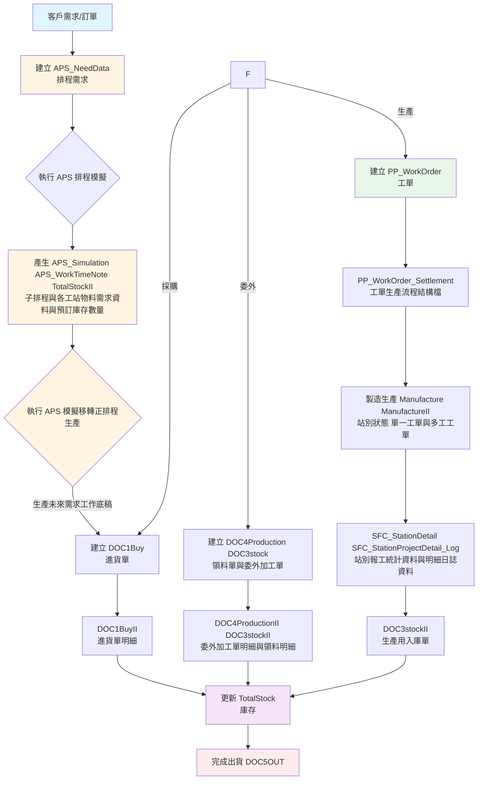
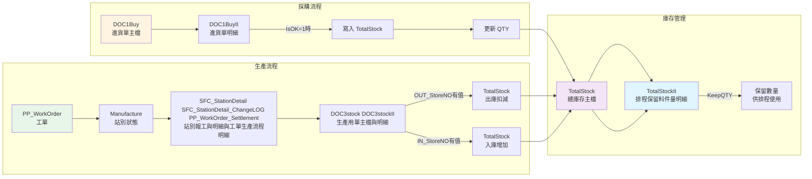
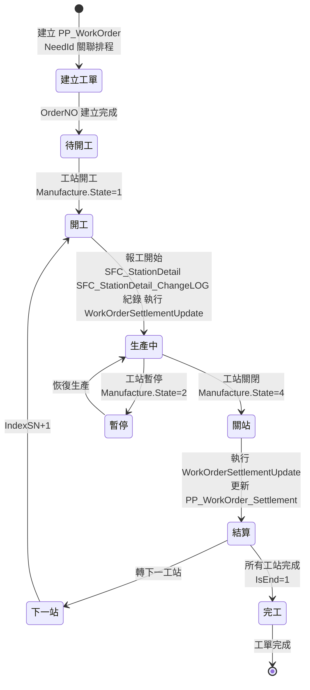
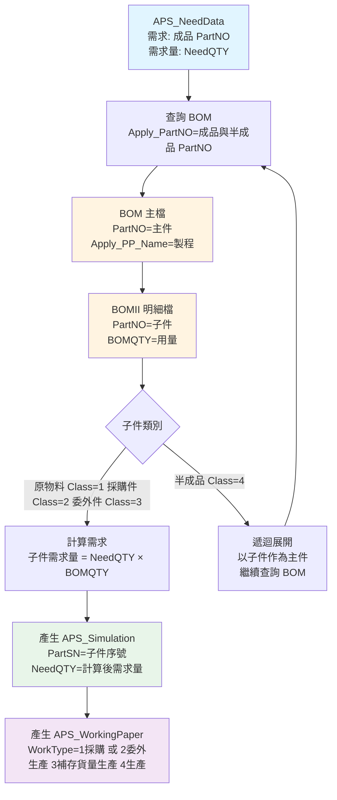
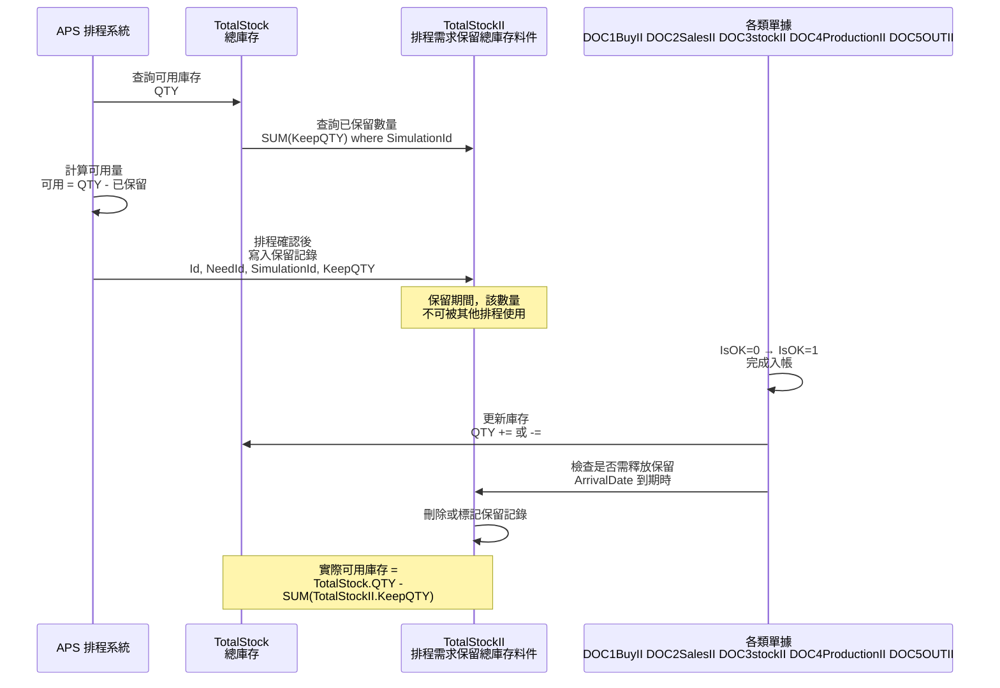
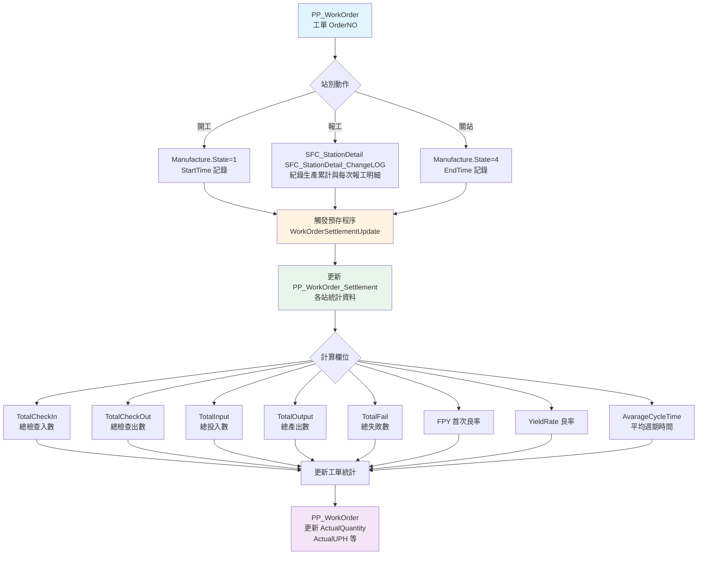

# SoftNet 資料庫欄位完整說明書
## 📋 文件資訊

| 項目 | 內容 |
|------|------|
| **文件版本** | 3.0 |
| **建立日期** | 2025-12-24 |
| **最後更新** | 2026-01-22 |
[SQL Express 伺服器名稱] (Kurt_NB1\SQLEXPRESS)
[SQL Express 使用者帳號] (sa)
[SQL Express 使用者密碼] (admin+123)

---

# SoftNetMainDB - 主要業務資料庫

## 1. Material (物料主檔)

| 欄位名稱 | 資料型別 | 說明 | 備註 |
|---------|---------|------|------|
| ServerId | nchar | 用戶編號 | 多租戶識別碼 |
| PartNO | nvarchar | 料件編號 | 主鍵，必填 |
| PartName | nvarchar | 品名 | 必填 |
| Specification | nvarchar | 規格 | |
| Model | nvarchar | 型號 | |
| Class | char | 物料類別 | 必填，例如：1=原物料, 2=採購件, 3=委外件, 4=半成品件, 5=成品件, 6=刀具, 7=治具 |
| PartType | char | 料件類型 | 必填 |
| Unit | nvarchar | 單位 | 必填，例如：PCS, KG |
| SafeQTY | int | 安全存量 | 預設值：0 |
| SafeWeightQty | float | 安全重量 | 預設值：0 |
| StoreSTime | int | 倉儲標準時間(秒) | 用於排程計算，預設值：0 |
| BuySTime | int | 採購標準時間(秒) | 預設值：0 |
| Buy_Flag | char | 是否自動採購標記 | 預設值：'1' |
| OutSTime | int | 出貨標準時間(秒) | 預設值：0 |
| Out_Flag | char | 是否自動出貨標記 | 預設值：'1' |
| APS_Default_MFNO | nvarchar | APS預設製造廠商編號 | |
| APS_Default_StoreNO | nvarchar | APS預設物料進出倉庫編號 | |
| APS_Default_StoreSpacesNO | nvarchar | APS預設倉庫編號內的儲位編號 | |
| IS_Store_Test | bit | 是否進出倉庫檢驗 | |
| IS_WorkingPaper | bit | 是否由工作底稿進行採購或生產 | 1=是, 0=否 |
| Use_ONLineTime | int | 刀具類領出在工作站最長分鐘 | |
| Use_LimitDay | int | 刀具類使用最長天數 | |
| Use_Count | int | 刀具類使用最長次數 | |
| Remark | nvarchar | 備註 | |

**用途說明**:  
> **Material 原物料編號基本資料主檔,所有料件都記錄在此檔**

## 2. BOM (生產用物料BOM表結構主檔)

| 欄位名稱 | 資料型別 | 說明 | 備註 |
|---------|---------|------|------|
| Id | char | BOM編號 | |
| ServerId | nchar | 用戶編號 | |
| Apply_PartNO | nvarchar | 適用料號 | 必填 |
| PartNO | nvarchar | 料件編號 | 主件料號，必填 |
| Main_Item | bit | 是否主件 | 1=主件, 0=子件，預設值：0 |
| Apply_PP_Name | nvarchar | 適用製程名稱 | 必填，預設值：'' |
| Apply_StationNO | nvarchar | 適用站別編號 | 預設值：'' |
| IndexSN | int | 製程順序 | 製程順序，預設值：1 |
| EffectiveDate | date | 生效日期 | |
| ExpiryDate | date | 失效日期 | |
| Version | nvarchar | 版本 | |
| OutPackType | bit | 是否為委外類型 | 1=是, 0=否，預設值：0 |
| UpdateTime | datetime | 更新時間 | |
| Station_DIS_Remark | nvarchar |  | |
| ESOP_Files | nvarchar | ESOP檔案路徑 | |
| IsEnd | bit | 是否為最後結束站 | 1=是, 0=否　|
| Station_Custom_IndexSN | nvarchar | 客戶制訂製程順序 | |
| StationNO_Custom_DisplayName | nvarchar | 客戶制訂製程順序名稱 | |
| IsChackQTY | bit | 確認關站前數量已足 | 1=是, 0=否 |
| IsChackIsOK | bit | 確認關站前單據已完成 | 1=是, 0=否 |
| IsConfirm | bit | 確認用戶編號是否歸屬發行 | 1=是, 0=否  |
| IsShare_PP_Name | bit | 是否為共享製程名稱 |1=是, 0=否 |
| StationNO_Merge | nvarchar |是否可共享指定工站編號| |
| MFNO | nvarchar | 委外加工廠商編號 | 預設值：'' |

**用途說明**:  
> **若為半成品件或成品件 主件,均需指定主件的BOM結構**

## 3. BOMII (生產用物料BOM表結構明細檔)

| 欄位名稱 | 資料型別 | 說明 | 備註 |
|---------|---------|------|------|
| Id | char | 唯一編號 | |
| BOMId | char | BOM編號 | BOM表的Id欄位，必填 |
| ServerId | nchar | 用戶編號 | 必填 |
| sn | int | 序號 | 預設值：1 |
| PartNO | nvarchar | 料件編號 | BOM表PartNO的明細件料件編號，必填 |
| BOMQTY | int | BOM用量 | 預設值：0 |
| Class | char | 物料類別 | 預設值：'1' |
| AttritionRate | float | 損耗率 | 預設值：0 |

**用途說明**:  
> **為BOM表主件的生產用物料明細,一筆 BOM 主件可以對多筆 BOMII 明細資料**

## 4. Store (倉庫主檔)

| 欄位名稱 | 資料型別 | 說明 | 備註 |
|---------|---------|------|------|
| ServerId | nchar | 用戶編號 | 主鍵之一，必填 |
| StoreNO | nvarchar | 倉庫編號 | 主鍵之一，必填 |
| StoreName | nvarchar | 倉庫名稱 | 必填 |
| FactoryName | nvarchar | 廠別名稱 | 必填 |
| Class | nvarchar | 倉庫類別 | 必填 |
| Simulation_FirstNO | int | 排程優先選用權重值 | 預設值：1 |
| PostNO | nvarchar | 郵遞區號 | 預設值：'' |
| PostMail | nvarchar | 郵件地址 | |
| Address | nvarchar | 地址 | |
| Config_macID | nvarchar | 倉庫電子紙配置MAC ID | 必填，預設值：'' |
| Default_IN_OUT | char | 定義倉庫類型 | 預設值：'0'，0=不限定類型, 1=適用原物料, 2=適用半成品件/成品件/委外加工件, 3=適用於大正倉, 4=限定刀工具, 5=適用成品件 |
| Store_Type | nchar | 倉庫類型 | 必填，預設值：'0' |

**用途說明**:  
> **一個工廠可以有多的倉庫 Simulation_FirstNO 與 Default_IN_OUT 欄位,於排程安排時用哪個 StoreNO 最適合**

## 5. StoreII (倉庫儲位明細檔)

| 欄位名稱 | 資料型別 | 說明 | 備註 |
|---------|---------|------|------|
| Id | char | 唯一編號 | |
| ServerId | nchar | 用戶編號 | |
| StoreNO | nvarchar | 倉庫編號 | |
| StoreSpacesNO | nvarchar | 儲位編號 | |
| StoreSpacesName | nvarchar | 儲位名稱 | |
| Config_macID | nvarchar | 儲位電子紙配置MAC ID | |
| Remark | nvarchar | 備註 | |

**用途說明**:  
> **為Store表的儲位明細資料,一筆 Store 可以對多筆 StoreII 明細資料**

## 6. TotalStock (總庫存主檔)

| 欄位名稱 | 資料型別 | 說明 | 備註 |
|---------|---------|------|------|
| Id | char | 唯一編號 | 必填 |
| ServerId | nchar | 用戶編號 | 必填 |
| StoreNO | nvarchar | 倉庫編號 | 必填 |
| StoreSpacesNO | nvarchar | 儲位編號 | 必填，預設值：'' |
| PartNO | nvarchar | 料件編號 | 必填 |
| QTY | int | 庫存數量 | 必填，預設值：0 |
| WeightQty | float | 重量數量 | 預設值：0 |
| Class | nvarchar | 類別 | 必填，例如：實體倉, 虛擬倉, 大正倉 |

**用途說明**:  
> **紀錄每個 PartNO 物料在各倉在儲位, 分別的數量**

## 7. TotalStockII (排程系統預先保留料件明細檔)

| 欄位名稱 | 資料型別 | 說明 | 備註 |
|---------|---------|------|------|
| Id | char | 總庫存主檔ID | 外鍵至TotalStock.Id |
| NeedId | nchar | 排程編號 | 關聯APS_NeedData.Id |
| SimulationId | nchar | 子排程編號 | 關聯APS_Simulation.SimulationId |
| ServerId | nchar | 用戶編號 | |
| KeepQTY | int | 保留數量 | |
| StoreOrder | smallint |  | |
| OverQTY | int | 超量數量 | |
| ArrivalDate | datetime | 排程預計使用日期 | |

**用途說明**:  
> **每個排程在排定後,紀錄 TotalStock (總庫存主檔) 哪一個 TotalStock 的 Id, 的物料,被計算過的數量,將被記錄在此, 如此每一個數量就可以事先知道,那些可以用,那些不可以用**

## 8. DOC1Buy (進貨單主檔)

| 欄位名稱 | 資料型別 | 說明 | 備註 |
|---------|---------|------|------|
| ServerId | nvarchar | 用戶編號 | 主鍵之一 |
| DOCNumberNO | nvarchar | 單據編號 | 主鍵之一 |
| DOCNO | nvarchar | 單據別代碼 | |
| DOCDate | datetime | 單據日期 | 必填 |
| SourceNO | nvarchar | 來源的單據編號 | |
| UserId | nvarchar | 使用者ID | |
| MFNO | nvarchar | 廠商編號 | |
| FlowLevel | int | 流程層級 | 預設值：1 |
| FlowStatus | nvarchar | 流程狀態 | Y=是, N=否 |
| IsOK | bit | 是否完成入帳 | 0=未完成, 1=已完成 |

## 9. DOC1BuyII (進貨單明細檔)

| 欄位名稱 | 資料型別 | 說明 | 備註 |
|---------|---------|------|------|
| Id | nvarchar | 唯一編號 | |
| DOCNumberNO | nvarchar | 單據編號 | 外鍵 |
| PartNO | nvarchar | 料件編號 | 必填 |
| Price | decimal | 單價 | |
| Unit | nvarchar | 單位 | |
| QTY | decimal | 數量 | |
| ArrivalDate | datetime | 預計使用日期 | |
| SimulationId | nvarchar | 子排程編號 | 關聯APS_Simulation.SimulationId |
| Remark | nvarchar | 備註 | |
| IsOK | bit | 是否完成入帳 | 0=未完成, 1=已完成 |

**用途說明**:  
> **若 Id 被寫入 TotalStock 的數量,則表示已完成帳務處理 IsOK 會記錄1=已完成, 若 IsOK 欄位未完成,則物料整體數量,須包含 IsOK=0的數量**

## 10. DOC2Sales (銷貨單主檔)

| 欄位名稱 | 資料型別 | 說明 | 備註 |
|---------|---------|------|------|
| ServerId | nvarchar | 用戶編號 | 主鍵之一 |
| DOCNumberNO | nvarchar | 單據編號 | 主鍵之一 |
| DOCNO | nvarchar | 單據別代碼 | |
| DOCDate | datetime | 單據日期 | |
| SourceNO | nvarchar | 來源的單據編號 | |
| UserId | nvarchar | 使用者ID | |
| IsOK | bit | 是否完成入帳 | 0=未完成, 1=已完成 |

## 11. DOC2SalesII (銷貨單明細檔)

| 欄位名稱 | 資料型別 | 說明 | 備註 |
|---------|---------|------|------|
| Id | nvarchar | 唯一編號 | |
| DOCNumberNO | nvarchar | 單據編號 | 外鍵 |
| PartNO | nvarchar | 料件編號 | |
| Price | decimal | 單價 | |
| Unit | nvarchar | 單位 | |
| QTY | decimal | 數量 | |
| IsOK | bit | 是否完成入帳 | 0=未完成, 1=已完成 |
**用途說明**:  
> **若 Id 被寫入 TotalStock 的數量,則表示已完成帳務處理 IsOK 會記錄1=已完成, 若 IsOK 欄位未完成,則物料整體數量,須包含 IsOK=0的數量**

## 12. DOC3stock (生產用單主檔)

| 欄位名稱 | 資料型別 | 說明 | 備註 |
|---------|---------|------|------|
| ServerId | nvarchar | 用戶編號 | 主鍵之一 |
| DOCNumberNO | nvarchar | 單據編號 | 主鍵之一 |
| DOCNO | nvarchar | 單據別代碼 | |
| DOCDate | datetime | 單據日期 | |
| IsOK | bit | 是否完成入帳 | 0=未完成, 1=已完成 |

## 13. DOC3stockII (生產用單明細檔)

| 欄位名稱 | 資料型別 | 說明 | 備註 |
|---------|---------|------|------|
| Id | char | 唯一編號 | 必填 |
| DOCNumberNO | char | 單據編號 | 外鍵，必填 |
| ArrivalDate | datetime | 使用日期 | 必填 |
| ServerId | nchar | 用戶編號 | |
| PartNO | nvarchar | 料件編號 | |
| Price | float | 單價 | 預設值：0 |
| Unit | nvarchar | 單位 | |
| QTY | int | 數量 | 預設值：0 |
| WeightQty | float | 重量數量 | 預設值：0 |
| Remark | nvarchar | 備註 | |
| SimulationId | nvarchar | 子排程編號 | 關聯APS_Simulation.SimulationId，預設值：'' |
| IsOK | bit | 是否完成入帳 | 0=未完成, 1=已完成，預設值：0 |
| IN_StoreNO | nvarchar | 入庫倉庫編號 | 必填，預設值：'' |
| IN_StoreSpacesNO | nvarchar | 入庫儲位編號 | 必填，預設值：'' |
| OUT_StoreNO | nvarchar | 出庫倉庫編號 | 必填，預設值：'' |
| OUT_StoreSpacesNO | nvarchar | 出庫儲位編號 | 必填，預設值：'' |
| EndTime | datetime | 結束時間 | |
| StartTime | datetime | 開始時間 | |
| CT | int | 週期時間(秒) | 預設值：0 |
**用途說明**:  
> **單據 IN_StoreNO 欄位有值表該筆為入庫資料,OUT_StoreNO 欄位有值表該筆為出庫資料,若 Id 被寫入 TotalStock 的數量,則表示已完成帳務處理 IsOK 會記錄1=已完成, 若 IsOK 欄位未完成,則物料整體數量,須包含 IsOK=0的數量**

## 14. DOC4Production (委外加工單主檔)

| 欄位名稱 | 資料型別 | 說明 | 備註 |
|---------|---------|------|------|
| ServerId | nvarchar | 用戶編號 | 主鍵之一 |
| DOCNumberNO | nvarchar | 單據編號 | 主鍵之一 |
| DOCNO | nvarchar | 單據別代碼 | |
| DOCDate | datetime | 單據日期 | |
| IsOK | bit | 是否完成入帳 | 0=未完成, 1=已完成 |

## 15. DOC4ProductionII (委外加工單明細檔)

| 欄位名稱 | 資料型別 | 說明 | 備註 |
|---------|---------|------|------|
| Id | nvarchar | 唯一編號 | |
| DOCNumberNO | nvarchar | 單據編號 | 外鍵 |
| PartNO | nvarchar | 料件編號 | |
| Price | decimal | 單價 | |
| Unit | nvarchar | 單位 | |
| QTY | decimal | 數量 | |
| ArrivalDate | datetime | 使用日期 | |
| SimulationId | nvarchar | 子排程編號 | 關聯APS_Simulation.SimulationId |
| Remark | nvarchar | 備註 | |
| IsOK | bit | 是否完成入帳 | 0=未完成, 1=已完成 |
**用途說明**:  
> **若 Id 被寫入 TotalStock 的數量,則表示已完成帳務處理 IsOK 會記錄1=已完成, 若 IsOK 欄位未完成,則物料整體數量,須包含 IsOK=0的數量**

## 16. DOC5OUT (出貨單主檔)

| 欄位名稱 | 資料型別 | 說明 | 備註 |
|---------|---------|------|------|
| ServerId | nvarchar | 用戶編號 | 主鍵之一 |
| DOCNumberNO | nvarchar | 單據編號 | 主鍵之一 |
| DOCNO | nvarchar | 單據別代碼 | |
| DOCDate | datetime | 單據日期 | |
| IsOK | bit | 是否完成入帳 | 0=未完成, 1=已完成 |

## 17. DOC5OUTII (出貨單明細檔)

| 欄位名稱 | 資料型別 | 說明 | 備註 |
|---------|---------|------|------|
| Id | nvarchar | 唯一編號 | |
| DOCNumberNO | nvarchar | 單據編號 | 外鍵 |
| PartNO | nvarchar | 料件編號 | |
| Price | decimal | 單價 | |
| Unit | nvarchar | 單位 | |
| QTY | decimal | 數量 | |
| IsOK | bit | 是否完成入帳 | 0=未完成, 1=已完成 |
**用途說明**:  
> **若 Id 被寫入 TotalStock 的數量,則表示已完成帳務處理 IsOK 會記錄1=已完成, 若 IsOK 欄位未完成,則物料整體數量,須包含 IsOK=0的數量**

## 18. DOCRole (單據別設定)

| 欄位名稱 | 資料型別 | 說明 | 備註 |
|---------|---------|------|------|
| Id | nvarchar | 唯一編號 | |
| ServerId | nvarchar | 用戶編號 | |
| DOCType | nvarchar | 單據類型 | 必填，1=進貨類, 2=銷貨類, 3=生產_領料類, 4=生產_入料類, 6=生產類, 7=委外加工類 8=檢驗類, 9=財務類 |
| DOCNO | nvarchar | 單據別代碼 | 必填 |
| DOCName | nvarchar | 單據名稱 | 必填 |
| Remark | nvarchar | 備註 | |

## 19. Manufacture (製造站別狀態 單一工單)

| 欄位名稱 | 資料型別 | 說明 | 備註 |
|---------|---------|------|------|
| StationNO | nvarchar | 工站編號 | 主鍵之一，必填 |
| ServerId | nchar | 用戶編號 | 主鍵之一，必填 |
| State | char | 狀態 | 必填，預設值：'2'，例如：0=待機, 1=開工, 2=停工, 4=關站, 5=關工單 |
| OrderNO | nvarchar | 工單編號 | 預設值：'' |
| OP_NO | nvarchar | 使用者ID | 作業員可多名用;符號分隔，預設值：'' |
| Master_PP_Name | nvarchar | 主製程名稱 | 預設值：'' |
| PP_Name | nvarchar | 製程名稱 | 預設值：'' |
| IndexSN | int | 製程序號 | 製程順序，預設值：0 |
| Station_Custom_IndexSN | nvarchar | 客戶制訂製程順序 | 預設值：'' |
| StationNO_Custom_DisplayName | nvarchar | 客戶制訂製程順序名稱 | 預設值：'' |
| SimulationId | nvarchar | 子排程編號 | 必填，預設值：'' |
| StartTime | datetime | 開始時間 | |
| RemarkTimeS | datetime | 備註開始時間 | |
| RemarkTimeE | datetime | 備註結束時間 | |
| EndTime | datetime | 結束時間 | |
| Config_WaitTime_Formula | nchar | 配置等待時間公式 | 預設值：'0' |
| Config_CycleTime_Formula | nchar | 配置週期時間公式 | 預設值：'0' |
| Config_OutQtyTagName | nvarchar | 配置產出數量標籤名稱 | 預設值：'' |
| Config_FailQtyTagName | nvarchar | 配置失敗數量標籤名稱 | 預設值：'' |
| Config_IsTagValueCumulative | int | 配置標籤值是否累計 | 預設值：0 |
| Config_CalculatePauseTime | nchar | 配置計算暫停時間 | 預設值：'0' |
| Config_WaitTagValueDIO | nvarchar | 配置等待標籤值DIO | 預設值：'true' |
| Config_IsWaitTargetFinish | nchar | 配置是否等待目標完成 | 預設值：'0' |
| Config_Store_Type | nchar | 配置儲存類型 | 預設值：'1' |
| Config_Store_BeforeTime | int | 配置儲存前置時間(秒) | 預設值：240 |
| Config_macID | nvarchar | 工站電子紙配置MAC ID | 必填，預設值：'' |
| LOG_CalculatePauseTime | datetime | 日誌計算暫停時間 | 預設值：'' |
| Label_ProjectType | bit | 是否為LabelProject類型 | 預設值：0 |
| Config_MutiWO | bit | 配置多工單 | 預設值：0，0=否, 1=是 |
| PartNO | nvarchar | 料件編號 | 預設值：'' |

**用途說明**:  
> **記錄製造站別的狀態資訊，包括工單、製程、作業員等資訊，用於追蹤生產進度**

## 20. ManufactureII (製造站別狀態 多工工單)

| 欄位名稱 | 資料型別 | 說明 | 備註 |
|---------|---------|------|------|
| Id | nchar | 唯一編號 | 必填 |
| StationNO | nvarchar | 工站編號 | 必填 |
| ServerId | nchar | 用戶編號 | 必填 |
| OrderNO | nvarchar | 工單編號 | |
| Master_PP_Name | nvarchar | 主製程名稱 | |
| PP_Name | nvarchar | 製程名稱 | |
| IndexSN | int | 製程順序 | 預設值：0 |
| Station_Custom_IndexSN | nvarchar | 客戶制訂製程順序 | 預設值：'' |
| StationNO_Custom_DisplayName | nvarchar | 客戶制訂製程順序名稱 | 預設值：'' |
| PartNO | nvarchar | 料件編號 | 預設值：'' |
| SimulationId | nvarchar | 子排程編號 | |
| StartTime | datetime | 開始時間 | |
| EndTime | datetime | 結束時間 | |
| RemarkTimeS | datetime | 備註開始時間 | |
| RemarkTimeE | datetime | 備註結束時間 | |
| PNQTY | int | 產品數量 | 預設值：0 |

**用途說明**:  
> **記錄製造站別多工單的明細資訊，一個站別可以同時處理多個工單**

## 21. Factory (廠別設定)

| 欄位名稱 | 資料型別 | 說明 | 備註 |
|---------|---------|------|------|
| Id | nvarchar | 唯一編號 | |
| FactoryName | nvarchar | 廠別名稱 | 必填 |
| Manager | nvarchar | 管理者 | 必填 |
| Address | nvarchar | 地址 | 必填 |
| Telephone | nvarchar | 電話 | 必填 |

## 22. User (使用者)

| 欄位名稱 | 資料型別 | 說明 | 備註 |
|---------|---------|------|------|
| Id | nvarchar(10) | 使用者ID | 主鍵 |
| Account | nvarchar(20) | 帳號 | 必填 |
| UserNO | nvarchar | 員工編號 | |
| Name | nvarchar(20) | 姓名 | 必填 |
| Pwd | nvarchar | 密碼 | 必填 |
| DeptId | nvarchar(10) | 部門ID | 必填 |
| PhotoFile | nvarchar(100) | 照片檔案 | |
| Status | bit | 狀態 | true=啟用, false=停用 |
| ServerId | nvarchar | 用戶編號 | |

## 23. XpUserRole (使用者角色)

| 欄位名稱 | 資料型別 | 說明 | 備註 |
|---------|---------|------|------|
| Id | nvarchar | 唯一編號 | |
| UserId | nvarchar | 使用者ID | 外鍵至User.Id |
| RoleId | nvarchar | 角色ID | 必填 |

## 24. XpCode (代碼表)

| 欄位名稱 | 資料型別 | 說明 | 備註 |
|---------|---------|------|------|
| Id | nvarchar | 唯一編號 | |
| Code | nvarchar | 代碼 | |
| Name | nvarchar | 名稱 | |
| Type | nvarchar | 類型 | |
| Sort | int | 排序 | |
| Status | bit | 狀態 | |

## 25. XpFlow (流程主檔)

| 欄位名稱 | 資料型別 | 說明 | 備註 |
|---------|---------|------|------|
| Id | nvarchar | 唯一編號 | |
| Code | nvarchar | 流程代碼 | |
| Name | nvarchar | 流程名稱 | |
| Portrait | bit | 是否直向 | |
| Status | bit | 狀態 | |

## 26. XpFlowLine (流程線)

| 欄位名稱 | 資料型別 | 說明 | 備註 |
|---------|---------|------|------|
| Id | nvarchar | 唯一編號 | |
| FlowId | nvarchar | 流程ID | 外鍵 |
| StartNode | nvarchar | 起始節點 | |
| EndNode | nvarchar | 結束節點 | |
| CondStr | nvarchar | 條件字串 | |
| Sort | short | 排序 | |

## 27. XpFlowNode (流程節點)

| 欄位名稱 | 資料型別 | 說明 | 備註 |
|---------|---------|------|------|
| Id | nvarchar | 唯一編號 | |
| FlowId | nvarchar | 流程ID | 外鍵 |
| Name | nvarchar | 節點名稱 | |
| NodeType | nvarchar | 節點類型 | |
| PosX | short | X座標 | |
| PosY | short | Y座標 | |
| SignerType | nvarchar | 簽核者類型 | |
| SignerValue | nvarchar | 簽核者值 | |
| PassType | nvarchar | 通過類型 | |
| PassNum | short? | 通過數量 | |

## 28. XpFlowSign (流程簽核)

| 欄位名稱 | 資料型別 | 說明 | 備註 |
|---------|---------|------|------|
| Id | nvarchar | 唯一編號 | |
| FlowId | nvarchar | 流程ID | 外鍵 |
| SourceId | nvarchar | 來源ID | |
| NodeName | nvarchar | 節點名稱 | |
| FlowLevel | short | 流程層級 | |
| TotalLevel | short | 總層級 | |
| SignerId | nvarchar | 簽核者ID | |
| SignerName | nvarchar | 簽核者名稱 | |
| SignStatus | nvarchar | 簽核狀態 | |
| SignTime | datetime? | 簽核時間 | |
| Note | nvarchar | 備註 | |

## 29. XpProg (程式權限)

| 欄位名稱 | 資料型別 | 說明 | 備註 |
|---------|---------|------|------|
| Id | nvarchar | 唯一編號 | |
| Code | nvarchar | 程式代碼 | |
| Name | nvarchar | 程式名稱 | |

## 30. MFData (廠商資料)

| 欄位名稱 | 資料型別 | 說明 | 備註 |
|---------|---------|------|------|
| ServerId | nvarchar | 用戶編號 | |
| MFNO | nvarchar | 廠商單號 | |
| SName | nvarchar | 廠商名稱 | |
| SCM_ServerId | nchar | 對方softnet MES 用戶編號 | |

## 31. LabelMACs (標籤MAC檔)

| 欄位名稱 | 資料型別 | 說明 | 備註 |
|---------|---------|------|------|
| ServerId | nvarchar | 用戶編號 | |
| macID | nvarchar | 電子紙配置MAC ID | |
**用途說明**:  
> **若工站,倉庫,儲位有使用電子紙時,這裡會記錄 電子紙配置MAC ID**

## 32. LabelStateINFO (標籤狀態資訊)

| 欄位名稱 | 資料型別 | 說明 | 備註 |
|---------|---------|------|------|
| ServerId | nvarchar | 用戶編號 | |
| macID | nvarchar | 電子紙配置MAC ID | |
| ShowValue | nvarchar | 顯示值 | |
| Ledrgb | nvarchar | LED RGB | |
| Ledstate | int | LED狀態 | |
| StationNO | nvarchar | 工站編號 | |
| Type | nvarchar | 類型 | |
| OrderNO | nvarchar | 工單編號 | |
| IndexSN | nvarchar | 序號 | |
| StoreNO | nvarchar | 倉庫編號 | |
| StoreSpacesNO | nvarchar | 儲位編號 | |
| QTY | decimal | 數量 | |
| IsUpdate | bit | 是否更新 | 0=未完成, 1=已完成 |

**用途說明**:  
> **紀錄每個電子紙配置MAC ID,目前的狀態與顯示的資訊**

## 33. BarCode_TMP (工站電子紙動作暫存檔)

| 欄位名稱 | 資料型別 | 說明 | 備註 |
|---------|---------|------|------|
| ServerId | nchar | 用戶編號 | |
| Keys | nvarchar | | |
| StationNO | nvarchar | 工站編號 | |
| StoreNO | nvarchar | 倉庫編號 | |
| Value | nvarchar | | |
| FailTime | datetime | 失敗時間 | |
**用途說明**:  
> **當電子紙配置MAC ID,須等地２個指令時,會先將錢移指令站存此處, 當動作完成,程式會刪除**

## 34. TotalStock_Blank_LOG (總庫存空白日誌)

| 欄位名稱 | 資料型別 | 說明 | 備註 |
|---------|---------|------|------|
| Id | char | 唯一編號 | 必填 |
| StoreId | nchar | 倉庫ID | 必填 |
| logDate | datetime | 日誌日期 | |
| SimulationId | nchar | 子排程編號 | |
| QTY | int | 數量 | 預設值：0 |
| WeightQty | float | 重量數量 | 預設值：0 |
| Remark | nvarchar | 備註 | |

**用途說明**:  
> **記錄總庫存為空白時的日誌資訊**

## 35. TotalStockII_Knives (總庫存刀具明細)

| 欄位名稱 | 資料型別 | 說明 | 備註 |
|---------|---------|------|------|
| KId | char | 刀具ID | 主鍵，必填 |
| MId | char | 物料ID | 主鍵，必填 |
| ServerId | nchar | 用戶編號 | 必填 |
| StationNO | nvarchar | 工站編號 | 預設值：'' |
| StoreNO | nvarchar | 倉庫編號 | 預設值：'' |
| StoreSpacesNO | nvarchar | 儲位編號 | 預設值：'' |
| TOTWorkTime | int | 總工作時間 | 預設值：0 |
| TOTCount | int | 總計數 | 預設值：0 |
| StartTime | datetime | 開始時間 | |
| RecoverTime | datetime | 恢復時間 | |
| IsDel | bit | 是否刪除 | 0=否, 1=是，預設值：0 |

**用途說明**:  
> **記錄總庫存中刀具的明細資訊**

## 36. TotalStockII_Knives_LOG (總庫存刀具日誌)

| 欄位名稱 | 資料型別 | 說明 | 備註 |
|---------|---------|------|------|
| Id | char | 唯一編號 | 必填 |
| KId | char | 刀具ID | 必填 |
| ServerId | nchar | 用戶編號 | 必填 |
| LOGDateTime | datetime | 日誌日期時間 | |
| StationNO | nvarchar | 工站編號 | 必填 |
| PartNO | nvarchar | 料件編號 | 必填 |
| WorkQTY | int | 工作數量 | 預設值：0 |
| WorkTime | int | 工作時間 | 預設值：0 |

**用途說明**:  
> **記錄總庫存刀具的操作日誌**

## 37. PP_ProductProcess_Index_M (製程索引主檔)

| 欄位名稱 | 資料型別 | 說明 | 備註 |
|---------|---------|------|------|
| Id | char | 唯一編號| |
| PP_Index_Name | nvarchar | | |
| M_PP_Name | nvarchar | | |

## 38. PP_ProductProcess_Index_S (製程索引子檔)

| 欄位名稱 | 資料型別 | 說明 | 備註 |
|---------|---------|------|------|
| Id | char | 唯一編號| |
| IndexId | char | | |
| PP_Name | nvarchar | | |

## 39. PP_ProductProcess_Index_S_Index (製程索引子檔序號)

| 欄位名稱 | 資料型別 | 說明 | 備註 |
|---------|---------|------|------|
| Id | char | | 唯一編號|
| IndexId_S | char | | |
| IndexId_M | char | | |
| S_StationNO | nvarchar |工站編號 | |
| S_IndexSN | int | | |
| S_Station_Custom_IndexSN | nvarchar | | |
| C_StationNO | nvarchar | | |
| C_IndexSN | int | | |
| C_Station_Custom_IndexSN | nvarchar | | |

## 40. CTData (客戶資料)

| 欄位名稱 | 資料型別 | 說明 | 備註 |
|---------|---------|------|------|
| ServerId | nchar | 用戶編號 | 必填 |
| CTNO | nvarchar | 客戶編號 | 必填 |
| CTName | nvarchar | 客戶名稱 | 必填 |
| SName | nvarchar | 供應商名稱 | |
| UniFormNO | nvarchar | 統一編號 | |
| TEL | nvarchar | 電話 | |
| FAX | nvarchar | 傳真 | |
| ContactMan | nvarchar | 聯絡人 | |
| ContactTEL | nvarchar | 聯絡電話 | |
| EMail | nvarchar | 電子郵件 | |
| Address | nvarchar | 地址 | |
| PaymentMethod | nvarchar | 付款方式 | |
| PaymentDate | nvarchar | 付款日期 | |
| PaymentTerms | nvarchar | 付款條件 | |
| StoreNO | nvarchar | 倉庫編號 | |
| Remark | nvarchar | 備註 | |
| CTDataWeights | float | CT資料權重 | 預設值：0 |
| SCM_ServerId | nchar | 對方softnet MES 用戶編號 | |

**用途說明**:  
> **客戶資料主檔**

## 41. Dept (部門)

| 欄位名稱 | 資料型別 | 說明 | 備註 |
|---------|---------|------|------|
| Id | nvarchar | 部門ID | 主鍵，必填 |
| Name | nvarchar | 部門名稱 | 必填 |
| MgrId | varchar | 管理者ID | 必填 |

**用途說明**:  
> **部門基本資料主檔**

## 42. Column (欄位定義表)

| 欄位名稱 | 資料型別 | 說明 | 備註 |
|---------|---------|------|------|
| Id | varchar | 唯一編號| |
| TableId | varchar | | |
| Code | varchar | | |
| Name | nvarchar | | |
| DataType | varchar | | |
| Nullable | bit | | |
| DefaultValue | varchar | | |
| Sort | int | | |
| Note | nvarchar | | |
| Status | bit | | |

## 43. Crud (CRUD功能定義表)

| 欄位名稱 | 資料型別 | 說明 | 備註 |
|---------|---------|------|------|
| Id | varchar | 唯一編號| |
| ProjectId | varchar | | |
| ProgCode | varchar | | |
| ProgName | nvarchar | | |
| LabelHori | bit | | |
| ReadSql | varchar | | |
| TableAs | varchar | | |
| HasCreate | bit | | |
| HasUpdate | bit | | |
| HasDelete | bit | | |
| HasView | bit | | |
| HasExport | bit | | |
| HasReset | bit | | |
| AuthType | tinyint | | |
| Status | bit | | |
| Created | datetime | | |
| Revised | datetime | | |

## 44. CrudEitem (CRUD編輯項目表)

| 欄位名稱 | 資料型別 | 說明 | 備註 |
|---------|---------|------|------|
| Id | varchar | 唯一編號| |
| EtableId | varchar | | |
| ColumnId | varchar | | |
| EitemType | varchar | | |
| ItemData | nvarchar | | |
| Required | bit | | |
| HasCreate | bit | | |
| HasUpdate | bit | | |
| PlaceHolder | varchar | | |
| DefaultValue | varchar | | |
| PosGroup | varchar | | |
| LayoutCols | varchar | | |
| Width | int | | |
| CheckType | varchar | | |
| CheckData | varchar | | |
| Sort | int | | |

## 45. CrudEtable (CRUD編輯表格表)

| 欄位名稱 | 資料型別 | 說明 | 備註 |
|---------|---------|------|------|
| Id | varchar | 唯一編號| |
| CrudId | varchar | | |
| TableId | varchar | | |
| PkeyFid | varchar | | |
| FkeyFid | varchar | | |
| Col4 | varchar | | |
| OrderBy | varchar | | |
| Sort | int | | |
| HalfWidth | bit | | |

## 46. CrudQitem (CRUD查詢項目表)

| 欄位名稱 | 資料型別 | 說明 | 備註 |
|---------|---------|------|------|
| Id | varchar | 唯一編號| |
| CrudId | varchar | | |
| ColumnId | varchar | | |
| TableAs | varchar | | |
| QitemType | varchar | | |
| ItemData | varchar | | |
| Op | varchar | | |
| IsRange | bit | | |
| IsFind2 | bit | | |
| PosGroup | varchar | | |
| LayoutCols | varchar | | |
| Sort | int | | |

## 47. CrudRitem (CRUD報表項目表)

| 欄位名稱 | 資料型別 | 說明 | 備註 |
|---------|---------|------|------|
| Id | varchar | 唯一編號| |
| CrudId | varchar | | |
| ColumnCode | varchar | | |
| Name | nvarchar | | |
| Width | int | | |
| RitemType | varchar | | |
| Sort | int | | |

## 48. DOCUpdateLog (單據更新日誌表)

| 欄位名稱 | 資料型別 | 說明 | 備註 |
|---------|---------|------|------|
| Id | char | | 唯一編號|
| LOGDateTime | datetime | 更新日期| |
| DOCId | nchar | 被更新的原Id欄位值| |
| DOCNumberNO | nchar | 被更新的原DOCNumberNO欄位值| |
| NeedId | nchar | 是哪個排程編號| |
| SimulationId | nchar | 是哪個排程編號內的子排程編號| |
| PartNO | nvarchar | 是哪個料件編號| |
| QTY | int | 更新數量| |
| FunName | nvarchar | 哪個程式中的函式執行| |
| ProName | nvarchar | | 哪個程式執行|
**用途說明**:  
> **若 (DOC1BuyII) (DOC2SalesII) (DOC3stockII) (DOC4ProductionII) (DOC5OUTII) IsOK=1後, 會Log何時,哪單號,IsOK=1的本身Id欄位,哪個NeedId,哪個SimulationId異動**

## 49. Project (專案表)

| 欄位名稱 | 資料型別 | 說明 | 備註 |
|---------|---------|------|------|
| Id | varchar | 唯一編號| |
| Code | nvarchar | | |
| DbName | varchar | | |
| ProjectPath | varchar | | |
| ConnectStr | varchar | | |
| Status | bit | | |

## 50. Table (表格定義表)

| 欄位名稱 | 資料型別 | 說明 | 備註 |
|---------|---------|------|------|
| Id | varchar | 唯一編號| |
| ProjectId | varchar | | |
| Code | varchar | | |
| Name | nvarchar | | |
| Note | nvarchar | | |
| TranLog | bit | | |
| Status | bit | | |

## 51. XpRole (角色表)

| 欄位名稱 | 資料型別 | 說明 | 備註 |
|---------|---------|------|------|
| Id | char | 唯一編號| |
| Name | nvarchar | | |

## 52. XpRoleProg (角色程式權限表)

| 欄位名稱 | 資料型別 | 說明 | 備註 |
|---------|---------|------|------|
| Id | char | 唯一編號 | |
| RoleId | char | | |
| ProgId | char | | |
| FunCreate | tinyint | | |
| FunRead | tinyint | | |
| FunUpdate | tinyint | | |
| FunDelete | tinyint | | |
| FunPrint | tinyint | | |
| FunExport | tinyint | | |
| FunView | tinyint | | |
| FunOther | tinyint | | |

---

# SoftNetSYSDB - 系統配置與排程資料庫

## 1. PP_Station (站別設定)

| 欄位名稱 | 資料型別 | 說明 | 備註 |
|---------|---------|------|------|
| ServerId | nchar | 用戶編號 | 主鍵之一，必填 |
| StationNO | nvarchar | 工站編號 | 主鍵之一，必填，預設值：'' |
| FactoryName | nvarchar | 廠別名稱 | 必填 |
| LineName | nvarchar | 線別名稱 | 必填 |
| StationName | nvarchar | 站別名稱 | 必填 |
| RMSName | nvarchar | RMS名稱 | 必填 |
| CalendarName | nvarchar | 行事曆名稱 | 必填 |
| Station_Type | nchar | 站別類型 | 預設值：'1' |
| StationUI_type | nchar | 站別UI類型 | 必填，預設值：'1'，1=追蹤型 |
| IsRobotAutoControl | bit | 是否機器人自動控制 | 預設值：1 |
| DeviceName | nvarchar | 裝置名稱 | |
| UpdateUser | nvarchar | 更新使用者 | |
| UpdateTime | datetime | 更新時間 | |
| IsBeforWork | bit | 是否前置作業 | 預設值：0 |
| PP_Type | nchar | 製程類型 | 預設值：'1' |
| IsKnives | bit | 是否刀具站 | 預設值：0 |
| Remark | nvarchar | 備註 | |

## 2. PP_WorkOrder (工單主檔)

| 欄位名稱 | 資料型別 | 說明 | 備註 |
|---------|---------|------|------|
| ServerId | nchar | 用戶編號 | 主鍵之一，必填 |
| OrderNO | nvarchar | 工單編號 | 主鍵之一，必填 |
| FactoryName | nvarchar | 廠別名稱 | 必填 |
| LineName | nvarchar | 線別名稱 | 必填 |
| PP_Name | nvarchar | 製程名稱 | 必填 |
| PartNO | nvarchar | 料件編號 | 必填 |
| PartName | nvarchar | 品名 | 必填 |
| Quantity | int | 數量 | 必填，預設值：0 |
| CalendarName | nvarchar | 行事曆名稱 | |
| EstimatedStartTime | datetime | 預計開始時間 | |
| StartTime | datetime | 實際開始時間 | |
| EndTime | datetime | 結束時間 | |
| PauseTime | datetime | 暫停時間 | |
| AccumulatePauseHours | float | 累計暫停時數 | 預設值：0 |
| FPY | float | 首次良率 | 必填，預設值：0 |
| YieldRate | float | 良率 | 必填，預設值：0 |
| PlanUPH | float | 計劃每小時產量 | 必填，預設值：0 |
| PlanHours | float | 計劃時數 | 必填，預設值：0 |
| RemainingHours | float | 剩餘時數 | 預設值：0 |
| ActualUPH | float | 實際每小時產量 | 必填，預設值：0 |
| AchievingRateUPH | float | 達成率 | 必填，預設值：0 |
| CloseType | nchar | 關閉類型 | 預設值：'0'，2=正常關工單, 3=異常關工單 |
| IsAutoPauseWO | bit | 是否自動暫停工單 | 預設值：0 |
| IsAutoCloseWO | bit | 是否自動關閉工單 | 預設值：0 |
| WarningYieldRate | float | 警告良率 | 預設值：0 |
| WarningProcessHours | float | 警告製程時數 | 預設值：0 |
| UpdateUser | nvarchar | 更新使用者 | |
| UpdateTime | datetime | 更新時間 | 必填，預設值：getdate() |
| Custom01 | nvarchar | 自訂欄位01 | |
| Custom02 | nvarchar | 自訂欄位02 | |
| Custom03 | nvarchar | 自訂欄位03 | |
| Custom04 | nvarchar | 自訂欄位04 | |
| Custom05 | nvarchar | 自訂欄位05 | |
| Custom06 | float | 自訂欄位06 | 預設值：0 |
| Custom07 | float | 自訂欄位07 | 預設值：0 |
| Custom08 | float | 自訂欄位08 | 預設值：0 |
| Custom09 | float | 自訂欄位09 | 預設值：0 |
| Custom10 | float | 自訂欄位10 | 預設值：0 |
| WorkingHours | float | 工作時數 | |
| WOStatus | smallint | 工單狀態 | 預設值：0 |
| ScheduleNO | nvarchar | 排程編號 | |
| FirstInTime | datetime2 | 首次入站時間 | |
| LastOutTime | datetime2 | 最後出站時間 | |
| ActualQuantity | int | 實際數量 | 必填，預設值：0 |
| TmpClose | bit | 暫時關閉 | |
| NeedId | nvarchar | 排程編號 | 關聯APS_NeedData.Id，預設值：'' |
| WOType | char | 工單類型 | 預設值：0 |

## 3. PP_WorkOrder_Settlement (工單所有工站2生產流程結構檔)

| 欄位名稱 | 資料型別 | 說明 | 備註 |
|---------|---------|------|------|
| ServerId | nvarchar | 用戶編號 | |
| OrderNO | nvarchar | 工單編號 | |
| StationNO | nvarchar | 工站編號 | |
| StationName | nvarchar | 站別名稱 | |
| PP_Name | nvarchar | 製程名稱 | |
| IndexSN | int | 製程順序 | |
| DisplaySN | int | 顯示序號 | |
| IsLastStation | bit | 是否最後站 | |
| Sub_PP_Name | nvarchar | 子製程名稱 | |
| StatndCycleTime | decimal | 標準CT週期時間 | |
| UpdateTime | datetime | 更新時間 | |
| IndexSN_Merge | nvarchar | 合併序號 | |
| StartTime | datetime | 工站開始時間 | |
| CumulativeTime | decimal | 累計時間 | |
| AvarageCycleTime | decimal | 平均實際CT週期時間 | |
| AvarageWaitTime | decimal | 平均等待時間 | |
| TotalCheckIn | int | 總檢查入數 | |
| TotalCheckOut | int | 總檢查出數 | |
| TotalInput | int | 總投入數 | |
| TotalOutput | int | 總報工量 | |
| TotalFail | int | 總報工不良量 | |
| TotalKeep | int | 總保留數 | |
| FPY | decimal | 首次良率 | |
| YieldRate | decimal | 良率 | |
| StationYieldRate | decimal | 站別良率 | |
| EndTime | datetime | 工站結束時間 | |
**用途說明**:  
> **當工單的工站編號有開工,停工,關站,報工,等動作時,程式會執行預存程序 (WorkOrderSettlementUpdate),重新統計相關欄位值**

## 4. PP_WO_Process_Item (工單製程項目)

| 欄位名稱 | 資料型別 | 說明 | 備註 |
|---------|---------|------|------|
| OrderNO | nvarchar(50) | 工單編號 | |
| StationNO | nvarchar(50) | 工站編號 | |
| OPID | nvarchar(50) | 作業人員 | |
| UpdateDate | datetime | 更新時間 | |
| ListSN | int | | 預設值：1 |
| Type | bit | | 預設值：1 |
| IndexSN | int | | |

## 5. PP_ProductProcess (製程主檔)

| 欄位名稱 | 資料型別 | 說明 | 備註 |
|---------|---------|------|------|
| ServerId | nchar | 用戶編號| |
| FactoryName | nvarchar | 適用工廠| |
| LineName | nvarchar | 適用生產線| |
| Apply_PartNO | nvarchar | 主件料件編號| |
| PP_Name | nvarchar | 製程名稱| |
| PartPicture | varbinary | 料件圖片| |
| PlanUPH | float | 標準UPH| |
| PlanHours | float | 標準總工時| |
| UpdateUser | nvarchar | 更新員工| |
| UpdateTime | datetime | 更新時間| |
| Remark | nvarchar |備註 | |
| WorkingHours | float | | |
| IsAutoPauseWO | bit | 是否主動暫停| |
| IsAutoCloseWO | bit | 是否主動關閉工單| |
| WarningYieldRate | float | | |
| WarningProcessHours | float | | |
| CalendarName | nvarchar | 適用行事曆| |
| First_MailAddressee | nvarchar | | |
| First_MailSubject | nvarchar | | |
| First_MailContent | nvarchar | | |
| Second_MailAddressee | nvarchar | | |
| Second_MailSubject | nvarchar | | |
| Second_MailContent | nvarchar | | |
| ScheduleTime | int | | |
| IsShare_PP_Name | bit | 是否可以共用製程| |

## 6. PP_ProductProcess_Item (製程生產流程項目明細)

| 欄位名稱 | 資料型別 | 說明 | 備註 |
|---------|---------|------|------|
| Id | nchar | 唯一編號| |
| ServerId | nchar | 用戶編號| |
| FactoryName | nvarchar | 適用工廠| |
| LineName | nvarchar | 適用生產線| |
| Apply_PartNO | nvarchar | 主件料件編號| |
| PP_Name | nvarchar |製程名稱 | |
| PartNO | nvarchar | 生產流程使用料件編號| |
| DisplaySN | int | 生產流程順序編號(畫面顯示順序)| |
| IndexSN | int |生產流程順序編號 | |
| IndexSN_Merge | bit | 其他站是否可執行| |
| StationNO | nvarchar | 工站編號| |
| Sub_PP_Name | nvarchar | 子製程名稱| |
| BelowYield | float | | |
| BelowCycleTime | int | | |
| E_CycleTime | int |標準工時(秒) | |
| SerialNOKey | nchar | 產生生產序號的方式| |
| SerialNOFrom_ThingName | nvarchar | | |
| SerialNOFrom_StationNO | nvarchar | | |
| SerialNOFrom_StationNO_Buffer | smallint | | |
| SerialNOFrom_StationNO_ByOrder | bit | | |
| SerialNOFrom_CodingName | nvarchar | | |
| SerialNOFrom_SQL_ConnectString | nvarchar | | |
| SerialNOFrom_SQL_Language | nvarchar | | |
| First_MailAddressee | nvarchar | | |
| First_MailSubject | nvarchar | | |
| First_MailContent | nvarchar | | |
| Second_MailAddressee | nvarchar | | |
| Second_MailSubject | nvarchar | | |
| Second_MailContent | nvarchar | | |
| ScheduleTime | int | | |
| Station_Custom_IndexSN | nvarchar | 客戶端自訂生產流程順序編號| |
| DisplayName | nvarchar | 客戶端自訂生產流程順序名稱| |
| OutPackType | bit | 是否可委外加工| |
| MFNO | nvarchar | 委外加工商廠商編號| |
| BOMId | nchar | 適用BOMII的Id編號| |

## 7. PP_ProductProcess_Item_PartNO (製程項目料號)

| 欄位名稱 | 資料型別 | 說明 | 備註 |
|---------|---------|------|------|
| Id | nchar | | |
| By_Class | nchar | | |
| By_PartType | nchar | | |
| By_Model | nvarchar | | |
| Default_Use_PartNOs | nvarchar | | |

## 8. PP_WorkOrder_Dispatch_Item (工單派工項目)

| 欄位名稱 | 資料型別 | 說明 | 備註 |
|---------|---------|------|------|
| OrderNO | nvarchar | 工單編號 | |
| StationNO | nvarchar | 工站編號 | |
| OPID | nvarchar | | |
| UpdateDate | datetime | | |
| ListSN | int | | |
| Type | bit | | |
| IndexSN | int | | |

## 9. PP_EfficientConfig (效能配置)

| 欄位名稱 | 資料型別 | 說明 | 備註 |
|---------|---------|------|------|
| ServerId | nvarchar | 用戶編號 | |
| EfficiencyType | nvarchar | 效能類型 | |
| TypeKey | nvarchar | 類型鍵值 | |

## 10. PP_EfficientDetail (效能明細)

| 欄位名稱 | 資料型別 | 說明 | 備註 |
|---------|---------|------|------|
| ServerId | nvarchar | 用戶編號 | |
| DOCNO | nvarchar | 單據別代碼 | |
| PartNO | nvarchar | 料件編號 | |
| Sub_PartNO | nvarchar | 子料件編號 | |
| EfficientCycleTime | int | 目標CT週期時間 | |
| CountQTY | int | 計數數量 | |
| Id | nvarchar | 唯一編號 | |
| Next_StationNO | nvarchar | | |
| Apply_PP_Name | nvarchar | 主製程名稱 | |
| PP_Name | nvarchar | 製程名稱 | |
| IndexSN | int | 製程順序 | |
| MFNO | nvarchar | 廠商編號 | |
| AverageCycleTime | int | 實際平均CT週期時間 | |
| SD_LowerLimit | int | 最佳CT週期時間 | |
| SD_UpperLimit | int | 最差CT週期時間 | |
| Custom_SD_LowerLimit | int | 客製期許CT週期時間 | |
| STD | float | 標準差STD值 | |

## 11. PP_EfficientSCT (效能標準時間)

| 欄位名稱 | 資料型別 | 說明 | 備註 |
|---------|---------|------|------|
| Id | char | 唯一編號| |
| ServerId | nchar | 用戶編號| |
| StationNO | nvarchar | 工站編號| |
| PP_Name | nvarchar | 製程名稱| |
| PartNO | nvarchar |料件編號 | |
| IndexSN | int | 生產流程順序編號| |
| SCT | int | 標準時間| |

## 12. PP_CapacityIncreaseRate (產能增加率)

| 欄位名稱 | 資料型別 | 說明 | 備註 |
|---------|---------|------|------|
| Year | int | | |
| WeekNO | int | | |
| ProcessName | nvarchar | | |
| StationNO | nvarchar | 工站編號| |
| PartNO | nvarchar | 料件編號| |
| IsIncludeWT | bit | | |
| AvgUseSecond | float | | |
| SD | float | | |
| WOQty | int | | |
| IncreaseRate | float | | |

## 13. PP_HolidayCalendar (上班行事曆)

| 欄位名稱 | 資料型別 | 說明 | 備註 |
|---------|---------|------|------|
| ServerId | nchar | 用戶編號| |
| CalendarName | nvarchar | 行事曆名稱| |
| Holiday | date |上班日期 | |
| Flag_Morning | bit | 是否早班工作| |
| Flag_Afternoon | bit | 是否中班工作| |
| Flag_Night | bit |是否晚班工作 | |
| Flag_Graveyard | bit |是否大夜班工作 | |
| Shift_Morning | nvarchar | 早班工作時間區間| |
| Shift_Afternoon | nvarchar | 中班工作時間區間| |
| Shift_Night | nvarchar | 晚班工作時間區間| |
| Shift_Graveyard | nvarchar | 大夜班工作時間區間| |

## 14. PP_Station_RobotConfig (站別機器人配置)

| 欄位名稱 | 資料型別 | 說明 | 備註 |
|---------|---------|------|------|
| sn | int | | |
| StationNO | nvarchar | 工站編號| |
| PartNO | nvarchar | 料件編號| |
| Robot_Project | nvarchar | | |
| IsAutoDownload_PROG | bit | | |
| E_CycleTime | int | | |
| BelowYield | float | | |
| BelowCycleTime | int | | |
| IsRobotAutoControl | bit | | |
| DeviceName | nvarchar | | |
| Cutter_Jigs | nvarchar | | |
| MachineName | nvarchar | | |
| Cutter_Jigs_Type | bit | | |

## 15. APS_NeedData (APS需求資料)

| 欄位名稱 | 資料型別 | 說明 | 備註 |
|---------|---------|------|------|
| ServerId | nchar | 用戶編號 | 主鍵之一，必填 |
| Id | char | 需求編號 | 主鍵之一，必填 |
| IsAdd_SafeQTY | bit | 是否加入安全量 | 預設值：0 |
| NeedType | char | 需求類型 | 預設值：'3'，1=訂單需求, 2=客戶需求, 4=補足安全量需求 5=工作底稿需求|
| NeedSource | nvarchar | 需求來源 | |
| NeedDate | datetime | 需求日期 | 必填 |
| PartNO | nvarchar | 料件編號 | 必填 |
| NeedQTY | int | 需求量 | 預設值：0 |
| BOMId | nvarchar | BOM編號 | 必填，預設值：'' |
| Apply_PP_Name | nvarchar | 製程名稱 | 必填，預設值：'' |
| BufferTime | int | 緩衝時間(小時) | 預設值：0 |
| ChangeQTY | int | 變更數量 | 預設值：0 |
| StockQTY | int | 庫存數量 | 預設值：0 |
| SafeStockQTY | int | 安全庫存數量 | 預設值：0 |
| WIP2Day | int | 2天在制量 | 預設值：0 |
| WIP7Day | int | 7天在制量 | 預設值：0 |
| WIP30Daya | int | 30天在制量 | 預設值：0 |
| UpdateTime | datetime | 更新時間 | |
| Config_CIRate | float | 配置產能增加率 | 預設值：0 |
| Config_IsWIP | bit | 配置是否在制 | 預設值：1 |
| Config_AutoWTime | bit | 配置自動工作時間 | 預設值：0 |
| Config_SType | bit | 配置類型 | 預設值：1 |
| Config_CheckLine | bit | 配置檢查線 | 預設值：1 |
| State | char | 狀態 | 預設值：'0'，1=新增, 2=待模擬, 3=已取消, 4=模擬中, 6=已模擬, 7=待結案, 9=已結案 P=暫停需求|
| StateINFO | nvarchar | 狀態資訊 | |
| CalendarName | nvarchar | 行事曆名稱 | 預設值：'' |
| KeyA | nvarchar | 鍵值A | 必填，預設值：'' |
| NeedSimulationDate | datetime | 需求預計完成日期 | |
| CTNO | nvarchar | 客戶編號 | |
| CTName | nvarchar | 客戶名稱 | |
| FactoryName | nvarchar | 生產工廠名稱 | |
| Is_Close_DOC3stock | bit | 是否主動關閉DOC3stockII | 預設值：0 |
**用途說明**:  
> **此 (Id 欄位是其他表格的 NeedId 欄位)**

## 16. APS_Simulation (APS模擬資料)

| 欄位名稱 | 資料型別 | 說明 | 備註 |
|---------|---------|------|------|
| SimulationId | char | 子排程編號 | 主鍵，必填 |
| ServerId | nchar | 用戶編號 | |
| NeedId | char | 排程編號 | 關聯APS_NeedData.Id，預設值：'' |
| PartSN | int | 料件序號 | 預設值：0，0=主件 |
| PartSN_Sub | int | 料件子序號 | 預設值：0 |
| Master_PartNO | nvarchar(100) | 主件料件編號 | 必填 |
| Apply_PP_Name | nvarchar(50) | 適用製程名稱 | 必填，預設值：'' |
| Apply_StationNO | nvarchar(50) | 適用站別編號 | 必填，預設值：'' |
| IndexSN | int | 序號 | 必填，預設值：0 |
| Station_Custom_IndexSN | nvarchar(255) | 站別自訂序號 | 必填，預設值：'' |
| Master_Class | char | 主件類別 | 必填，預設值：'1' |
| Apply_BOMId | nchar(12) | 適用BOM ID | 必填 |
| PartNO | nvarchar(50) | 料件編號 | |
| PartNO_Replace | nvarchar(500) | 替換料件編號 | |
| StationNO_Merge | nvarchar(500) | 站別合併 | |
| OutPackType | bit | 委外類型 | 預設值：0 |
| Source_StationNO | nvarchar(50) | 來源站別編號 | |
| Source_StationNO_IndexSN | int | 來源站別序號 | 預設值：0 |
| Source_StationNO_Custom_IndexSN | nvarchar(255) | 客戶制訂製程順序 | 預設值：'' |
| Source_StationNO_Custom_DisplayName | nvarchar(255) | 客戶制訂製程順序名稱 | |
| Class | char | 類別 | 預設值：'1'，1=原物料, 2=半成品, 3=成品, 4=生產件, 5=委外件 |
| PartType | char | 料件類型 | 預設值：0 |
| IsEnd | bit | 是否結束 | 0=否, 1=是，預設值：0 |
| BOMQTY | int | BOM用量 | 預設值：0 |
| NeedQTY | int | 需求量 | 預設值：0 |
| SafeQTY | int | 安全量 | 預設值：0 |
| ReplacePartNO | nvarchar(max) | 替換料件編號 | |
| StartDate | datetime | 此子排程編號開始準備日期 | |
| SimulationDate | datetime | 此子排程編號開始日期 | 同APS_PartNOTimeNote的CalendarDate欄位 |
| ChangeSimulationClass | char | 變更模擬類別 | |
| ChangeSimulationDate | datetime | 變更模擬日期 | |
| Math_EfficientCT | float | 計算效能週期時間 | 預設值：0 |
| Math_EfficientWT | float | 計算效能等待時間 | 預設值：0 |
| Math_StandardCT | float | 計算標準週期時間 | 預設值：0 |
| Math_TotalStock_HasUseQTY | float | 計算總庫存已使用量 | 預設值：0 |
| Math_Online_SurplusQTY | float | 計算線上剩餘量 | 預設值：0 |
| Math_UseTime | int | 計算使用時間 | 預設值：0 |
| Math_UseOPCount | smallint | 計算使用作業次數 | 預設值：1 |
| DOCNumberNO | nvarchar(16) | 單據編號 | 關聯工單，預設值：'' |
| IsOK | bit | 是否完成 | 0=未完成, 1=已完成，預設值：0 |
| IsDEL | bit | 是否刪除 | 預設值：0 |
| IsWPaper | bit | 是否工作底稿 | 預設值：0 |
| IsChackQTY | bit | 是否檢查數量 | 預設值：1 |
| IsChackIsOK | bit | 是否檢查完成 | 預設值：1 |

## 17. APS_WorkingPaper (生產與倉儲需求工作底稿)

| 欄位名稱 | 資料型別 | 說明 | 備註 |
|---------|---------|------|------|
| Id | nchar(12) | 唯一編號 | |
| ServerId | nchar(2) | 用戶編號 | |
| WorkType | nchar(1) | 工作類型 | 1=採購, 2=生產, 3=入庫, 4=安全存量 |
| PartNO | nvarchar(50) | 料件編號 | |
| Class | char(1) | 類別 | |
| IsOK | char(1) | 是否完成 | 0=未完成, 1=已完成 |
| NeedId | nchar(12) | 排程編號 | |
| SimulationId | nchar(12) | 子排程編號 | |
| UP_SimulationId | nchar(12) | 上層子排程編號 | |
| Down_SimulationId | nchar(12) | 下層子排程編號 | |
| NeedQTY | int | 需求量 | 預設值：0 |
| Price | float | 單價 | 預設值：0 |
| Unit | nvarchar(10) | 單位 | |
| MFNO | nvarchar(50) | 製造單號 | 預設值：'' |
| IN_StoreNO | nvarchar(50) | 入庫倉庫編號 | |
| IN_StoreSpacesNO | nvarchar(50) | 入庫儲位編號 | |
| OUT_StoreNO | nvarchar(50) | 出庫倉庫編號 | |
| OUT_StoreSpacesNO | nvarchar(50) | 出庫儲位編號 | |
| APS_StationNO | nvarchar(50) | APS站別編號 | 預設值：'' |
| APS_StationNO_SID | nchar(12) | APS站別SID | 預設值：'' |
| StartTime | datetime | 開始時間 | |
| ArrivalDate | datetime | 使用日期 | |
| EndTime | datetime | 結束時間 | |
| UpdateTime | datetime | 更新時間 | |
| DOCNumberNO | nvarchar(16) | 單據編號 | 預設值：'' |
| SendTime | datetime | 發送時間 | |
| Remark | nvarchar(255) | 備註 | |
| MBOMId | nchar(12) | MBOM ID | 預設值：'' |
| Apply_PP_Name | nvarchar(50) | 適用製程名稱 | 預設值：'' |

## 18. APS_PartNOTimeNote (APS工站排程與料號與時間)

| 欄位名稱 | 資料型別 | 說明 | 備註 |
|---------|---------|------|------|
| PartNO | nvarchar(100) | 料件編號 | |
| Class | char(1) | 料件類別 | |
| OutPackType | bit | 委外類型 | 預設值：0 |
| NoStation | bit | 無站別 | 預設值：0 |
| CalendarDate | datetime | 預計工站開工日期 | |
| SimulationId | nchar(12) | 子排程編號 | 關聯APS_Simulation.SimulationId |
| NeedId | nchar(12) | 排程編號 | 關聯APS_NeedData.Id |
| ServerId | nchar(2) | 用戶編號 | |
| NeedQTY | int | 需求量 | 預設值：0 |
| DOCNumberNO | nvarchar(16) | 單據編號 | |
| StationNO_Merge | nvarchar(500) | 站別合併 | |
| APS_StationNO | nvarchar(50) | APS站別編號 | |
| Detail_QTY | int | 明細數量 | 預設值：0 |
| Detail_Fail_QTY | int | 明細不良數量 | 預設值：0 |
| Next_APS_StationNO | nvarchar(50) | 下一站別 | |
| Next_StationQTY | int | 下次站別數量 | 預設值：0 |
| Store_DOCNumberNO | nvarchar(16) | 儲存單據編號 | |
| Next_StoreQTY | int | 下次儲存量 | 預設值：0 |
| macID | nvarchar(50) | 電子紙MAC | 預設值：'' |
| IsDEL | bit | 是否刪除 | 預設值：0 |

## 19. APS_WorkTimeNote (APS工站每日班別預計工作計畫)

| 欄位名稱 | 資料型別 | 說明 | 備註 |
|---------|---------|------|------|
| StationNO | nvarchar(50) | 工站編號 | |
| CalendarDate | datetime | 工站每日班別工作計畫日期 | |
| NeedId | char(12) | 排程編號 | |
| SimulationId | char(12) | 子排程編號 | |
| ServerId | nchar(2) | 用戶編號 | |
| Type1 | bit | 早班是否上班 | 預設值：0 |
| Type2 | bit | 午班是否上班 | 預設值：0 |
| Type3 | bit | 晚班是否上班 | 預設值：0 |
| Type4 | bit | 夜班是否上班 | 預設值：0 |
| Time1_C | float | 早班計畫的工時秒數 | 預設值：0 |
| Time2_C | float | 午班計畫的工時秒數 | 預設值：0 |
| Time3_C | float | 晚班計畫的工時秒數 | 預設值：0 |
| Time4_C | float | 夜班計畫的工時秒數 | 預設值：0 |
| Time_TOT | float | 排程計畫預計當天的總計工時秒數 | 預設值：0 |
| DOCNumberNO | nvarchar(max) | 單據編號 | 預設值：'' |
| BufferTime | int | 緩衝時間 | 預設值：0 |
| Id | nchar(12) | 唯一編號 | |
| StationNO_Merge | nvarchar(500) | 可共用站別索引(用,符號紀錄多站別) | |

## 20. APS_Simulation_ErrorData (APS模擬錯誤資料)

| 欄位名稱 | 資料型別 | 說明 | 備註 |
|---------|---------|------|------|
| Id | char(12) | 唯一編號 | |
| ServerId | nchar(2) | 用戶編號 | |
| SimulationId | nvarchar(12) | 子排程編號 | |
| DOCNumberNO | nvarchar(50) | 單據編號 | |
| StationNO | nvarchar(50) | 工站編號 | |
| ErrorType | nchar(2) | 錯誤類型 | 00=工單自動檢查數據, 01=生產排程計畫原物料保留量不足, 02=生產排程計畫自製件保留量不足, 03=工站沒如預期開工, 04=工站生產未領料, 05=生產無備料單據發起, 06=進貨單據未如預期完成, 07=銷貨單據未如預期完成, 08=存貨單據未如預期完成, 09=生產單據未如預期完成, 10=委外加工單據未如預期完成, 12=工單應關而未關, 14=工站CT偏離目標值, 15=人工報工延遲, 17=工站數量移轉量不合理, 19=生產排程計畫預計完成日期偏離, 22=重複報工, 23=委外加工單數量多下, 24=工單關閉後補單, 25=干涉自動補報工量, 26=領入庫單據時間晚於計畫逾7天, 27=領入庫單據時間早於計畫逾7天, 28=報工不足, 29=工站移轉或在制數量為負, 30=報工時間遠超計畫工時, 31=領料或入庫數量為負, 33=計畫久未執行 |
| ErrorKey | nvarchar(255) | 錯誤鍵值 | |
| ErrorRemark | nvarchar(255) | 錯誤說明 | |
| LogDate | datetime | 記錄時間 | |
| ActionType | nvarchar(1) | 動作類型 | ''=待處理, 0=已處理, 1=逾時 |
| ActionRemark | nvarchar(255) | 動作說明 | |
| ActionLogDate | datetime | 動作日誌日期 | |
| NeedId | nvarchar(12) | 排程編號 | |
| Count | smallint | 次數 | 預設值：0 |
| Time_N_Type | nchar(1) | 時間類型 | 預設值：0 |

## 21. APS_WarningData (APS警告資料)

| 欄位名稱 | 資料型別 | 說明 | 備註 |
|---------|---------|------|------|
| Id | nchar(12) | 唯一編號 | |
| ServerId | nchar(2) | 用戶編號 | |
| ErrorType | nchar(2) | 錯誤類型 | 例如：21=工單強制關閉 |
| ErrorType2 | nchar(1) | 錯誤細分類 | 預設值：0 |
| NeedId | nchar(12) | 排程編號 | |
| SimulationId | nchar(12) | 子排程編號 | |
| StationNO | nvarchar(50) | 工站編號 | |
| DOCNumberNO | nvarchar(16) | 單據編號 | |
| PartNO | nvarchar(50) | 料件編號 | |
| OP_NO | nvarchar(max) | 製程編號 | |
| WarningDate | datetime | 警告日期 | |
| IsDEL | bit | 是否刪除 | 預設值：0 |
| DATA_Remark | nvarchar(50) | 資料備註 | |

## 22. Device (裝置)

| 欄位名稱 | 資料型別 | 說明 | 備註 |
|---------|---------|------|------|
| ServerId | nchar | | |
| DeviceName | nvarchar | | |
| Device_IP | nvarchar | | |
| Device_Type | nvarchar | | |
| DeviceEnable | bit | | |
| Modbus_Port | int | | |
| IPCConnect_Port | int | | |
| IPCRobotName | nvarchar | | |
| RMSName | nvarchar | | |
| RMSState | nvarchar | | |
| BackupRMSList | nvarchar | | |
| KeepDBConnectString | nvarchar | | |
| RMSLoopTime | int | | |
| MonitorLoopTime | int | | |
| DeviceOKImage | varbinary | | |
| DeviceNGImage | varbinary | | |
| DBMaxSize | float | | |
| DBKeepDataDay | float | | |
| DeviceGroupName | nvarchar | | |
| DeviceParentGroupName | nvarchar | | |
| Remark | nvarchar | | |
| ModbusIsEnable | bit | | |
| ModbusIsSync | bit | | |
| ModbusRetryCount | smallint | | |
| ModbusRetryInterval | smallint | | |
| ModbusTimeout | smallint | | |
| UpdateUser | nvarchar | | |
| UpdateTime | datetime | | |
| DBCheckTime | datetime | | |
| MonitorName | nvarchar | | |
| NodeID | int | | |
| RMSLogMode | char | | |
| OpcUaEndpointUrl | nvarchar | | |
| OpcUaPort | nvarchar | | |
| OpcUaSecurityPolicyUri | nvarchar | | |
| OpcUaSecurityMode | nvarchar | | |
| OpcUaSecurityLevel | nvarchar | | |
| OpcUaTransportProfileUri | nvarchar | | |
| OpcUaUserTokenType | smallint | | |
| OpcUaUserName | nvarchar | | |
| OpcUaUserPassword | nvarchar | | |
| OpcUaCertFilePath | nvarchar | | |
| OpcUaCertPassword | nvarchar | | |
| RobotAutoVarSync | bit | | |

---

# SoftNetSYSDB 補充表格（MCP 核對補上）

以下表格為資料庫存在但原文件未列出者，依 MCP 取得欄位結構補上。

## 補充A. PP_WO_Process_Item_History (工單製程項目歷史)

| 欄位名稱 | 資料型別 | 說明 | 備註 |
|---------|---------|------|------|
| sn | int | | |
| PartNO | nvarchar(50) | | |
| OrderNO | nvarchar(50) | | |
| FactoryName | nvarchar(50) | | 預設值：'' |
| LineName | nvarchar(50) | | 預設值：'' |
| PP_Name | nvarchar(50) | | |
| DisplaySN | int | | 預設值：0 |
| IndexSN | int | | 預設值：0 |
| IndexSN_Merge | bit | | 預設值：0 |
| StationNO | nvarchar(50) | | |
| Sub_PP_Name | nvarchar(50) | | |
| BelowYield | float | | |
| BelowCycleTime | int | | |
| E_CycleTime | int | | |
| SerialNOKey | nchar(1) | | |
| SerialNOFrom_ThingName | nvarchar(50) | | |
| SerialNOFrom_StationNO | nvarchar(50) | | |
| SerialNOFrom_StationNO_Buffer | smallint | | |
| SerialNOFrom_StationNO_ByOrder | bit | | |
| SerialNOFrom_CodingName | nvarchar(50) | | |
| SerialNOFrom_SQL_ConnectString | nvarchar(255) | | |
| SerialNOFrom_SQL_Language | nvarchar(2000) | | |
| First_MailAddressee | nvarchar(2000) | | |
| First_MailSubject | nvarchar(2000) | | |
| First_MailContent | nvarchar(max) | | |
| Second_MailAddressee | nvarchar(2000) | | |
| Second_MailSubject | nvarchar(2000) | | |
| Second_MailContent | nvarchar(max) | | |
| ScheduleTime | int | | 預設值：0 |
| RoutingVersion | int | | 預設值：1 |
| Station_Custom_IndexSN | nvarchar(255) | | |
| DisplayName | nvarchar(50) | | |

## 補充B. PP_WorkOrder_ProductProcess (工單製程主檔)

| 欄位名稱 | 資料型別 | 說明 | 備註 |
|---------|---------|------|------|
| OrderNO | nvarchar(50) | | |
| PP_Name | nvarchar(50) | | |
| FactoryName | nvarchar(50) | | 預設值：'' |
| LineName | nvarchar(50) | | 預設值：'' |
| PartPicture | varbinary(max) | | |
| PlanUPH | float | | 預設值：0 |
| PlanHours | float | | 預設值：0 |
| UpdateUser | nvarchar(255) | | |
| UpdateTime | datetime | | |
| Remark | nvarchar(255) | | |
| WorkingHours | float | | 預設值：0 |
| IsAutoPauseWO | bit | | 預設值：0 |
| IsAutoCloseWO | bit | | 預設值：0 |
| WarningYieldRate | float | | 預設值：0 |
| WarningProcessHours | float | | 預設值：0 |
| CalendarName | nvarchar(50) | | |
| First_MailAddressee | nvarchar(2000) | | |
| First_MailSubject | nvarchar(2000) | | |
| First_MailContent | nvarchar(max) | | |
| Second_MailAddressee | nvarchar(2000) | | |
| Second_MailSubject | nvarchar(2000) | | |
| Second_MailContent | nvarchar(max) | | |
| ScheduleTime | int | | 預設值：0 |

## 補充C. SystemConfig (系統設定主檔)

| 欄位名稱 | 資料型別 | 說明 | 備註 |
|---------|---------|------|------|
| MailFrom | nvarchar(100) | | 預設值：'' |
| MailCredentialsAccount | nvarchar(100) | | 預設值：'' |
| MailCredentialsPWD | nvarchar(100) | | 預設值：'' |
| MailSmtpServer | nvarchar(100) | | 預設值：'' |
| MailSmtpPort | int | | 預設值：25 |
| DataSources | xml | | |
| SMSUserName | nvarchar(50) | | 預設值：'' |
| SMSPassword | nvarchar(50) | | 預設值：'' |
| SMSReturnID | nvarchar(50) | | 預設值：'' |
| SMSProvider | nvarchar(50) | | 預設值：'' |
| IsONLineUpdate | bit | | 預設值：0 |
| IsManageDataByUser | bit | | 預設值：0 |
| IsAllowDataEdit | bit | | 預設值：1 |
| SQLByUser | nvarchar(max) | | 預設值：'' |
| FileByUser | nvarchar(max) | | 預設值：'' |
| WorkFlowRMSName | nvarchar(50) | | 預設值：'' |
| DataCenterIP | nvarchar(50) | | 預設值：'' |
| DataCenterPort | int | | 預設值：5435 |
| DataCenterUpdateTime | smallint | | 預設值：24 |
| UpdateUser | nvarchar(255) | | |
| UpdateTime | datetime | | |
| AdminPWD | nvarchar(max) | | 預設值：'' |
| AdminKey01 | nvarchar(255) | | |
| AdminKey02 | nvarchar(255) | | |
| AdminKey03 | int | | 預設值：0 |
| AdminKey04 | int | | 預設值：0 |
| AdminKey05 | int | | 預設值：0 |
| AdminKey06 | int | | 預設值：1 |
| AdminKey07 | int | | 預設值：0 |
| AdminKey08 | nvarchar(255) | | |
| AdminKey09 | nvarchar(255) | | |
| AdminKey10 | nvarchar(255) | | |
| AdminKey11 | bit | | 預設值：0 |
| AdminKey12 | bit | | 預設值：0 |
| AdminKey13 | bit | | 預設值：0 |
| AdminKey14 | bit | | 預設值：0 |
| AdminKey15 | bit | | 預設值：0 |
| AdminKey16 | bit | | 預設值：0 |
| AdminKey17 | bit | | 預設值：0 |
| AdminKey18 | bit | | 預設值：0 |
| AdminKey19 | bit | | 預設值：0 |
| AdminKey20 | bit | | 預設值：0 |
| AdminKey21 | bit | | 預設值：0 |
| AdminKey22 | bit | | 預設值：0 |
| AdminKey23 | bit | | 預設值：0 |
| AdminKey24 | bit | | 預設值：0 |
| AdminKey25 | bit | | 預設值：0 |
| AdminKey26 | bit | | 預設值：0 |
| AdminKey27 | bit | | 預設值：0 |
| AdminKey28 | bit | | 預設值：0 |
| AdminKey29 | bit | | 預設值：0 |
| AdminKey30 | nchar(10) | | |
| ProductKey | nvarchar(50) | | |
| LicenseIP | nvarchar(50) | | |
| TlsBaseUrl | nvarchar(150) | | |
| LicenseCode | nvarchar(max) | | |
| IsRunTask | bit | | |
| IsDBScheduleBackup | nvarchar(1500) | | |
| IsProjectScheduleBackup | nvarchar(1500) | | |
| LicenseError | nvarchar(max) | | |
| DashBordContainerIcon | varbinary(max) | | |
| DashBordContainerBackColor | varchar(11) | | |
| WaitConnectImage | varbinary(max) | | |
| WebDashboardIP | nvarchar(50) | | |
| WebDashboardPort | int | | |
| WebDashboardIsInstalled | bit | | 預設值：0 |
| Version | nvarchar(50) | | 預設值：v0.00.0000 |
| Flag_Morning | bit | | 預設值：1 |
| Flag_Afternoon | bit | | 預設值：1 |
| Flag_Night | bit | | 預設值：0 |
| Flag_Graveyard | bit | | 預設值：0 |
| Shift_Morning | nvarchar(23) | | 預設值：08:00,10:30,10:40,12:00 |
| Shift_Afternoon | nvarchar(23) | | 預設值：13:00,15:30,15:40,17:00 |
| Shift_Night | nvarchar(23) | | 預設值：18:00,20:30,20:40,22:00 |
| Shift_Graveyard | nvarchar(23) | | 預設值：23:30,02:30,02:40,06:00 |
| S_Prot5431 | int | | 預設值：5431 |
| S_Prot5430 | int | | 預設值：5430 |
| NotifySvrInfo | nvarchar(max) | | |
| S_Prot5434 | int | | 預設值：5434 |
| RobotAutoVarSync | bit | | |

## 補充D. SystemConfigII (系統設定 II)

| 欄位名稱 | 資料型別 | 說明 | 備註 |
|---------|---------|------|------|
| UserName | nvarchar(20) | | |
| PWD | nvarchar(50) | | |
| EMail | nvarchar(255) | | |

## 補充E. SystemConfigIII (系統設定 III)

| 欄位名稱 | 資料型別 | 說明 | 備註 |
|---------|---------|------|------|
| Type | nvarchar(50) | | |
| IP | nvarchar(50) | | |

## 補充F. TMmanagerAccount_View (TM管理帳號檢視)

| 欄位名稱 | 資料型別 | 說明 | 備註 |
|---------|---------|------|------|
| AccountID | varchar(50) | | VIEW |
| UserName | nvarchar(50) | | VIEW |
| PassWord | nvarchar(50) | | VIEW |
| EmailAddress | varchar(100) | | VIEW |
| PhoneNumber | varchar(10) | | VIEW |
| LineID | varchar(100) | | VIEW |
| WechatID | varchar(100) | | VIEW |
| FunctionID | uniqueidentifier | | VIEW |
| FunctionName | varchar(50) | | VIEW |
| RoleID | uniqueidentifier | | VIEW |
| RoleName | nvarchar(50) | | VIEW |
| TMmanagerAccountUpdateBy | nvarchar(50) | | VIEW |
| TMmanagerAccountUpdateTime | datetime | | VIEW |
| TMmanagerRoleUpdateBy | nvarchar(50) | | VIEW |
| TMmanagerRoleUpdateTime | datetime | | VIEW |
| LastLogin | datetime | | VIEW |

## 補充G. TMmanagerFuntion_View (TM管理功能檢視)

| 欄位名稱 | 資料型別 | 說明 | 備註 |
|---------|---------|------|------|
| FunctionID | uniqueidentifier | | VIEW |
| FunctionName | varchar(50) | | VIEW |
| RoleID | uniqueidentifier | | VIEW |
| RoleName | nvarchar(50) | | VIEW |

## 補充H. TMmanagerRole_View (TM管理角色檢視)

| 欄位名稱 | 資料型別 | 說明 | 備註 |
|---------|---------|------|------|
| RoleID | uniqueidentifier | | VIEW |
| RoleName | nvarchar(50) | | VIEW |
| FunctionID | uniqueidentifier | | VIEW |
| FunctionName | varchar(50) | | VIEW |
| CreateBy | nvarchar(50) | | VIEW |
| CreateTime | datetime | | VIEW |
| UpdateBy | nvarchar(50) | | VIEW |
| UpdateTime | datetime | | VIEW |

# SoftNetLogDB - 日誌資料庫

## 1. OperateLog (操作日誌)

| 欄位名稱 | 資料型別 | 說明 | 備註 |
|---------|---------|------|------|
| ServerId | nvarchar | 用戶編號 | |
| Id | nvarchar | 唯一編號 | |
| NeedId | nvarchar | 排程編號 | |
| SimulationId | nvarchar | 子排程編號 | |
| LOGDateTime | datetime | 日誌日期時間 | |
| ProgramName | nvarchar | 程式名稱 | 例如：RUNTimeServer |
| OperateType | nvarchar | 操作類型 | 例如：開工, 報工, 智慧關站 系統主動干涉 |
| Remark | nvarchar | 備註 | |
| StationNO | nvarchar | 工站編號 | |
| PartNO | nvarchar | 料件編號 | |
| OrderNO | nvarchar | 工單編號 | |
| OP_NO | nvarchar | 製程編號 | |
| IndexSN | int | 序號 | |

## 2. APS_EventLog (APS事件日誌)

| 欄位名稱 | 資料型別 | 說明 | 備註 |
|---------|---------|------|------|
| Id | nvarchar | 唯一編號 | |
| ServerId | nvarchar | 用戶編號 | |
| Event | nvarchar | 事件描述 | |
| EventType | nvarchar | 事件類型 | 例如：99=系統事件 |
| LOGDateTime | datetime | 日誌日期時間 | |
| NeedId | nvarchar | 排程編號 | |
| SimulationId | nvarchar | 子排程編號 | |

## 3. APS_Change_S_Date_Log (APS變更日期日誌)

| 欄位名稱 | 資料型別 | 說明 | 備註 |
|---------|---------|------|------|
| Trigger_NeedId | nvarchar | 觸發排程編號 | |

## 4. SFC_StationDetail (SFC站別明細)

| 欄位名稱 | 資料型別 | 說明 | 備註 |
|---------|---------|------|------|
| ServerId | nvarchar | 用戶編號 | |
| LOGDateTime | datetime | 日誌日期時間 | |
| Master_PP_Name | nvarchar | 主製程名稱 | |
| PP_Name | nvarchar | 製程名稱 | |
| OP_NO | nvarchar | 製程編號 | |
| StationNO | nvarchar | 工站編號 | |
| IndexSN | int | 序號 | |
| IndexSN_Merge | nvarchar | 合併序號 | |
| OrderNO | nvarchar | 工單編號 | |
| PartNO | nvarchar | 料件編號 | |
| InTime | datetime | 入站時間 | |
| OutTime | datetime | 出站時間 | |
| CycleTime | decimal | 週期時間(秒) | |
| InputFlag | bit | 投入標記 | 1=有投入 |
| OutputFlag | bit | 產出標記 | 1=有產出 |
| FailFlag | bit | 失敗標記 | 1=有失敗 |
| Station_Type | nvarchar | 站別類型 | |
| ProductFinishedQty | int | 產品完成數量 | |
| ProductFailedQty | int | 產品失敗數量 | |
| SerialNO | nvarchar | 序號 | |
| RMSName | nvarchar | RMS名稱 | |
| SimulationId | nvarchar | 子排程編號 | |

## 5. SFC_StationDetail_ChangeLOG (SFC站別明細變更日誌)

| 欄位名稱 | 資料型別 | 說明 | 備註 |
|---------|---------|------|------|
| ServerId | nvarchar | 用戶編號 | |
| LOGDateTime | datetime | 日誌日期時間 | 關聯SFC_StationDetail的LOGDateTime |
| LOGDateTimeID | datetime | 唯一編號 | |
| StationNO | nvarchar | 工站編號 | |
| PP_Name | nvarchar | 製程名稱 | |
| IndexSN | int | 序號 | |
| PartNO | nvarchar | 料件編號 | |
| UpperCT | int | 最差的CT秒數 | |
| LowerCT | int | 最佳的CT秒數 | |
| ECT | int | 目標的CT秒數 | |
| CycleTime | int | 實際的CT秒數 | |
| ReportTime | int | 報工時間(秒) | |

## 6. SFC_StationProjectDetail (SFC站別專案明細)

| 欄位名稱 | 資料型別 | 說明 | 備註 |
|---------|---------|------|------|
| ServerId | nchar | | |
| Id | nchar | | |
| StationNO | nvarchar | 工站編號| |
| Master_PP_Name | nvarchar | | |
| PP_Name | nvarchar | | |
| OP_NO | nvarchar | | |
| IndexSN | int | | |
| OrderNO | nvarchar | | |
| PartNO | nvarchar |料件編號 | |
| ProductFinishedQty | int | | |
| ProductFailedQty | int | | |
| WeightQty | float | | |
| OP_Count | smallint | | |
| CycleTime | int | | |
| WaitTime | int | | |
| RMSName | nvarchar | | |
| StartTime | datetime | | |
| EndTime | datetime | | |
| RemarkTimeS | datetime | | |
| RemarkTimeE | datetime | | |
| Remark | nvarchar | | |

## 7. SFC_StationProjectDetail_Log (SFC站別專案明細日誌)

| 欄位名稱 | 資料型別 | 說明 | 備註 |
|---------|---------|------|------|
| ServerId | nvarchar | 用戶編號 | |
| StationNO | nvarchar | 工站編號 | |
| PP_Name | nvarchar | 製程名稱 | |
| IndexSN | int | 序號 | |
| PartNO | nvarchar | 料件編號 | |
| LOGDateTime | datetime | 日誌日期時間 | |
| ReportTime | decimal | 報工時間(秒) | |

## 8. LabelStateLog (標籤狀態日誌)

| 欄位名稱 | 資料型別 | 說明 | 備註 |
|---------|---------|------|------|
| Id | char | 唯一編號| |
| macID | nvarchar | | |
| LOGDateTime | datetime | | |
| ActionType | nvarchar | | |
| ReceiveType | nvarchar | | |
| JSON | nvarchar | | |
| INFO | nvarchar | | |

## 9. Manufacture_Log (製造日誌)

| 欄位名稱 | 資料型別 | 說明 | 備註 |
|---------|---------|------|------|
| Log01_PartNO | nvarchar | 料件編號| |
| ExINFO | nvarchar | | |

## 10. test_BOM_INFO (測試BOM資訊)

| 欄位名稱 | 資料型別 | 說明 | 備註 |
|---------|---------|------|------|
| (此表格目前無欄位資料) | | | |

## 11. WorkOrderSettlementUpdate (工單結算更新預存程序)

| 欄位名稱 | 資料型別 | 說明 | 備註 |
|---------|---------|------|------|
| (預存程序，無欄位) | | | |

## 12. SCM_MailOutbox (SCM 郵件寄件佇列表)

| 欄位名稱 | 資料型別 | 說明 | 備註 |
|---------|---------|------|------|
| Id | bigint (identity) | 寄件佇列流水號 | 主鍵（PK） |
| MessageId | nvarchar(50) | 訊息唯一識別碼 | 唯一鍵（UNIQUE），用於冪等 |
| FromServerId | nchar(2) | 發送端 ServerId | 對應 SoftNet 用戶編號 |
| ToServerId | nchar(2) | 目標端 ServerId | 對應 SoftNet 用戶編號 |
| MessageType | nvarchar(20) | 訊息類型 | 例如：CreateNeed、PromiseDate、OKNeed、NGNeed、CancelNeed、NeedCreated、AskStatus、ProdStatus、Exception、CloseNeed、AckMsg |
| Subject | nvarchar(500) | 郵件主旨 | 含 From/To/Type/Msg 路由資訊 |
| BodyJson | nvarchar(max) | 郵件內容 JSON | |
| Status | char(1) | 寄件狀態 | 0=Pending, 1=Sent, 2=Failed, 3=Cancelled |
| RetryCount | int | 已重送次數 | 預設值：0 |
| NextRetryTime | datetime | 下次重送時間 | |
| CreatedTime | datetime | 佇列建立時間 | 預設值：getdate() |
| SentTime | datetime | 實際寄送成功時間 | 可為 null |
| ErrorMessage | nvarchar(1000) | 最後一次失敗錯誤 | 可為 null |

## 13. SCM_MailInbox (SCM 郵件收件暫存表)

| 欄位名稱 | 資料型別 | 說明 | 備註 |
|---------|---------|------|------|
| Id | bigint (identity) | 收件暫存流水號 | 主鍵（PK） |
| MessageId | nvarchar(50) | 訊息唯一識別碼 | 對應寄件端 MessageId |
| FromServerId | nchar(2) | 來源端 ServerId | 對應 SoftNet 用戶編號 |
| ToServerId | nchar(2) | 目標端 ServerId | 對應 SoftNet 用戶編號 |
| MessageType | nvarchar(20) | 訊息類型 | 同 SCM 規格定義（CreateNeed、PromiseDate、OKNeed、NGNeed、CancelNeed、NeedCreated、AskStatus、ProdStatus、Exception、CloseNeed、AckMsg） |
| Subject | nvarchar(500) | 原始郵件主旨 | |
| BodyJson | nvarchar(max) | 原始內容 JSON | |
| ReceiveTime | datetime | 收件時間 | 預設值：getdate() |
| ParseStatus | char(1) | 解析狀態 | 0=OK, 1=InvalidSubject, 2=InvalidJson, 3=NotTarget |
| ProcessStatus | char(1) | 業務處理狀態 | 0=Pending, 1=Done, 2=Failed, 3=Duplicated |
| ErrorMessage | nvarchar(1000) | 解析/處理錯誤 | 可為 null |

## 14. SCM_NeedLink (SCM 需求關聯主表)

| 欄位名稱 | 資料型別 | 說明 | 備註 |
|---------|---------|------|------|
| LinkId | nchar(12) | 關聯主鍵 | 主鍵（PK） |
| FromServerId | nchar(2) | 下單端（A）ServerId | 對應 SoftNet 用戶編號 |
| ToServerId | nchar(2) | 接單端（B）ServerId | 對應 SoftNet 用戶編號 |
| NeedId_A | nchar(12) | A 端需求編號 | |
| SimulationId_A | nchar(12) | A 端子排程編號 | 可為 null |
| NeedId_B | nchar(12) | B 端需求編號 | |
| DocType | nchar(4) | 單據類型 | DOC1 / DOC4 |
| DocNumberNO | nvarchar(20) | 來源單據編號 | |
| LinkStatus | char(1) | 關聯狀態 | 0=Pending, 1=Linked, 2=Closed, 3=Rejected |
| CreatedTime | datetime | 建立時間 | 預設值：getdate() |
| UpdatedTime | datetime | 最後更新時間 | 預設值：getdate() |

## 15. SCM_StatusSnapshot (SCM 供應鏈進度快照表)

| 欄位名稱 | 資料型別 | 說明 | 備註 |
|---------|---------|------|------|
| SnapshotId | bigint (identity) | 快照流水號 | 主鍵（PK） |
| LinkId | nchar(12) | 關聯鍵 | 外鍵（FK）→ SCM_NeedLink.LinkId |
| NeedId_B | nchar(12) | B 端需求編號 | |
| PromiseDate | datetime | 承諾交期 | 可為 null |
| PlanState | nvarchar(50) | 排程/投產狀態 | |
| ReportProgress | nvarchar(200) | 生產進度摘要 | |
| ExceptionCode | nvarchar(30) | 異常代碼 | 可為 null |
| ExceptionRemark | nvarchar(500) | 異常說明 | 可為 null |
| SnapshotTime | datetime | 快照時間 | 預設值：getdate() |

---

## 備註說明

### 狀態碼說明

**APS_NeedData.State:**
- 1 = 新增
- 2 = 待模擬
- 3 = 已取消
- 4 = 模擬中
- 6 = 已模擬
- 7 = 待結案
- 9 = 已結案

**Manufacture.State:**
- 0 = 待機
- 1 = 開工
- 2 = 暫停
- 3 = 異常
- 4 = 關站

**Material.Class:**
- 1 = 原物料
- 2 = 半成品
- 3 = 成品
- 4 = 生產件
- 5 = 委外件
- 6 = 刀具
- 7 = 治具

**DOCRole.DOCType:**
- 1 = 進貨
- 2 = 銷貨
- 3 = 存貨
- 4 = 生產
- 5 = 委外
- 9 = 財務

**APS_WorkingPaper.WorkType:**
- 1 = 採購
- 2 = 生產
- 3 = 入庫
- 4 = 安全存量

**SCM_MailOutbox.Status:**
- 0 = Pending（待寄）
- 1 = Sent（已寄）
- 2 = Failed（失敗）
- 3 = Cancelled（取消）

**SCM_MailInbox.ParseStatus:**
- 0 = OK（解析成功）
- 1 = InvalidSubject（主旨格式錯誤）
- 2 = InvalidJson（內容 JSON 錯誤）
- 3 = NotTarget（非本機目標）

**SCM_MailInbox.ProcessStatus:**
- 0 = Pending（待處理）
- 1 = Done（處理完成）
- 2 = Failed（處理失敗）
- 3 = Duplicated（重複訊息）

**SCM_NeedLink.LinkStatus:**
- 0 = Pending（待關聯）
- 1 = Linked（已關聯）
- 2 = Closed（已結案）
- 3 = Rejected（拒絕）

---

## 資料庫關聯說明

### 主要關聯關係：

1. **APS_NeedData** → **APS_Simulation** (一對多，透過NeedId)
2. **APS_Simulation** → **APS_WorkingPaper** (一對多，透過SimulationId)
3. **APS_Simulation** → **PP_WorkOrder** (一對一，透過DOCNumberNO)
4. **PP_WorkOrder** → **PP_WorkOrder_Settlement** (一對多，透過OrderNO)
5. **Material** → **BOM** (一對多，透過PartNO)
6. **BOM** → **BOMII** (一對多，透過BOMId)
7. **Store** → **StoreII** (一對多，透過StoreNO)
8. **TotalStock** → **TotalStockII** (一對多，透過Id)
9. **DOC1Buy** → **DOC1BuyII** (一對多，透過DOCNumberNO)
10. **DOC3stock** → **DOC3stockII** (一對多，透過DOCNumberNO)
11. **DOC4Production** → **DOC4ProductionII** (一對多，透過DOCNumberNO)

---

---

## 📝 待補充表格清單

以下表格存在於資料庫中，但尚未在本文件中完整說明。這些表格需要後續補充：

### SoftNetMainDB 待補充表格（已補充欄位結構，待補充說明）：✓ 已完成
1. **Column** - 欄位定義表 ✓
2. **Crud** - CRUD功能定義表 ✓
3. **CrudEitem** - CRUD編輯項目表 ✓
4. **CrudEtable** - CRUD編輯表格表 ✓
5. **CrudQitem** - CRUD查詢項目表 ✓
6. **CrudRitem** - CRUD報表項目表 ✓
7. **DOCUpdateLog** - 單據更新日誌表 ✓
8. **Project** - 專案表 ✓
9. **Table** - 表格定義表 ✓
10. **XpRole** - 角色表 ✓
11. **XpRoleProg** - 角色程式權限表 ✓
12. **PP_ProductProcess_Index_M** - 製程索引主檔 ✓
13. **PP_ProductProcess_Index_S** - 製程索引子檔 ✓
14. **PP_ProductProcess_Index_S_Index** - 製程索引子檔序號 ✓

### SoftNetSYSDB 待補充表格（已補充欄位結構，待補充說明）：✓ 已完成

## 23. Actions (動作表)

| 欄位名稱 | 資料型別 | 說明 | 備註 |
|---------|---------|------|------|
| ActionName | nvarchar | | |
| RMSName | nvarchar | | |
| ActionType | nvarchar | | |
| SetText | nvarchar | | |
| SetValue | nvarchar | | |
| DeviceName | nvarchar | | |
| FCode | nvarchar | | |
| MailTO | nvarchar | | |
| ConvertValue | char | | |
| ActionGroupName | nvarchar | | |
| ActionParentGroupName | nvarchar | | |
| Remark | nvarchar | | |
| UpdateUser | nvarchar | | |
| UpdateTime | datetime | | |
| NodeID | int | | |

## 24. APS_SimulationII (APS模擬資料II)

| 欄位名稱 | 資料型別 | 說明 | 備註 |
|---------|---------|------|------|
| Id | char | 唯一編號| |
| Math_Other_NeedId | char | | |
| ServerId | nchar | | |
| Math_Other_NeedId_QTY | float | | |

## 25. Device_MaintenanceLog (裝置維護日誌)

| 欄位名稱 | 資料型別 | 說明 | 備註 |
|---------|---------|------|------|
| DeviceName | nvarchar | | |
| RecordDate | datetime | | |
| RecordContent | nvarchar | | |
| RecordUser | nvarchar | | |

## 26. Group_Device (群組裝置表)

| 欄位名稱 | 資料型別 | 說明 | 備註 |
|---------|---------|------|------|
| GroupName | nvarchar | | |
| DeviceName | nvarchar | | |

## 27. Groups (群組表)

| 欄位名稱 | 資料型別 | 說明 | 備註 |
|---------|---------|------|------|
| GroupName | nvarchar | | |
| RMSName | nvarchar | | |
| UpdateUser | nvarchar | | |
| UpdateTime | datetime | | |

## 28. LastStationStatus (最後站別狀態)

| 欄位名稱 | 資料型別 | 說明 | 備註 |
|---------|---------|------|------|
| Robot_Name | nvarchar | | |
| Model_Name | nvarchar | | |
| Connection_Status | bit | | |
| Speed | int | | |
| Modbus_Status | bit | | |
| Project_Name | nvarchar | | |
| Running_Status | bit | | |
| Pause_Status | bit | | |
| Error_Status | bit | | |
| Error_Code | int | | |
| Robot_Version | varchar | | |
| Voltage | float | | |
| Electric_Current | float | | |
| PowerConsumption | float | | |
| Temperature | float | | | |
| Station_Status | nvarchar | | |
| Robot_Running_Mode | int | | |
| Robot_Light | int | | |
| Update_Time | datetime | | |
| Production_Input | int | | |
| Production_Output | int | | |
| Production_Fail | int | | |
| Production_CT | float | | |

## 29. Login (登入記錄表)

| 欄位名稱 | 資料型別 | 說明 | 備註 |
|---------|---------|------|------|
| LoginUserName | nvarchar | | |
| LoginPassWord | nvarchar | | |
| UpdateUser | nvarchar | | |
| UpdateTime | datetime | | |

## 30. Monitor_Action (監控動作表)

| 欄位名稱 | 資料型別 | 說明 | 備註 |
|---------|---------|------|------|
| sn | int | | |
| MonitorName | nvarchar | | |
| ActionEnable | bit | | |
| ActionType | nvarchar | | |
| SetText | nvarchar | | |
| SetValue | nvarchar | | |
| DeviceName | nvarchar | | |
| FCode | nvarchar | | |
| MailTO | nvarchar | | |
| ConvertValue | char | | |

## 31. Monitor_Condition (監控條件表)

| 欄位名稱 | 資料型別 | 說明 | 備註 |
|---------|---------|------|------|
| sn | int | | |
| MonitorName | nvarchar | | |
| ThingName | nvarchar | | |
| Operation | varchar | | |
| MatchValue | nvarchar | | |
| Complex | varchar | | |

## 32. Monitor_Exception_Action (監控異常動作表)

| 欄位名稱 | 資料型別 | 說明 | 備註 |
|---------|---------|------|------|
| sn | int | | |
| MonitorName | nvarchar | | |
| ActionEnable | bit | | |
| ActionType | nvarchar | | |
| SetText | nvarchar | | |
| SetValue | nvarchar | | |
| DeviceName | nvarchar | | |
| FCode | nvarchar | | |
| MailTO | nvarchar | | |
| ConvertValue | char | | |

## 33. Monitor_NO_Action (監控無動作表)

| 欄位名稱 | 資料型別 | 說明 | 備註 |
|---------|---------|------|------|
| sn | int | | |
| MonitorName | nvarchar | | |
| ActionEnable | bit | | |
| ActionType | nvarchar | | |
| SetText | nvarchar | | |
| SetValue | nvarchar | | |
| DeviceName | nvarchar | | |
| FCode | nvarchar | | |
| MailTO | nvarchar | | |
| ConvertValue | char | | |

## 34. Monitors (監控表)

| 欄位名稱 | 資料型別 | 說明 | 備註 |
|---------|---------|------|------|
| MonitorName | nvarchar | | |
| RMSName | nvarchar | | |
| MonitorGroupName | nvarchar | | |
| MonitorEnable | bit | | |
| LoopTime | int | | |
| ActionCount | smallint | | |
| StartTime | time | | |
| EndTime | time | | |
| MonitorParentGroupName | nvarchar | | |
| Remark | nvarchar | | |
| MonitorActOKDisable | bit | | |
| ConditionCount | smallint | | |
| UpdateUser | nvarchar | | |
| UpdateTime | datetime | | |
| NodeID | int | | |
## 35. PP_CodingABC (製程編碼ABC表)

| 欄位名稱 | 資料型別 | 說明 | 備註 |
|---------|---------|------|------|
| CodingName | nvarchar | | |
| TotalLength | smallint | | |
| CodingNumberLOG | int | | |
| OtherCodingLOG | nvarchar | | |
| CodingDateLOG | date | | |
| IsCompleteComparison | bit | | |
| IsRenumber | bit | | |
| NodeID | int | | |
| Remark | nvarchar | | |
| UpdateUser | nvarchar | | |
| UpdateTime | datetime | | |

## 36. PP_CodingABC_Define (製程編碼ABC定義表)

| 欄位名稱 | 資料型別 | 說明 | 備註 |
|---------|---------|------|------|
| CodingName | nvarchar | | |
| sn | int | | |
| snLength | int | | |
| CodeTpye | smallint | | |
| ThingName | nvarchar | | |
| CodeGetAddr | int | | |
| SetPadLeft | nchar | | |
| TypeFixed | nvarchar | | |
| TypeDate | nvarchar | | |
| TypeNumberStart | int | | |
| TypeNumberOperation | char | | |
| TypeNumberOperation_Value | int | | |
| TypeNumberDisplayType | char | | |
| TypeNumberReturnType | char | | |
| TypeWeekType | nvarchar | | |

## 37. PP_EfficientDetail_Count (效能明細計數表)

| 欄位名稱 | 資料型別 | 說明 | 備註 |
|---------|---------|------|------|
| ServerId | nchar | | |
| Id | char | 唯一編號| |
| LOGDateTime | date | | |
| Factory | nvarchar | | |
| StationNO | nvarchar | 工站編號| |
| Apply_PP_Name | nvarchar | | |
| PP_Name | nvarchar | | |
| PartNO | nvarchar | 料件編號| |
| Sub_PartNO | nvarchar | 子料件編號| |
| OP_NO | nvarchar | | |
| DOCNO | nvarchar | | |
| AverageCycleTime | float | | |
| EfficientCycleTime | float | | |
| SD_LowerLimit | float | | |
| SD_UpperLimit | float | | |
| Custom_SD_LowerLimit | float | | |

## 38. PP_KnifeHolder (刀具夾具表)

| 欄位名稱 | 資料型別 | 說明 | 備註 |
|---------|---------|------|------|
| KnifeHolderNO | nvarchar | | |
| KnifeHolderName | nvarchar | | |
| LongRecoup | float | | |
| PathRecoup | float | | |
| UseNumberCount | int | | |
| UseTimeSecond | int | | |
| DeviceName | nvarchar | | |
| UseID | int | | |
| Zero_UpdateTime | datetime | | |
| tmpLogFirstTime | datetime | | |
| Custom01 | nvarchar | | |
| Custom02 | nvarchar | | |
| Custom03 | nvarchar | | |
| Custom04 | nvarchar | | |
| Custom05 | nvarchar | | |

## 39. PP_Operation_Exception_Action (製程作業異常動作表)

| 欄位名稱 | 資料型別 | 說明 | 備註 |
|---------|---------|------|------|
| StationNO | nvarchar | 工站編號| |
| Class_Process | int | | |
| sn | int | | |
| ActionEnable | bit | | |
| ActionType | nvarchar | | |
| SetText | nvarchar | | |
| SetValue | nvarchar | | |
| DeviceName | nvarchar | | |
| FCode | nvarchar | | |
| MailTO | nvarchar | | |
| ConvertValue | char | | |

## 40. PP_SerialNO_BufferTable (製程序號緩衝表)

| 欄位名稱 | 資料型別 | 說明 | 備註 |
|---------|---------|------|------|
| OrderNO | nvarchar | | |
| StationNO | nvarchar | 工站編號| |
| SerialNO | nvarchar | | |
| IsGet | bit | | |

## 41. PP_Station_Process (站別製程表)

| 欄位名稱 | 資料型別 | 說明 | 備註 |
|---------|---------|------|------|
| sn | int | | |
| StationNO | nvarchar | 工站編號| |
| Class_Process | int | | |
| Process_Name | nvarchar | | |
| ProcessEnable | bit | | |
| Process_LoopTime | int | | |
| ActionCount | smallint | | |
| ActionNOCount | smallint | | |
| Remark | nvarchar | | |

## 42. PP_Station_Process_Action (站別製程動作表)

| 欄位名稱 | 資料型別 | 說明 | 備註 |
|---------|---------|------|------|
| StationNO | nvarchar | 工站編號| |
| Class_Process | int | | |
| sn | int | | |
| ActionEnable | bit | | |
| ActionType | nvarchar | | |
| SetText | nvarchar | | |
| SetValue | nvarchar | | |
| DeviceName | nvarchar | | |
| FCode | nvarchar | | |
| MailTO | nvarchar | | |
| ConvertValue | char | | |

## 43. PP_Station_Process_Condition (站別製程條件表)

| 欄位名稱 | 資料型別 | 說明 | 備註 |
|---------|---------|------|------|
| StationNO | nvarchar | 工站編號| |
| Class_Process | int | | |
| sn | int | | |
| ThingName | nvarchar | | |
| Operation | varchar | | |
| MatchValue | nvarchar | | |
| Complex | varchar | | |

## 44. PP_Station_Process_NO_Action (站別製程無動作表)

| 欄位名稱 | 資料型別 | 說明 | 備註 |
|---------|---------|------|------|
| StationNO | nvarchar | 工站編號| |
| Class_Process | int | | |
| sn | int | | |
| ActionEnable | bit | | |
| ActionType | nvarchar | | |
| SetText | nvarchar | | |
| SetValue | nvarchar | | |
| DeviceName | nvarchar | | |
| FCode | nvarchar | | |
| MailTO | nvarchar | | |
| ConvertValue | char | | |
## 45. Robot_Error_Code (機器人錯誤代碼表)

| 欄位名稱 | 資料型別 | 說明 | 備註 |
|---------|---------|------|------|
| Error_Group | nvarchar | | |
| Error_Dec | int | | |
| Error_Hex | nvarchar | | |
| Description_EN | nvarchar | | |
| Description_TW | nvarchar | | |
| Description_CN | nvarchar | | |
| Description_KR | nvarchar | | |
| Description_VN | nvarchar | | |
| Description_JP | nvarchar | | |
| Description_DE | nvarchar | | |

## 46. SCM_WorkingPaper (SCM 供應鏈工作底稿表)

| 欄位名稱 | 資料型別 | 說明 | 備註 |
|---------|---------|------|------|
| Id | nchar | 唯一編號| |
| ServerId | nchar | 用戶編號| |
| Local_WP_Id | nchar | | |
| SType | nchar | | |
| MFNO | nvarchar | | |
| CTNO | nvarchar | | |
| Local_PartNO | nvarchar | | |
| First_QTY | int | | |
| First_Price | float | | |
| Unit | nvarchar | | |
| Change_QTY | int | | |
| Change_Price | float | | |
| Source_PartNO | nvarchar | | |
| Source_WP_Id | nchar | | |
| Source_NeedId | nchar | 來源排程編號| |
| Source_SimulationId | nchar | | |
| Source_ArrivalDate | datetime | | |
| Source_StartTime | datetime | | |
| Source_EndTime | datetime | | |
| Source_REMQTY | int | | |
| Source_FailQTY | int | | |
| Source_OKQTY | int | | |

## 47. TableSchemaUpgradeLogs (表格結構升級日誌)

| 欄位名稱 | 資料型別 | 說明 | 備註 |
|---------|---------|------|------|
| Id | int | | |
| SchemaVersion | nvarchar | | |
| UpdatedBy | nvarchar | | |
| UpdatedTime | datetime | | |

## 48. Thing_TMPs (物聯網暫存表)

| 欄位名稱 | 資料型別 | 說明 | 備註 |
|---------|---------|------|------|
| ThingName | nvarchar | | |
| RMSName | nvarchar | | |
| ThingType | nvarchar | | |
| ValueType | char | | |
| Is_HistoryData | bit | | |
| CaptureType | char | | |
| DeviceName | nvarchar | | |
| ThingGroupName | nvarchar | | |
| Modbus_FunCode | smallint | | |
| Modbus_StartAddr | int | | |
| Modbus_Len | smallint | | |
| Modbus_ConvertType | char | | |
| Modbus_Value | nvarchar | | |
| RMS_CaptureType | char | | |
| SourceDefine | nvarchar | | |
| SQL_ConnectType | char | | |
| SQL_ConnectString | nvarchar | | |
| SQL_Language | nvarchar | | |
| Flow_VariableName | nvarchar | | |
| File_PathName | nvarchar | | |
| ThingParentGroupName | nvarchar | | |
| Remark | nvarchar | | |
| Group_Name | nvarchar | | |
| Group_Attribute | char | | |
| Group_Status | char | | |
| Device_StatusFlag | char | | |
| HistoryDataByOne | nvarchar | | |
| Filter_Condition | nvarchar | | |
| Filter_Match | nvarchar | | |
| Filter_Value | nvarchar | | |
| ConvertValue | nvarchar | | |
| FilterMonitorName | nvarchar | | |
| UpdateUser | nvarchar | | |
| UpdateTime | datetime | | |
| SocketHeader | nvarchar | | |
| SocketTail | nvarchar | | |
| FlowProjectName | nvarchar | | |
| ProjectNameEnable | bit | | |

## 49. Things (物聯網表)

| 欄位名稱 | 資料型別 | 說明 | 備註 |
|---------|---------|------|------|
| ThingName | nvarchar | | |
| RMSName | nvarchar | | |
| ThingType | nvarchar | | |
| ValueType | char | | |
| Is_HistoryData | bit | | |
| CaptureType | char | | |
| DeviceName | nvarchar | | |
| ThingGroupName | nvarchar | | |
| Modbus_FunCode | smallint | | |
| Modbus_StartAddr | int | | |
| Modbus_Len | smallint | | |
| Modbus_ConvertType | char | | |
| Modbus_Value | nvarchar | | |
| RMS_CaptureType | char | | |
| SourceDefine | nvarchar | | |
| SQL_ConnectType | char | | |
| SQL_ConnectString | nvarchar | | |
| SQL_Language | nvarchar | | |
| Flow_VariableName | nvarchar | | |
| File_PathName | nvarchar | | |
| ThingParentGroupName | nvarchar | | |
| Remark | nvarchar | | |
| Group_Name | nvarchar | | |
| Group_Attribute | char | | |
| Group_Status | char | | |
| Device_StatusFlag | char | | |
| HistoryDataByOne | nvarchar | | |
| Filter_Condition | nvarchar | | |
| Filter_Match | nvarchar | | |
| Filter_Value | nvarchar | | |
| ConvertValue | nvarchar | | |
| FilterMonitorName | nvarchar | | |
| UpdateUser | nvarchar | | |
| UpdateTime | datetime | | |
| SocketHeader | nvarchar | | |
| SocketTail | nvarchar | | |
| FlowProjectName | nvarchar | | |
| ProjectNameEnable | bit | | |
| NodeID | int | | |
| Consolidation_Type | nchar | | |
| Consolidation_ByIntervalTime | nchar | | |
| Consolidation_ByInterval_M | smallint | | |
| Consolidation_SaveType | bit | | |
| Consolidation_SaveThingName | nvarchar | | |
| Consolidation_ByInterval_CPK | nvarchar | | |
| Consolidation_ByInterval_T | int | | |
| Consolidation_OrderType | bit | | |
| Consolidation_Operation | nvarchar | | |
| ActionRUN_Type | nchar | | |
| ActionRUN_LowerBound | float | | |
| ActionRUN_UpperBound | float | | |
| ThingOKImage | varbinary | | |
| ThingNGImage | varbinary | | |
| OpcUaNodeId | nvarchar | | |
| OpcUaAccessLevel | nvarchar | | |
| OpcUaNodeName | nvarchar | | |
| NOValueIsKeep | bit | | |

## 50. Things_Action (物聯網動作表)

| 欄位名稱 | 資料型別 | 說明 | 備註 |
|---------|---------|------|------|
| sn | int | | |
| ThingName | nvarchar | | |
| RMSName | nvarchar | | |
| ActionEnable | bit | | |
| ActionType | nvarchar | | |
| SetText | nvarchar | | |
| SetValue | nvarchar | | |
| DeviceName | nvarchar | | |
| FCode | nvarchar | | |
| MailTO | nvarchar | | |
| ConvertValue | nvarchar | | |
| IsSetModbusAction | bit | | |

## 51. Things_History (物聯網歷史表)

| 欄位名稱 | 資料型別 | 說明 | 備註 |
|---------|---------|------|------|
| LOGDateTime | datetime | | |
| DeviceName | nvarchar | | |
| ThingName | nvarchar | | |
| ThingValue | nvarchar | | |
| IPCRobotName | nvarchar | | |
| RMSName | nvarchar | | |
## 52. TMmanagerAccount (TM管理帳號表)

| 欄位名稱 | 資料型別 | 說明 | 備註 |
|---------|---------|------|------|
| AccountID | varchar | | |
| UserName | nvarchar | | |
| PassWord | nvarchar | | |
| EmailAddress | varchar | | |
| PhoneNumber | varchar | | |
| LineID | varchar | | |
| WechatID | varchar | | |
| CreateBy | nvarchar | | |
| CreateTime | datetime | | |
| UpdateBy | nvarchar | | |
| UpdateTime | datetime | | |
| LastLogin | datetime | | |

## 53. TMmanagerFunction (TM管理功能表)

| 欄位名稱 | 資料型別 | 說明 | 備註 |
|---------|---------|------|------|
| FunctionID | uniqueidentifier | | |
| FunctionName | varchar | | |
| CreateBy | nvarchar | | |
| CreateTime | datetime | | |
| UpdateBy | nvarchar | | |
| UpdateTime | datetime | | |

## 54. TMmanagerRole (TM管理角色表)

| 欄位名稱 | 資料型別 | 說明 | 備註 |
|---------|---------|------|------|
| RoleID | uniqueidentifier | | |
| RoleName | nvarchar | | |
| CreateBy | nvarchar | | |
| CreateTime | datetime | | |
| UpdateBy | nvarchar | | |
| UpdateTime | datetime | | |

## 55. TMmanagerRoleAccounts (TM管理角色帳號表)

| 欄位名稱 | 資料型別 | 說明 | 備註 |
|---------|---------|------|------|
| RoleAccountID | uniqueidentifier | | |
| AccountID | varchar | | |
| RoleID | uniqueidentifier | | |
| CreateBy | nvarchar | | |
| CreateTime | datetime | | |

## 56. TMmanagerRoleFunctions (TM管理角色功能表)

| 欄位名稱 | 資料型別 | 說明 | 備註 |
|---------|---------|------|------|
| RoleFunctionID | uniqueidentifier | | |
| FunctionID | uniqueidentifier | | |
| RoleID | uniqueidentifier | | |
| CreateBy | nvarchar | | |
| CreateTime | datetime | | |

## 57. TreeGroup (樹狀群組表)

| 欄位名稱 | 資料型別 | 說明 | 備註 |
|---------|---------|------|------|
| GroupID | int | | |
| GroupName | nvarchar | | |
| ParentID | int | | |
| ProjectID | int | | |
| TypeID | int | | |

## 58. TreeGroupNode (樹狀群組節點表)

| 欄位名稱 | 資料型別 | 說明 | 備註 |
|---------|---------|------|------|
| NodeID | int | | |
| GroupID | int | | |

## 59. WebDashboardDesignerTokens (Web儀表板設計器令牌表)

| 欄位名稱 | 資料型別 | 說明 | 備註 |
|---------|---------|------|------|
| DesignerToken | nvarchar | | |
| IsTaken | bit | | |

## 60. WebDashboards (Web儀表板表)

| 欄位名稱 | 資料型別 | 說明 | 備註 |
|---------|---------|------|------|
| DashboardID | nvarchar | | |
| Path | nvarchar | | |
| Password | nvarchar | | |
| Owner | nvarchar | | |
| CreatedBy | nvarchar | | |
| CreatedTime | datetime | | |
| UpdatedBy | nvarchar | | |
| UpdatedTime | datetime | | |

## 61. WebDashboardViewers (Web儀表板檢視者表)

| 欄位名稱 | 資料型別 | 說明 | 備註 |
|---------|---------|------|------|
| Viewer | nvarchar | | |
| DashboardID | nvarchar | | |
| LastEnteredPwd | nvarchar | | |

## 62. DeviceStatusTimeRecords (裝置狀態時間記錄)

| 欄位名稱 | 資料型別 | 說明 | 備註 |
|---------|---------|------|------|
| DeviceName | varchar | | |
| RecordDate | date | | |
| TotalRunningTime | int | | |
| TotalPauseTime | int | | |
| TotalErrorTime | int | | |
| TotalStopTime | int | | |
| UpdateTime | datetime | | |

### SoftNetLogDB 待補充表格（已補充欄位結構，待補充說明）：

## 63. CNCError_Hisdtory (CNC錯誤歷史)

| 欄位名稱 | 資料型別 | 說明 | 備註 |
|---------|---------|------|------|
| LOGDateTime | datetime | | |
| CNCName | nvarchar | | |
| ErrorCode | nvarchar | | |
| ErrorMEG | nvarchar | | |

## 64. CNCStatusLog (CNC狀態日誌)

| 欄位名稱 | 資料型別 | 說明 | 備註 |
|---------|---------|------|------|
| ID | datetime | | |
| DeviceName | nvarchar | | |
| Status | char | | |
| Status2 | char | | |
| RMSName | nvarchar | | |

## 65. CNCTimeLog (CNC時間日誌)

| 欄位名稱 | 資料型別 | 說明 | 備註 |
|---------|---------|------|------|
| ID | datetime | | |
| CNCName | nvarchar | | |
| RUNTime | float | | |
| IdleTime | float | | |
| ErrorTime | float | | |
| ShutdownTime | float | | |
| OutQTY | int | | |
| ClearDate | datetime | | |

## 66. IPCError_History (IPC錯誤歷史)

| 欄位名稱 | 資料型別 | 說明 | 備註 |
|---------|---------|------|------|
| LOGDateTime | datetime | | |
| RMSName | nvarchar | | |
| TargetName | nvarchar | | |
| ErrorCode | nvarchar | | |
| ErrorMEG | ntext | | |
| FunctionName | nvarchar | | |
| IPCRobotName | nvarchar | | |

## 67. RobotActivityRate (機器人活動率)

| 欄位名稱 | 資料型別 | 說明 | 備註 |
|---------|---------|------|------|
| DateTimeLog | date | | |
| DeviceName | nvarchar | | |
| PlayTotal | float | | |
| WorkHour | float | | |
| RMSName | nvarchar | | |
| Robot_Light | nvarchar | | |
| Robot_Status | nvarchar | | |
| Robot_HMI_Ver | nvarchar | | |
| Robot_DefaultProjectName | nvarchar | | |
| Robot_Reliability | smallint | | |
| Robot_Speed | smallint | | |
| Robot_ProjectCheckSUM | nvarchar | | |
| tmp_PlayTime | int | | |

## 68. RobotProjectList_History (機器人專案清單歷史)

| 欄位名稱 | 資料型別 | 說明 | 備註 |
|---------|---------|------|------|
| DeviceName | nvarchar | | |
| ProjectName | nvarchar | | |
| DateLog | date | | |
| CKSUM | nvarchar | | |
| RMSName | nvarchar | | |

## 69. SFC_AlarmMail (SFC警報郵件)

| 欄位名稱 | 資料型別 | 說明 | 備註 |
|---------|---------|------|------|
| AlarmTime | datetime | | |
| AlarmID | int | | |
| OrderNO | nvarchar | | |
| PP_Name | nvarchar | | |
| StationNO | nvarchar | 工站編號| |
| IsHandle | bit | | |
| HandleTime | datetime | | |
| HandleLog | nvarchar | | |
| MailLog | char | | |
| AlarmType | char | | |
| Second_MailAddressee | nvarchar | | |
| Second_MailSubject | nvarchar | | |
| Second_MailContent | nvarchar | | |
| ScheduleTime | int | | |
| nextTime | datetime | | |

## 70. SFC_CloseBufferDATA (SFC關閉緩衝資料)

| 欄位名稱 | 資料型別 | 說明 | 備註 |
|---------|---------|------|------|
| StationNO | nvarchar | 工站編號| |
| IndexSN | int | | |
| OrderNO | nvarchar | | |
| OP_NO | nvarchar | | |
| ProjectWithoutExtension | nvarchar | | |
| ObjName | nvarchar | | |

## 71. SFC_CodingABC_History (SFC編碼ABC歷史)

| 欄位名稱 | 資料型別 | 說明 | 備註 |
|---------|---------|------|------|
| LOGDateTime | datetime2 | | |
| StationNO | nvarchar | | |
| CodingName | nvarchar | | |
| SerialNO | nvarchar | | |
| IndexSN | int | | |
| IsGet | bit | | |
| LOGRemark | nvarchar | | |
| RMSName | nvarchar | | |

## 72. SFC_IndicatorAnomalyLog (SFC指示器異常日誌)

| 欄位名稱 | 資料型別 | 說明 | 備註 |
|---------|---------|------|------|
| ServerId | nchar | | |
| LogDateTime | datetime2 | | |
| OrderNO | nvarchar | | |
| StationNO | nvarchar | 工站編號| |
| Name | nvarchar | | |
| IndicatorNO | char | | |
| IndicatorStatus | char | | |
| Value | nvarchar | | |

## 73. SFC_MWO_CloseBufferDATA_Data (SFC多工單關閉緩衝資料)

| 欄位名稱 | 資料型別 | 說明 | 備註 |
|---------|---------|------|------|
| LOGDateTime | datetime2 | | |
| StationNO | nvarchar |工站編號 | |
| OrderNO | nvarchar | | |
| PartNO | nvarchar | 料件編號| |
| SerialNO | nvarchar | | |
| IndexSN | int | | |
| DataName | nvarchar | | |
| DataValue | nvarchar | | |
| DataType | char | | |
| RMSName | nvarchar | | |
| Remark | nvarchar | | |

## 74. SFC_MWO_CloseBufferDATA_Detail (SFC多工單關閉緩衝明細)

| 欄位名稱 | 資料型別 | 說明 | 備註 |
|---------|---------|------|------|
| LOGDateTime | datetime2 | | |
| Master_PP_Name | nvarchar | | |
| PP_Name | nvarchar | | |
| OP_NO | nvarchar | | |
| StationNO | nvarchar | 工站編號| |
| IndexSN | int | | |
| IndexSN_Merge | bit | | |
| OrderNO | nvarchar | | |
| SerialNO | nvarchar | | |
| PartNO | nvarchar | 料件編號| |
| InTime | datetime2 | | |
| OutTime | datetime2 | | |
| FailMEG | nvarchar | | |
| CycleTime | int | | |
| IsCheckedInFlag | char | | |
| IsCheckedOutFlag | char | | |
| InputFlag | char | | |
| OutputFlag | char | | |
| FailFlag | char | | |
| KeepFlag | char | | |
| RetryCount | int | | |
| Link_57_StationNO | nvarchar | | |
| Link_57_LOGDateTime | datetime2 | | |
| Station_Type | nchar | | |
| Maintain_GOTO_StationNO | nvarchar | | |
| IsDel | bit | | |
| Del_SourceLOGDateTime | datetime2 | | |
| RMSName | nvarchar | | |
| WaitTime | int | | |
| ProductFinishedQty | int | | |
| ProductFailedQty | int | | |
| ControlFlag | char | | |
| RoutingVersion | int | | |
| OP_Count | smallint | | |
| CurrentMark_byCodeUse | int | | |

## 75. SFC_MWO_CloseBufferDATA_IDLink (SFC多工單關閉緩衝ID連結)

| 欄位名稱 | 資料型別 | 說明 | 備註 |
|---------|---------|------|------|
| LOGDateTime | datetime2 | | |
| StationNO | nvarchar | 工站編號| |
| OrderNO | nvarchar | | |
| PartNO | nvarchar | 料件編號| |
| SerialNO | nvarchar | | |
| IndexSN | int | | |
| IndexName | nvarchar | | |
| LinkID | nvarchar | | |
| RMSName | nvarchar | | |
| IsDel | bit | | |

## 76. SFC_StationControlChangeLog (SFC站別控制變更日誌)

| 欄位名稱 | 資料型別 | 說明 | 備註 |
|---------|---------|------|------|
| id | int | 唯一編號| |
| LOGDateTime | datetime2 | | |
| StationNO | nvarchar | 工站編號| |
| OrderNO | nvarchar | | |
| SerialNO | nvarchar | | |
| IndexSN | int | | |
| IsUsed | bit | | |

## 77. SFC_StationData (SFC站別資料)

| 欄位名稱 | 資料型別 | 說明 | 備註 |
|---------|---------|------|------|
| ID | uniqueidentifier | 唯一編號| |
| LOGDateTime | datetime2 | | |
| StationNO | nvarchar | 工站編號| |
| OrderNO | nvarchar | | |
| PartNO | nvarchar | 料件編號| |
| SerialNO | nvarchar | | |
| IndexSN | int | | |
| DataName | nvarchar | | |
| DataValue | nvarchar | | |
| DataType | char | | |
| RMSName | nvarchar | | |
| Remark | nvarchar | | |

## 78. SFC_StationDeviceLog (SFC站別裝置日誌)

| 欄位名稱 | 資料型別 | 說明 | 備註 |
|---------|---------|------|------|
| ID | uniqueidentifier | | |
| sn | int | | |
| UseNumberCount | int | | |
| UseTimeSecond | int | | |
| tmpLogFirstTime | datetime | | |
| RMSName | nvarchar | | |
| ChangeDateTime | datetime2 | | |
| IsChange | bit | | |
| StationNO | nvarchar | 工站編號| |
| PartNO | nvarchar | 料件編號| |
| Cutter_Jigs | nvarchar | | |
| Cutter_Jigs_Type | bit | | |

## 79. SFC_StationIDLink (SFC站別ID連結)

| 欄位名稱 | 資料型別 | 說明 | 備註 |
|---------|---------|------|------|
| LOGDateTime | datetime2 | | |
| StationNO | nvarchar | 工站編號| |
| OrderNO | nvarchar | | |
| PartNO | nvarchar | 料件編號| |
| SerialNO | nvarchar | | |
| IndexSN | int | | |
| IndexName | nvarchar | | |
| LinkID | nvarchar | | |
| RMSName | nvarchar | | |
| IsDel | bit | | |

## 80. SFC_StationMachineLog (SFC站別機器日誌)

| 欄位名稱 | 資料型別 | 說明 | 備註 |
|---------|---------|------|------|
| ID | datetime | 唯一編號| |
| StationNO | nvarchar | 工站編號| |
| OrderNO | nvarchar | | |
| MachineName | nvarchar | | |
| Status | char | | |
| RMSName | nvarchar | | |
| Robot_Name | nvarchar | | |
| Prefix_Name | varchar | | |
| Stick_Name | nvarchar | | |
| Voltage_Warning | float | | |
| Voltage_Error | float | | |
| Electric_Current_Warning | float | | |
| Electric_Current_Error | float | | |
| PowerConsumption_Warning | float | | |
| PowerConsumption_Error | float | | |
| Temperature_Warning | float | | |
| Temperature_Error | float | | |
| Work_Time_Day | float | | |

## 81. StationRobotDevice (站別機器人裝置)

| 欄位名稱 | 資料型別 | 說明 | 備註 |
|---------|---------|------|------|
| ID | int | 唯一編號| |
| Source_Type | varchar | | |
| Robot_Name | nvarchar | | |
| Model_Name | nvarchar | | |
| Connection_Status | bit | | |
| Speed | int | | |
| Modbus_Status | bit | | |
| Project_Name | nvarchar | | |
| Running_Status | bit | | |
| Pause_Status | bit | | |
| Error_Status | bit | | |
| Error_Code | int | | |
| Robot_Version | varchar | | |
| Voltage | float | | |
| Electric_Current | float | | |
| PowerConsumption | float | | |
| Temperature | float | | |
| Station_Status | varchar | | |
| Robot_Running_Mode | int | | |
| Robot_Light | int | | |
| Create_Time | datetime | | |
| Production_Input | int | | |
| Production_Output | int | | |
| Production_Fail | int | | |
| Production_CT | float | | |

## 82. StationStatusDetails (站別狀態明細)

| 欄位名稱 | 資料型別 | 說明 | 備註 |
|---------|---------|------|------|
| Version | nvarchar | | |
| LOGDateTime | datetime | | |
| DeviceName | nvarchar | | |
| ThingName | nvarchar | | |
| ThingValue | nvarchar | | |
| IPCRobotName | nvarchar | | |
| RMSName | nvarchar | | |

---

## 補充L1. RAG_QueryLog (RAG 查詢日誌)

| 欄位名稱 | 資料型別 | 說明 | 備註 |
|---------|---------|------|------|
| Id | bigint | | |
| ServerId | nchar(10) | | |
| UserNO | nvarchar(50) | | |
| Question | nvarchar(500) | | |
| Provider | nvarchar(20) | | |
| RetrievedDataCount | int | | 預設值：0 |
| Answer | nvarchar(max) | | |
| ResponseTime | int | | |
| Success | bit | | 預設值：1 |
| Error | nvarchar(max) | | |
| CreateTime | datetime | | 預設值：getdate() |

## 補充L2. RAG_VectorStore (RAG 向量庫主表，精簡結構)

大欄位（Text、Metadata、Embedding）已移至 RAG_VectorStorePayload；保留 90 天，逾時資料移至歷史表。

| 欄位名稱 | 資料型別 | 說明 | 備註 |
|---------|---------|------|------|
| Id | nvarchar(50) | 主鍵 | |
| ServerId | nchar(10) | | |
| DataType | nvarchar(50) | | |
| DataId | nvarchar(50) | | |
| CreateTime | datetime | | 預設值：getdate() |
| UpdateTime | datetime | | 預設值：getdate() |
| EmbeddingVector | vector(384) 或無 | 可選，供未來 UseSQLVector 使用 | 目前未使用 |

索引：IX_RAG_VectorStore_ServerId_DataType_CreateTime (ServerId, DataType, CreateTime DESC)。

## 補充L2-1. RAG_VectorStorePayload (RAG 向量庫 Payload，Text/Metadata/Embedding)

| 欄位名稱 | 資料型別 | 說明 | 備註 |
|---------|---------|------|------|
| Id | nvarchar(50) | 主鍵，FK → RAG_VectorStore(Id) ON DELETE CASCADE | |
| Text | nvarchar(max) | | |
| Metadata | nvarchar(max) | JSON | |
| Embedding | nvarchar(max) | JSON 陣列，供 C# 餘弦相似度 | |

## 補充L2-2. RAG_VectorStore_History / RAG_VectorStorePayload_History (RAG 向量庫歷史表)

超過保留天數（預設 90 天，RAG_VectorStoreRetentionDays）的資料由 sp_RAG_VectorStore_PurgeOldData 搬入歷史表。

- **RAG_VectorStore_History**：欄位同 RAG_VectorStore 主表（Id, ServerId, DataType, DataId, CreateTime, UpdateTime）。
- **RAG_VectorStorePayload_History**：欄位同 RAG_VectorStorePayload（Id, Text, Metadata, Embedding）。

## 補充L3. IndicatorAnomalyLog (指示器異常檢視)

| 欄位名稱 | 資料型別 | 說明 | 備註 |
|---------|---------|------|------|
| LogDateTime | datetime2 | | VIEW |
| OrderNO | nvarchar(50) | | VIEW |
| StationNO | nvarchar(50) | | VIEW |
| Name | nvarchar(50) | | VIEW |
| IndicatorNO | char(1) | | VIEW |
| IndicatorStatus | char(1) | | VIEW |
| Value | nvarchar(50) | | VIEW |

## 補充L4. DeviceStatusTimeRecords (裝置狀態時間記錄)

| 欄位名稱 | 資料型別 | 說明 | 備註 |
|---------|---------|------|------|
| DeviceName | varchar(50) | | |
| RecordDate | date | | |
| TotalRunningTime | int | | |
| TotalPauseTime | int | | |
| TotalErrorTime | int | | |
| TotalStopTime | int | | |
| UpdateTime | datetime | | |

## 補充L5. LastStationStatus (最後站別狀態)

| 欄位名稱 | 資料型別 | 說明 | 備註 |
|---------|---------|------|------|
| Robot_Name | nvarchar(50) | | |
| Model_Name | nvarchar(50) | | |
| Connection_Status | bit | | |
| Speed | int | | |
| Modbus_Status | bit | | |
| Project_Name | nvarchar(50) | | |
| Running_Status | bit | | |
| Pause_Status | bit | | |
| Error_Status | bit | | |
| Error_Code | int | | |
| Robot_Version | varchar(15) | | |
| Voltage | float | | |
| Electric_Current | float | | |
| PowerConsumption | float | | |
| Temperature | float | | |
| Station_Status | nvarchar(50) | | |
| Robot_Running_Mode | int | | |
| Robot_Light | int | | |
| Update_Time | datetime | | |
| Production_Input | int | | |
| Production_Output | int | | |
| Production_Fail | int | | |
| Production_CT | float | | |

## 補充L6. Things_History (物聯網歷史表)

| 欄位名稱 | 資料型別 | 說明 | 備註 |
|---------|---------|------|------|
| LOGDateTime | datetime | | |
| DeviceName | nvarchar(50) | | |
| ThingName | nvarchar(50) | | |
| ThingValue | nvarchar(255) | | |
| IPCRobotName | nvarchar(50) | | |
| RMSName | nvarchar(50) | | |

---

# 業務流程圖與資料流向圖

本文檔提供 SoftNet MES 系統的業務流程圖和資料流向圖，幫助理解各資料表之間的關聯和業務邏輯。

---

## 1. APS 排程到工單執行完整流程圖

### 相關資料表說明

- **APS_NeedData**: 排程需求主檔（Id 為排程編號）
- **APS_Simulation**: 子排程資料（SimulationId 為子排程編號，關聯 NeedId）
- **APS_PartNOTimeNote**: 各工站物料需求資料（SimulationId 為子排程編號，關聯 NeedId）
- **APS_WorkTimeNote**: 各工站計畫工作時間資料（SimulationId 為子排程編號，關聯 NeedId）
- **APS_WorkingPaper**: 工作底稿（關聯 SimulationId）
- **PP_WorkOrder**: 工單主檔（NeedId 關聯排程編號）
- **PP_WorkOrder_Settlement**: 工單生產流程結構檔（NeedId 關聯排程編號）
- **TotalStock**: 總庫存主檔（紀錄各倉庫各儲位的庫存數量）
- **TotalStockII**: 總庫存主檔（紀錄各子排程編號預訂庫存數量）
- **Manufacture**: 製造站別狀態 (紀錄工站單一工單)
- **ManufactureII**: 製造站別狀態 (紀錄工站多工工單)

---

## 2. 物料入庫到生產出庫資料流向圖

### 關鍵欄位說明

- **DOC1BuyII.IsOK**: 0=未完成入帳, 1=已完成入帳（完成後才會更新 TotalStock）
- **DOC3stockII.IN_StoreNO**: 有值表示入庫，會增加 TotalStock.QTY
- **DOC3stockII.OUT_StoreNO**: 有值表示出庫，會減少 TotalStock.QTY
- **TotalStockII.KeepQTY**: 排程預先保留的數量，實際可用量 = TotalStock.QTY - 已保留的 TotalStockII.KeepQTY

---

## 3. 工單執行與工站狀態流程圖

### 相關狀態碼說明

- **Manufacture.State**: 
  - 0=待機, 1=開工, 2=停工, 4=關站
- **PP_WorkOrder.CloseType**: 
  - 2=正常關工單, 3=異常關工單
- **BOM.IsEnd**: 
  - 1=是最後結束站

---

## 4. BOM 結構與物料需求展開流程圖

### 關鍵欄位說明

- **BOM.Apply_PartNO**: 適用料號（主件料號）
- **BOM.PartNO**: 料件編號（主件或子件）
- **BOMII.PartNO**: 子件料件編號
- **BOMII.BOMQTY**: BOM 用量（主件對子件的用量比例）
- **BOMII.AttritionRate**: 損耗率（計算時需考慮）

---

## 5. 庫存保留與排程使用資料流向圖

### 關鍵邏輯說明

1. **排程時**：查詢 TotalStock.QTY，扣除 TotalStockII.KeepQTY（相同 SimulationId），得到可用庫存
2. **排程確認**：寫入 TotalStockII 記錄，保留所需數量（KeepQTY）
3. **單據完成**：DOC1BuyII/DOC3stockII 等單據 IsOK=1 時，更新 TotalStock.QTY
4. **保留釋放**：當 ArrivalDate 到達或排程完成時，刪除對應的 TotalStockII 記錄

---

## 6. 工單各站生產結算流程圖

### 關鍵表格說明

- **Manufacture**: 記錄站別當前狀態和時間
- **ManufactureII**: 記錄站別多工單當前狀態和時間
- **SFC_StationDetail**: 記錄每個產品的站別進出累計
- **SFC_StationDetail_ChangeLOG**: 記錄每個產品的站別進出所有明細
- **PP_WorkOrder**: 工單主檔，包含整體統計資料
- **PP_WorkOrder_Settlement**: 各站別的統計結算資料（由預存程序自動更新）

---

